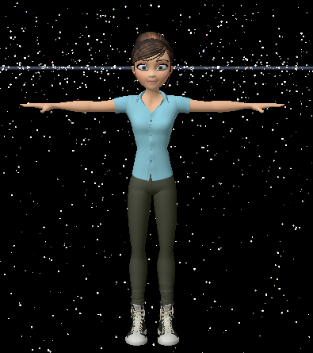
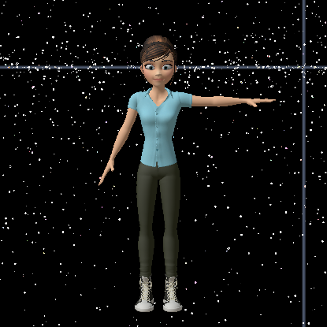
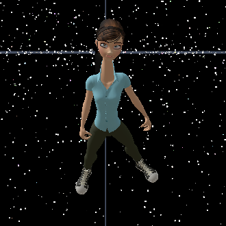

# MyAvatar

<div class="api-kind" v-pre><strong>Namespace.</strong> Can be used in: client scripts, entity scripts, avatar scripts.</div>

<div class="api-text" v-pre><p>Your avatar is your in-world representation of you. The <code>MyAvatar</code> API is used to manipulate the avatar. For example, you can customize the avatar's appearance, run custom avatar animations, change the avatar's position within the world, or manage the avatar's collisions with the environment and other avatars.</p>
 <p>For assignment client scripts, see <a href="Avatar"><code>Avatar</code></a>.</p></div>

## Properties {#properties}

<div class="api-table" v-pre><table><thead><tr><th>Name</th><th>Type</th><th>Default</th><th>Description</th></tr></thead><tbody>
<tr><td><code>position</code></td><td><a href="Vec3">Vec3</a></td><td></td><td><p>The position of the avatar.</p></td></tr>
<tr><td><code>scale</code></td><td>number</td><td><code>1.0</code></td><td><p>The scale of the avatar. The value can be set to anything between <code>0.005</code> and <code>1000.0</code>. When the scale value is fetched, it may temporarily be further limited by the world's settings.</p></td></tr>
<tr><td><code>density</code></td><td>number</td><td></td><td><p>The density of the avatar in kg/m<sup>3</sup>. The density is used to work out its mass in the application of physics. <em>Read-only.</em></p></td></tr>
<tr><td><code>handPosition</code></td><td><a href="Vec3">Vec3</a></td><td></td><td><p>A user-defined hand position, in world coordinates. The position moves with the avatar but is otherwise not used or changed by Interface.</p></td></tr>
<tr><td><code>bodyYaw</code></td><td>number</td><td></td><td><p>The left or right rotation about an axis running from the head to the feet of the avatar. Yaw is sometimes called "heading".</p></td></tr>
<tr><td><code>bodyPitch</code></td><td>number</td><td></td><td><p>The rotation about an axis running from shoulder to shoulder of the avatar. Pitch is sometimes called "elevation".</p></td></tr>
<tr><td><code>bodyRoll</code></td><td>number</td><td></td><td><p>The rotation about an axis running from the chest to the back of the avatar. Roll is sometimes called "bank".</p></td></tr>
<tr><td><code>orientation</code></td><td><a href="Quat">Quat</a></td><td></td><td><p>The orientation of the avatar.</p></td></tr>
<tr><td><code>headOrientation</code></td><td><a href="Quat">Quat</a></td><td></td><td><p>The orientation of the avatar's head.</p></td></tr>
<tr><td><code>headPitch</code></td><td>number</td><td></td><td><p>The rotation about an axis running from ear to ear of the avatar's head. Pitch is sometimes called "elevation".</p></td></tr>
<tr><td><code>headYaw</code></td><td>number</td><td></td><td><p>The rotation left or right about an axis running from the base to the crown of the avatar's head. Yaw is sometimes called "heading".</p></td></tr>
<tr><td><code>headRoll</code></td><td>number</td><td></td><td><p>The rotation about an axis running from the nose to the back of the avatar's head. Roll is sometimes called "bank".</p></td></tr>
<tr><td><code>velocity</code></td><td><a href="Vec3">Vec3</a></td><td></td><td><p>The current velocity of the avatar.</p></td></tr>
<tr><td><code>angularVelocity</code></td><td><a href="Vec3">Vec3</a></td><td></td><td><p>The current angular velocity of the avatar.</p></td></tr>
<tr><td><code>audioLoudness</code></td><td>number</td><td></td><td><p>The instantaneous loudness of the audio input that the avatar is injecting into the world.</p></td></tr>
<tr><td><code>audioAverageLoudness</code></td><td>number</td><td></td><td><p>The rolling average loudness of the audio input that the avatar is injecting into the world.</p></td></tr>
<tr><td><code>displayName</code></td><td>string</td><td></td><td><p>The avatar's display name.</p></td></tr>
<tr><td><code>sessionDisplayName</code></td><td>string</td><td></td><td><p><code>displayName's</code> sanitized and default version defined by the avatar mixer rather than Interface clients. The result is unique among all avatars present in the world at the time.</p></td></tr>
<tr><td><code>lookAtSnappingEnabled</code></td><td>boolean</td><td><code>true</code></td><td><p><code>true</code> if the avatar's eyes snap to look at another avatar's eyes when the other avatar is in the line of sight and also has <code>lookAtSnappingEnabled == true</code>.</p></td></tr>
<tr><td><code>gazeStyle</code></td><td>string</td><td><code>&quot;calm&quot;</code></td><td><p>How the avatar's eyes behave, for everyone to see: <code>"calm"</code>, <code>"excited"</code>, <code>"shy"</code>, <code>"sleepy"</code> or <code>"intent"</code>. A style sets how often and how far the eyes dart, where they rest and how much they meet other people's eyes, what the head does with them, and how the lids blink.</p></td></tr>
<tr><td><code>skeletonModelURL</code></td><td>string</td><td></td><td><p>The avatar's FST file.</p></td></tr>
<tr><td><code>attachmentData</code></td><td>Array&lt;<a href="globals#AttachmentData">AttachmentData</a>&gt;</td><td></td><td><p>Information on the avatar's attachments. </p>
<p class="important">Deprecated: This property is deprecated and will be removed. Use avatar entities instead.</p>
<p></p></td></tr>
<tr><td><code>jointNames</code></td><td>Array&lt;string&gt;</td><td></td><td><p>The list of joints in the current avatar model. <em>Read-only.</em></p></td></tr>
<tr><td><code>sessionUUID</code></td><td><a href="Uuid">Uuid</a></td><td></td><td><p>Unique ID of the avatar in the world. <em>Read-only.</em></p></td></tr>
<tr><td><code>sensorToWorldMatrix</code></td><td><a href="Mat4">Mat4</a></td><td></td><td><p>The scale, rotation, and translation transform from the user's real world to the avatar's size, orientation, and position in the virtual world. <em>Read-only.</em></p></td></tr>
<tr><td><code>controllerLeftHandMatrix</code></td><td><a href="Mat4">Mat4</a></td><td></td><td><p>The rotation and translation of the left hand controller relative to the avatar. <em>Read-only.</em></p></td></tr>
<tr><td><code>controllerRightHandMatrix</code></td><td><a href="Mat4">Mat4</a></td><td></td><td><p>The rotation and translation of the right hand controller relative to the avatar. <em>Read-only.</em></p></td></tr>
<tr><td><code>sensorToWorldScale</code></td><td>number</td><td></td><td><p>The scale that transforms dimensions in the user's real world to the avatar's size in the virtual world. <em>Read-only.</em></p></td></tr>
<tr><td><code>hasPriority</code></td><td>boolean</td><td></td><td><p><code>true</code> if the avatar is in a "hero" zone, <code>false</code> if it isn't. <em>Read-only.</em></p></td></tr>
<tr><td><code>hasScriptedBlendshapes</code></td><td>boolean</td><td><code>false</code></td><td><p><code>true</code> if blend shapes are controlled by scripted actions, otherwise <code>false</code>. Set this to <code>true</code> before using the <a href="#setBlendshape"><code>MyAvatar.setBlendshape</code></a> method, and set back to <code>false</code> after you no longer want scripted control over the blend shapes. </p>
<p><strong>Note:</strong> This property will automatically be set to <code>true</code> if the controller system has valid facial blend shape actions.</p>
<p></p></td></tr>
<tr><td><code>hasProceduralBlinkFaceMovement</code></td><td>boolean</td><td><code>true</code></td><td><p><code>true</code> if avatars blink automatically by animating facial blend shapes, <code>false</code> if automatic blinking is disabled. Set this property to <code>false</code> to fully control the blink facial blend shapes via the <a href="#setBlendshape"><code>MyAvatar.setBlendshape</code></a> method.</p></td></tr>
<tr><td><code>hasProceduralEyeFaceMovement</code></td><td>boolean</td><td><code>true</code></td><td><p><code>true</code> if the facial blend shapes for an avatar's eyes adjust automatically as the eyes move, <code>false</code> if this automatic movement is disabled. Set this property to <code>true</code> to prevent the iris from being obscured by the upper or lower lids. Set this property to <code>false</code> to fully control the eye blend shapes via the <a href="#setBlendshape"><code>MyAvatar.setBlendshape</code></a> method.</p></td></tr>
<tr><td><code>hasAudioEnabledFaceMovement</code></td><td>boolean</td><td><code>true</code></td><td><p><code>true</code> if the avatar's mouth blend shapes animate automatically based on detected microphone input, <code>false</code> if this automatic movement is disabled. Set this property to <code>false</code> to fully control the mouth facial blend shapes via the <a href="#setBlendshape"><code>MyAvatar.setBlendshape</code></a> method.</p></td></tr>
<tr><td><code>skeletonOffset</code></td><td><a href="Vec3">Vec3</a></td><td></td><td><p>Can be used to apply a translation offset between the avatar's position and the registration point of the 3D model.</p></td></tr>
<tr><td><code>qmlPosition</code></td><td><a href="Vec3">Vec3</a></td><td></td><td><p>A synonym for <code>position</code> for use by QML.</p></td></tr>
<tr><td><code>feetPosition</code></td><td><a href="Vec3">Vec3</a></td><td></td><td><p>The position of the avatar's feet.</p></td></tr>
<tr><td><code>shouldRenderLocally</code></td><td>boolean</td><td><code>true</code></td><td><p>If <code>true</code> then your avatar is rendered for you in Interface, otherwise it is not rendered for you (but it is still rendered for other users).</p></td></tr>
<tr><td><code>motorVelocity</code></td><td><a href="Vec3">Vec3</a></td><td><code>Vec3.ZERO</code></td><td><p>The target velocity of your avatar to be achieved by a scripted motor.</p></td></tr>
<tr><td><code>motorTimescale</code></td><td>number</td><td><code>1000000</code></td><td><p>The timescale for the scripted motor to achieve the target <code>motorVelocity</code> avatar velocity. Smaller values result in higher acceleration.</p></td></tr>
<tr><td><code>motorReferenceFrame</code></td><td>string</td><td><code>&quot;camera&quot;</code></td><td><p>Reference frame of the <code>motorVelocity</code>. Must be one of the following: <code>"camera"</code>, <code>"avatar"</code>, and <code>"world"</code>.</p></td></tr>
<tr><td><code>motorMode</code></td><td>string</td><td><code>&quot;simple&quot;</code></td><td><p>The Type of scripted motor behavior: <code>"simple"</code> to use the <code>motorTimescale</code> time scale; <code>"dynamic"</code> to use character controller timescales.</p></td></tr>
<tr><td><code>collisionSoundURL</code></td><td>string</td><td><code>&quot;qrc:/sounds/Body_Hits_Impact.wav&quot;</code></td><td><p>The sound that's played when the avatar experiences a collision. It can be a mono or stereo 16-bit WAV file running at either 24kHz or 48kHz. The latter is down-sampled by the audio mixer, so all audio effectively plays back at a 24khz. 48kHz RAW files are also supported.</p></td></tr>
<tr><td><code>audioListenerMode</code></td><td>number</td><td><code>0</code></td><td><p>Specifies the listening position when hearing spatialized audio. Must be one of the following property values: </p>
<ul> <li><code>MyAvatar.audioListenerModeHead</code></li>
 <li><code>MyAvatar.audioListenerModeCamera</code></li>
 <li><code>MyAvatar.audioListenerModeCustom</code></li>
 </ul>
<p></p></td></tr>
<tr><td><code>audioListenerModeHead</code></td><td>number</td><td><code>0</code></td><td><p>The audio listening position is at the avatar's head. <em>Read-only.</em></p></td></tr>
<tr><td><code>audioListenerModeCamera</code></td><td>number</td><td><code>1</code></td><td><p>The audio listening position is at the camera. <em>Read-only.</em></p></td></tr>
<tr><td><code>audioListenerModeCustom</code></td><td>number</td><td><code>2</code></td><td><p>The audio listening position is at a the position specified by set by the <code>customListenPosition</code> and <code>customListenOrientation</code> property values. <em>Read-only.</em></p></td></tr>
<tr><td><code>customListenPosition</code></td><td><a href="Vec3">Vec3</a></td><td><code>Vec3.ZERO</code></td><td><p>The listening position used when the <code>audioListenerMode</code> property value is <code>audioListenerModeCustom</code>.</p></td></tr>
<tr><td><code>customListenOrientation</code></td><td><a href="Quat">Quat</a></td><td><code>Quat.IDENTITY</code></td><td><p>The listening orientation used when the <code>audioListenerMode</code> property value is <code>audioListenerModeCustom</code>.</p></td></tr>
<tr><td><code>rotationRecenterFilterLength</code></td><td>number</td><td></td><td><p>Configures how quickly the avatar root rotates to recenter its facing direction to match that of the user's torso based on head and hands orientation. A smaller value makes the recentering happen more quickly. The minimum value is <code>0.01</code>.</p></td></tr>
<tr><td><code>rotationThreshold</code></td><td>number</td><td></td><td><p>The angle in radians that the user's torso facing direction (based on head and hands orientation) can differ from that of the avatar before the avatar's root is rotated to match the user's torso.</p></td></tr>
<tr><td><code>enableStepResetRotation</code></td><td>boolean</td><td></td><td><p>If <code>true</code> then after the user's avatar takes a step, the avatar's root immediately rotates to recenter its facing direction to match that of the user's torso based on head and hands orientation.</p></td></tr>
<tr><td><code>enableDrawAverageFacing</code></td><td>boolean</td><td></td><td><p>If <code>true</code>, debug graphics are drawn that show the average facing direction of the user's torso (based on head and hands orientation). This can be useful if you want to try out different filter lengths and thresholds.</p></td></tr>
<tr><td><code>leftHandPosition</code></td><td><a href="Vec3">Vec3</a></td><td></td><td><p>The position of the left hand in avatar coordinates if it's being positioned by controllers, otherwise <a href="Vec3">Vec3.ZERO</a>. <em>Read-only.</em></p></td></tr>
<tr><td><code>rightHandPosition</code></td><td><a href="Vec3">Vec3</a></td><td></td><td><p>The position of the right hand in avatar coordinates if it's being positioned by controllers, otherwise <a href="Vec3">Vec3.ZERO</a>. <em>Read-only.</em></p></td></tr>
<tr><td><code>leftHandTipPosition</code></td><td><a href="Vec3">Vec3</a></td><td></td><td><p>The position 0.3m in front of the left hand's position, in the direction along the palm, in avatar coordinates. If the hand isn't being positioned by a controller, the value is <a href="Vec3">Vec3.ZERO</a>. <em>Read-only.</em></p></td></tr>
<tr><td><code>rightHandTipPosition</code></td><td><a href="Vec3">Vec3</a></td><td></td><td><p>The position 0.3m in front of the right hand's position, in the direction along the palm, in avatar coordinates. If the hand isn't being positioned by a controller, the value is <a href="Vec3">Vec3.ZERO</a>. <em>Read-only.</em></p></td></tr>
<tr><td><code>leftHandPose</code></td><td><a href="globals#Pose">Pose</a></td><td></td><td><p>The left hand's pose as determined by the hand controllers, relative to the avatar. <em>Read-only.</em></p></td></tr>
<tr><td><code>rightHandPose</code></td><td><a href="globals#Pose">Pose</a></td><td></td><td><p>The right hand's pose as determined by the hand controllers, relative to the avatar. <em>Read-only.</em></p></td></tr>
<tr><td><code>leftHandTipPose</code></td><td><a href="globals#Pose">Pose</a></td><td></td><td><p>The left hand's pose as determined by the hand controllers, relative to the avatar, with the position adjusted by 0.3m along the direction of the palm. <em>Read-only.</em></p></td></tr>
<tr><td><code>rightHandTipPose</code></td><td><a href="globals#Pose">Pose</a></td><td></td><td><p>The right hand's pose as determined by the hand controllers, relative to the avatar, with the position adjusted by 0.3m along the direction of the palm. <em>Read-only.</em></p></td></tr>
<tr><td><code>energy</code></td><td>number</td><td></td><td><p><span class="important">Deprecated: This property will be removed.</span></p></td></tr>
<tr><td><code>isAway</code></td><td>boolean</td><td></td><td><p><code>true</code> if your avatar is away (i.e., inactive), <code>false</code> if it is active.</p></td></tr>
<tr><td><code>centerOfGravityModelEnabled</code></td><td>boolean</td><td><code>true</code></td><td><p><code>true</code> if the avatar hips are placed according to the center of gravity model that balances the center of gravity over the base of support of the feet. Set the value to <code>false</code> for default behavior where the hips are positioned under the head.</p></td></tr>
<tr><td><code>hmdLeanRecenterEnabled</code></td><td>boolean</td><td><code>true</code></td><td><p><code>true</code> IF the avatar is re-centered to be under the head's position. In room-scale VR, this behavior is what causes your avatar to follow your HMD as you walk around the room. Setting the value <code>false</code> is useful if you want to pin the avatar to a fixed position.</p></td></tr>
<tr><td><code>collisionsEnabled</code></td><td>boolean</td><td></td><td><p>Set to <code>true</code> to enable the avatar to collide with the environment, <code>false</code> to disable collisions with the environment. May return <code>true</code> even though the value was set <code>false</code> because the zone may disallow collisionless avatars.</p></td></tr>
<tr><td><code>otherAvatarsCollisionsEnabled</code></td><td>boolean</td><td></td><td><p>Set to <code>true</code> to enable the avatar to collide with other avatars, <code>false</code> to disable collisions with other avatars.</p></td></tr>
<tr><td><code>characterControllerEnabled</code></td><td>boolean</td><td></td><td><p>Synonym of <code>collisionsEnabled</code>. </p>
<p class="important">Deprecated: This property is deprecated and will be removed. Use <code>collisionsEnabled</code> instead.</p>
<p></p></td></tr>
<tr><td><code>useAdvancedMovementControls</code></td><td>boolean</td><td></td><td><p>Returns and sets the value of the Interface setting, Settings &gt; Controls &gt; Walking. Note: Setting the value has no effect unless Interface is restarted.</p></td></tr>
<tr><td><code>showPlayArea</code></td><td>boolean</td><td></td><td><p>Returns and sets the value of the Interface setting, Settings &gt; Controls &gt; Show room boundaries while teleporting. </p>
<p><strong>Note:</strong> Setting the value has no effect unless Interface is restarted.</p>
<p></p></td></tr>
<tr><td><code>yawSpeed</code></td><td>number</td><td><code>75</code></td><td><p>The mouse X sensitivity value in Settings &gt; General. <em>Read-only.</em></p></td></tr>
<tr><td><code>pitchSpeed</code></td><td>number</td><td><code>50</code></td><td><p>The mouse Y sensitivity value in Settings &gt; General. <em>Read-only.</em></p></td></tr>
<tr><td><code>hmdRollControlEnabled</code></td><td>boolean</td><td><code>true</code></td><td><p>If <code>true</code>, the roll angle of your HMD turns your avatar while flying.</p></td></tr>
<tr><td><code>hmdRollControlDeadZone</code></td><td>number</td><td><code>8</code></td><td><p>The amount of HMD roll, in degrees, required before your avatar turns if <code>hmdRollControlEnabled</code> is enabled.</p></td></tr>
<tr><td><code>hmdRollControlRate</code></td><td>number</td><td></td><td><p>If <code>MyAvatar.hmdRollControlEnabled</code> is true, this value determines the maximum turn rate of your avatar when rolling your HMD in degrees per second.</p></td></tr>
<tr><td><code>userHeight</code></td><td>number</td><td><code>1.75</code></td><td><p>The height of the user in sensor space.</p></td></tr>
<tr><td><code>userEyeHeight</code></td><td>number</td><td><code>1.65</code></td><td><p>The estimated height of the user's eyes in sensor space. <em>Read-only.</em></p></td></tr>
<tr><td><code>SELF_ID</code></td><td><a href="Uuid">Uuid</a></td><td></td><td><p>UUID representing "my avatar". Only use for local-only entities in situations where MyAvatar.sessionUUID is not available (e.g., if not connected to a world). Note: Likely to be deprecated. <em>Read-only.</em></p></td></tr>
<tr><td><code>walkSpeed</code></td><td>number</td><td></td><td><p>The walk speed of your avatar for the current control scheme (see <a href="#getControlScheme">getControlScheme</a>).</p></td></tr>
<tr><td><code>walkBackwardSpeed</code></td><td>number</td><td></td><td><p>The walk backward speed of your avatar for the current control scheme (see <a href="#getControlScheme">getControlScheme</a>).</p></td></tr>
<tr><td><code>sprintSpeed</code></td><td>number</td><td></td><td><p>The sprint (run) speed of your avatar for the current control scheme (see <a href="#getControlScheme">getControlScheme</a>).</p></td></tr>
<tr><td><code>analogPlusWalkSpeed</code></td><td>number</td><td></td><td><p>The walk speed of your avatar for the "AnalogPlus" control scheme. </p>
<p><strong>Warning:</strong> Setting this value also sets the value of <code>analogPlusSprintSpeed</code> to twice the value.</p>
<p></p></td></tr>
<tr><td><code>analogPlusSprintSpeed</code></td><td>number</td><td></td><td><p>The sprint (run) speed of your avatar for the "AnalogPlus" control scheme.</p></td></tr>
<tr><td><code>userRecenterModel</code></td><td><a href="#SitStandModelType">MyAvatar.SitStandModelType</a></td><td></td><td><p>Controls avatar leaning and recentering behavior.</p></td></tr>
<tr><td><code>isInSittingState</code></td><td>number</td><td></td><td><p><code>true</code> if the user wearing the HMD is determined to be sitting (avatar leaning is disabled, recentering is enabled), <code>false</code> if the user wearing the HMD is determined to be standing (avatar leaning is enabled, and avatar recenters if it leans too far). If <code>userRecenterModel == 2</code> (i.e., "auto") the property value automatically updates as the user sits or stands, unless <code>isSitStandStateLocked == true</code>. Setting the property value overrides the current sitting / standing state, which is updated when the user next sits or stands unless <code>isSitStandStateLocked == true</code>.</p></td></tr>
<tr><td><code>isSitStandStateLocked</code></td><td>boolean</td><td></td><td><p><code>true</code> to lock the avatar sitting/standing state, i.e., use this to disable automatically changing state.</p></td></tr>
<tr><td><code>allowTeleporting</code></td><td>boolean</td><td></td><td><p><code>true</code> if teleporting is enabled in the Interface settings, <code>false</code> if it isn't. <em>Read-only.</em></p></td></tr>
<tr><td><code>localPosition</code></td><td><a href="Vec3">Vec3</a></td><td></td><td></td></tr>
<tr><td><code>localRotation</code></td><td><a href="Quat">Quat</a></td><td></td><td></td></tr>
<tr><td><code>localVelocity</code></td><td><a href="Vec3">Vec3</a></td><td></td><td></td></tr>
<tr><td><code>localAngularVelocity</code></td><td><a href="Vec3">Vec3</a></td><td></td><td></td></tr>
<tr><td><code>localTransform</code></td><td><a href="Mat4">Mat4</a></td><td></td><td></td></tr>
<tr><td><code>sensorToParentMatrix</code></td><td><a href="Mat4">Mat4</a></td><td></td><td></td></tr>
<tr><td><code>parentID</code></td><td><a href="Uuid">Uuid</a></td><td></td><td></td></tr>
</tbody></table></div>

## Functions {#functions}

<div class="api-entry">

### addAnimationStateHandler {#addAnimationStateHandler}

```js
MyAvatar.addAnimationStateHandler(handler, propertiesList)
```

<div class="api-text" v-pre><p>Adds an animation state handler function that is invoked just before each animation graph update. More than one animation state handler function may be added by calling <code>addAnimationStateHandler</code> multiple times. It is not specified in what order multiple handlers are called. </p>
<p>The animation state handler function is called with an <a href="#AnimStateDictionary">AnimStateDictionary</a> "<code>animStateDictionaryIn</code>" parameter and is expected to return an <a href="#AnimStateDictionary">AnimStateDictionary</a> "<code>animStateDictionaryOut</code>" object. The <code>animStateDictionaryOut</code> object can be the same object as <code>animStateDictionaryIn</code>, or it can be a different object. The <code>animStateDictionaryIn</code> may be shared among multiple handlers and thus may contain additional properties specified when adding the different handlers.</p>
 <p>A handler may change a value from <code>animStateDictionaryIn</code> or add different values in the <code>animStateDictionaryOut</code> returned. Any property values set in <code>animStateDictionaryOut</code> will override those of the internal animation machinery.</p>
<p></p></div>
<div class="api-table" v-pre><strong>Parameters</strong><table><thead><tr><th>Name</th><th>Type</th><th>Description</th></tr></thead><tbody>
<tr><td><code>handler</code></td><td>function</td><td><p>The animation state handler function to add.</p></td></tr>
<tr><td><code>propertiesList</code></td><td>Array&lt;string&gt; | null</td><td><p>The list of <a href="#AnimStateDictionary">AnimStateDictionary</a> properties that should be included in the parameter that the handler function is called with. If <code>null</code> then all properties are included in the call parameter.</p></td></tr>
</tbody></table></div>
<div class="api-returns" v-pre><strong>Returns:</strong> number <p>The ID of the animation state handler function if successfully added, <code>undefined</code> if not.</p></div>

<div class="api-example" v-pre><strong>Example:</strong> <p>Log all the animation state dictionary parameters for a short while.</p></div>

```js
function animStateHandler(dictionary) {
    print("Anim state dictionary: " + JSON.stringify(dictionary));
}

var handler = MyAvatar.addAnimationStateHandler(animStateHandler, null);

Script.setTimeout(function () {
    MyAvatar.removeAnimationStateHandler(handler);
}, 100);
```

</div>

<div class="api-entry">

### beginReaction {#beginReaction}

```js
MyAvatar.beginReaction(reactionName)
```

<div class="api-text" v-pre><p>Starts playing a reaction on the avatar. The reaction will continue to play until stopped using <a href="#endReaction"><code>MyAvatar.endReaction</code></a> or superseded by another reaction. </p>
<p>Only reactions returned by <a href="#getBeginEndReactions"><code>MyAvatar.getBeginEndReactions</code></a> are available.</p>
<p></p></div>
<div class="api-table" v-pre><strong>Parameters</strong><table><thead><tr><th>Name</th><th>Type</th><th>Description</th></tr></thead><tbody>
<tr><td><code>reactionName</code></td><td>string</td><td><p>The reaction to start playing.</p></td></tr>
</tbody></table></div>
<div class="api-returns" v-pre><strong>Returns:</strong> boolean <p><code>true</code> if the reaction was started, <code>false</code> if the reaction is not supported.</p></div>

</div>

<div class="api-entry">

### beginSit {#beginSit}

```js
MyAvatar.beginSit(position, rotation)
```

<div class="api-text" v-pre><p>Starts a sitting action for the avatar.</p></div>
<div class="api-table" v-pre><strong>Parameters</strong><table><thead><tr><th>Name</th><th>Type</th><th>Description</th></tr></thead><tbody>
<tr><td><code>position</code></td><td><a href="Vec3">Vec3</a></td><td><p>The position where the avatar should sit.</p></td></tr>
<tr><td><code>rotation</code></td><td><a href="Quat">Quat</a></td><td><p>The initial orientation of the seated avatar.</p></td></tr>
</tbody></table></div>

</div>

<div class="api-entry">

### centerBody {#centerBody}

```js
MyAvatar.centerBody()
```

<div class="api-text" v-pre><p>Moves and orients the avatar, such that it is directly underneath the HMD, with toes pointed forward in the direction of the HMD.</p></div>

</div>

<div class="api-entry">

### clearIKJointLimitHistory {#clearIKJointLimitHistory}

```js
MyAvatar.clearIKJointLimitHistory()
```

<div class="api-text" v-pre><p>Clears inverse kinematics joint limit history. </p>
<p>The internal inverse-kinematics system maintains a record of which joints are "locked". Sometimes it is useful to forget this history to prevent contorted joints, e.g., after finishing with an override animation.</p>
<p></p></div>

</div>

<div class="api-entry">

### clearJointData {#clearJointData}

```js
MyAvatar.clearJointData(index)
```

<div class="api-text" v-pre><p>Clears joint translations and rotations set by script for a specific joint. This restores all motion from the default animation system including inverse kinematics for that joint. </p>
<p>Note: This is slightly faster than the function variation that specifies the joint name.</p>
<p></p></div>
<div class="api-table" v-pre><strong>Parameters</strong><table><thead><tr><th>Name</th><th>Type</th><th>Description</th></tr></thead><tbody>
<tr><td><code>index</code></td><td>number</td><td><p>The index of the joint.</p></td></tr>
</tbody></table></div>

</div>

<div class="api-entry">

### clearJointData {#clearJointData-2}

```js
MyAvatar.clearJointData(name)
```

<div class="api-text" v-pre><p>Clears joint translations and rotations set by script for a specific joint. This restores all motion from the default animation system including inverse kinematics for that joint. </p>
<p>Note: This is slightly slower than the function variation that specifies the joint index.</p>
<p></p></div>
<div class="api-table" v-pre><strong>Parameters</strong><table><thead><tr><th>Name</th><th>Type</th><th>Description</th></tr></thead><tbody>
<tr><td><code>name</code></td><td>string</td><td><p>The name of the joint.</p></td></tr>
</tbody></table></div>

<div class="api-example" v-pre><strong>Example:</strong> <p>Offset and restore the position of your avatar's head.</p></div>

```js
// Stretch your avatar's neck.
MyAvatar.setJointTranslation("Neck", Vec3.multiply(2, MyAvatar.getJointTranslation("Neck")));

// Restore your avatar's neck after 5s.
Script.setTimeout(function () {
    MyAvatar.clearJointData("Neck");
}, 5000);

// Note: If using from the Avatar API, replace all occurrences of "MyAvatar" with "Avatar".
```

</div>

<div class="api-entry">

### clearJointsData {#clearJointsData}

```js
MyAvatar.clearJointsData()
```

<div class="api-text" v-pre><p>Clears all joint translations and rotations that have been set by script. This restores all motion from the default animation system including inverse kinematics for all joints.</p></div>

<div class="api-example" v-pre><strong>Example:</strong> <p>Set your avatar to it's default T-pose for a while.</p></div>

```js
// Set all joint translations and rotations to defaults.
var i, length, rotation, translation;
for (i = 0, length = MyAvatar.getJointNames().length; i < length; i++) {
    rotation = MyAvatar.getDefaultJointRotation(i);
    translation = MyAvatar.getDefaultJointTranslation(i);
    MyAvatar.setJointData(i, rotation, translation);
}

// Restore your avatar's motion after 5s.
Script.setTimeout(function () {
    MyAvatar.clearJointsData();
}, 5000);

// Note: If using from the Avatar API, replace all occurrences of "MyAvatar" with "Avatar".
```

</div>

<div class="api-entry">

### clearPinOnJoint {#clearPinOnJoint}

```js
MyAvatar.clearPinOnJoint(index)
```

<div class="api-text" v-pre><p>Clears a lock on a joint's position and orientation, as set by <a href="#pinJoint">pinJoint</a>. </p>
<p><strong>Note:</strong> Only works on the hips joint.</p>
<p></p></div>
<div class="api-table" v-pre><strong>Parameters</strong><table><thead><tr><th>Name</th><th>Type</th><th>Description</th></tr></thead><tbody>
<tr><td><code>index</code></td><td>number</td><td><p>The index of the joint.</p></td></tr>
</tbody></table></div>
<div class="api-returns" v-pre><strong>Returns:</strong> boolean <p><code>true</code> if the joint was unpinned, <code>false</code> if it wasn't.</p></div>

</div>

<div class="api-entry">

### decreaseSize {#decreaseSize}

```js
MyAvatar.decreaseSize()
```

<div class="api-text" v-pre><p>Decreases the avatar's scale by five percent, down to a minimum scale of <code>0.25</code>.</p></div>

<div class="api-example" v-pre><strong>Example:</strong> <p>Reset your avatar's size to default then shrink it 5 times.</p></div>

```js
MyAvatar.resetSize();

for (var i = 0; i < 5; i++){
    print("Shrinking by 5 percent");
    MyAvatar.decreaseSize();
}
```

</div>

<div class="api-entry">

### disableDriveKey {#disableDriveKey}

```js
MyAvatar.disableDriveKey(key)
```

<div class="api-text" v-pre><p>Disables the action associated with a drive key.</p></div>
<div class="api-table" v-pre><strong>Parameters</strong><table><thead><tr><th>Name</th><th>Type</th><th>Description</th></tr></thead><tbody>
<tr><td><code>key</code></td><td><a href="globals#DriveKey">DriveKey</a></td><td><p>The drive key to disable.</p></td></tr>
</tbody></table></div>

<div class="api-example" v-pre><strong>Example:</strong> <p>Disable rotating your avatar using the keyboard for a couple of seconds.</p></div>

```js
print("Disable");
MyAvatar.disableDriveKey(DriveKeys.YAW);
Script.setTimeout(function () {
    print("Enable");
    MyAvatar.enableDriveKey(YAW);
}, 5000);
```

</div>

<div class="api-entry">

### disableHandTouchForID {#disableHandTouchForID}

```js
MyAvatar.disableHandTouchForID(entityID)
```

<div class="api-text" v-pre><p>Disables the hand touch effect on a specific entity. </p>
<p>The hand touch effect makes the avatar's fingers adapt to the shape of any object grabbed, creating the effect that it is really touching that object.</p>
<p></p></div>
<div class="api-table" v-pre><strong>Parameters</strong><table><thead><tr><th>Name</th><th>Type</th><th>Description</th></tr></thead><tbody>
<tr><td><code>entityID</code></td><td><a href="Uuid">Uuid</a></td><td><p>The entity that the hand touch effect will be disabled for.</p></td></tr>
</tbody></table></div>

</div>

<div class="api-entry">

### enableDriveKey {#enableDriveKey}

```js
MyAvatar.enableDriveKey(key)
```

<div class="api-text" v-pre><p>Enables the action associated with a drive key. The action may have been disabled with <a href="#disableDriveKey">disableDriveKey</a>.</p></div>
<div class="api-table" v-pre><strong>Parameters</strong><table><thead><tr><th>Name</th><th>Type</th><th>Description</th></tr></thead><tbody>
<tr><td><code>key</code></td><td><a href="globals#DriveKey">DriveKey</a></td><td><p>The drive key to enable.</p></td></tr>
</tbody></table></div>

</div>

<div class="api-entry">

### enableHandTouchForID {#enableHandTouchForID}

```js
MyAvatar.enableHandTouchForID(entityID)
```

<div class="api-text" v-pre><p>Enables the hand touch effect on a specific entity. </p>
<p>The hand touch effect makes the avatar's fingers adapt to the shape of any object grabbed, creating the effect that it is really touching that object.</p>
<p></p></div>
<div class="api-table" v-pre><strong>Parameters</strong><table><thead><tr><th>Name</th><th>Type</th><th>Description</th></tr></thead><tbody>
<tr><td><code>entityID</code></td><td><a href="Uuid">Uuid</a></td><td><p>The entity that the hand touch effect will be enabled for.</p></td></tr>
</tbody></table></div>

</div>

<div class="api-entry">

### endReaction {#endReaction}

```js
MyAvatar.endReaction(reactionName)
```

<div class="api-text" v-pre><p>Stops playing a reaction that was started using <a href="#beginReaction"><code>MyAvatar.beginReaction</code></a>.</p></div>
<div class="api-table" v-pre><strong>Parameters</strong><table><thead><tr><th>Name</th><th>Type</th><th>Description</th></tr></thead><tbody>
<tr><td><code>reactionName</code></td><td>string</td><td><p>The reaction to stop playing.</p></td></tr>
</tbody></table></div>
<div class="api-returns" v-pre><strong>Returns:</strong> boolean <p><code>true</code> if the reaction was stopped, <code>false</code> if the reaction is not supported.</p></div>

</div>

<div class="api-entry">

### endSit {#endSit}

```js
MyAvatar.endSit(position, rotation)
```

<div class="api-text" v-pre><p>Ends a sitting action for the avatar.</p></div>
<div class="api-table" v-pre><strong>Parameters</strong><table><thead><tr><th>Name</th><th>Type</th><th>Description</th></tr></thead><tbody>
<tr><td><code>position</code></td><td><a href="Vec3">Vec3</a></td><td><p>The position of the avatar when standing up.</p></td></tr>
<tr><td><code>rotation</code></td><td><a href="Quat">Quat</a></td><td><p>The orientation of the avatar when standing up.</p></td></tr>
</tbody></table></div>

</div>

<div class="api-entry">

### getAbsoluteDefaultJointRotationInObjectFrame {#getAbsoluteDefaultJointRotationInObjectFrame}

```js
MyAvatar.getAbsoluteDefaultJointRotationInObjectFrame(index)
```

<div class="api-text" v-pre><p>Gets the default joint rotations in avatar coordinates. The default pose of the avatar is defined by the position and orientation of all bones in the avatar's model file. Typically this is a T-pose.</p></div>
<div class="api-table" v-pre><strong>Parameters</strong><table><thead><tr><th>Name</th><th>Type</th><th>Description</th></tr></thead><tbody>
<tr><td><code>index</code></td><td>number</td><td><p>The joint index.</p></td></tr>
</tbody></table></div>
<div class="api-returns" v-pre><strong>Returns:</strong> <a href="Quat">Quat</a> <p>The default rotation of the joint in avatar coordinates.</p></div>

<div class="api-example" v-pre><strong>Example:</strong> <p>Report the default rotation of your avatar's head joint relative to your avatar.</p></div>

```js
var headIndex = MyAvatar.getJointIndex("Head");
var defaultHeadRotation = MyAvatar.getAbsoluteDefaultJointRotationInObjectFrame(headIndex);
print("Default head rotation: " + JSON.stringify(Quat.safeEulerAngles(defaultHeadRotation))); // Degrees
```

</div>

<div class="api-entry">

### getAbsoluteDefaultJointTranslationInObjectFrame {#getAbsoluteDefaultJointTranslationInObjectFrame}

```js
MyAvatar.getAbsoluteDefaultJointTranslationInObjectFrame(index)
```

<div class="api-text" v-pre><p>Gets the default joint translations in avatar coordinates. The default pose of the avatar is defined by the position and orientation of all bones in the avatar's model file. Typically this is a T-pose.</p></div>
<div class="api-table" v-pre><strong>Parameters</strong><table><thead><tr><th>Name</th><th>Type</th><th>Description</th></tr></thead><tbody>
<tr><td><code>index</code></td><td>number</td><td><p>The joint index.</p></td></tr>
</tbody></table></div>
<div class="api-returns" v-pre><strong>Returns:</strong> <a href="Vec3">Vec3</a> <p>The default position of the joint in avatar coordinates.</p></div>

<div class="api-example" v-pre><strong>Example:</strong> <p>Report the default translation of your avatar's head joint relative to your avatar.</p></div>

```js
var headIndex = MyAvatar.getJointIndex("Head");
var defaultHeadTranslation = MyAvatar.getAbsoluteDefaultJointTranslationInObjectFrame(headIndex);
print("Default head translation: " + JSON.stringify(defaultHeadTranslation));
```

</div>

<div class="api-entry">

### getAbsoluteJointRotationInObjectFrame {#getAbsoluteJointRotationInObjectFrame}

```js
MyAvatar.getAbsoluteJointRotationInObjectFrame(index)
```

<div class="api-text" v-pre><p>Gets the rotation of a joint relative to the avatar.</p></div>
<div class="api-table" v-pre><strong>Parameters</strong><table><thead><tr><th>Name</th><th>Type</th><th>Description</th></tr></thead><tbody>
<tr><td><code>index</code></td><td>number</td><td><p>The index of the joint.</p></td></tr>
</tbody></table></div>
<div class="api-returns" v-pre><strong>Returns:</strong> <a href="Quat">Quat</a> <p>The rotation of the joint relative to the avatar.</p></div>

<div class="api-example" v-pre><strong>Example:</strong> <p>Report the rotation of your avatar's head joint relative to your avatar.</p></div>

```js
var headIndex = MyAvatar.getJointIndex("Head");
var headRotation = MyAvatar.getAbsoluteJointRotationInObjectFrame(headIndex);
print("Head rotation: " + JSON.stringify(Quat.safeEulerAngles(headRotation))); // Degrees
```

</div>

<div class="api-entry">

### getAbsoluteJointTranslationInObjectFrame {#getAbsoluteJointTranslationInObjectFrame}

```js
MyAvatar.getAbsoluteJointTranslationInObjectFrame(index)
```

<div class="api-text" v-pre><p>Gets the translation of a joint relative to the avatar.</p></div>
<div class="api-table" v-pre><strong>Parameters</strong><table><thead><tr><th>Name</th><th>Type</th><th>Description</th></tr></thead><tbody>
<tr><td><code>index</code></td><td>number</td><td><p>The index of the joint.</p></td></tr>
</tbody></table></div>
<div class="api-returns" v-pre><strong>Returns:</strong> <a href="Vec3">Vec3</a> <p>The translation of the joint relative to the avatar.</p></div>

<div class="api-example" v-pre><strong>Example:</strong> <p>Report the translation of your avatar's head joint relative to your avatar.</p></div>

```js
var headIndex = MyAvatar.getJointIndex("Head");
var headTranslation = MyAvatar.getAbsoluteJointTranslationInObjectFrame(headIndex);
print("Head translation: " + JSON.stringify(headTranslation));
```

</div>

<div class="api-entry">

### getAcceleration {#getAcceleration}

```js
MyAvatar.getAcceleration()
```

<div class="api-text" v-pre><p>Gets the current acceleration of the avatar.</p></div>
<div class="api-returns" v-pre><strong>Returns:</strong> <a href="Vec3">Vec3</a> <p>The current acceleration of the avatar.</p></div>

</div>

<div class="api-entry">

### getAnimationRoles {#getAnimationRoles}

```js
MyAvatar.getAnimationRoles()
```

<div class="api-text" v-pre><p>Gets the current animation roles. </p>
<p>Each avatar has an avatar-animation.json file that defines which animations are used and how they are blended together with procedural data (such as look at vectors, hand sensors etc.). Each animation specified in the avatar-animation.json file is known as an animation role. Animation roles map to easily understandable actions that the avatar can perform, such as <code>"idleStand"</code>, <code>"idleTalk"</code>, or <code>"walkFwd"</code>. <code>getAnimationRoles()</code> is used get the list of animation roles defined in the avatar-animation.json.</p>
<p></p></div>
<div class="api-returns" v-pre><strong>Returns:</strong> Array&lt;string&gt; <p>Array of role strings.</p></div>

<div class="api-example" v-pre><strong>Example:</strong> <p>Print the list of animation roles defined in the avatar's avatar-animation.json file to the debug log.</p></div>

```js
var roles = MyAvatar.getAnimationRoles();
print("Animation Roles:");
for (var i = 0; i < roles.length; i++) {
    print(roles[i]);
}
```

</div>

<div class="api-entry">

### getAnimGraphOverrideUrl {#getAnimGraphOverrideUrl}

```js
MyAvatar.getAnimGraphOverrideUrl()
```

<div class="api-text" v-pre><p>Gets the URL of the override animation graph. </p>
<p>See Custom Avatar Animations for information on animation graphs.</p>
<p></p></div>
<div class="api-returns" v-pre><strong>Returns:</strong> string <p>The URL of the override animation graph JSON file. <code>""</code> if there is no override animation graph.</p></div>

</div>

<div class="api-entry">

### getAnimGraphUrl {#getAnimGraphUrl}

```js
MyAvatar.getAnimGraphUrl()
```

<div class="api-text" v-pre><p>Gets the URL of animation graph (i.e., the avatar animation JSON) that's currently being used for avatar animations. </p>
<p>See Custom Avatar Animations for information on animation graphs.</p>
<p></p></div>
<div class="api-returns" v-pre><strong>Returns:</strong> string <p>The URL of the current animation graph JSON file.</p></div>

<div class="api-example" v-pre><strong>Example:</strong> <p>Report the current avatar animation JSON being used.</p></div>

```js
print(MyAvatar.getAnimGraphUrl());
```

</div>

<div class="api-entry">

### getAvatarEntitiesVariant {#getAvatarEntitiesVariant}

```js
MyAvatar.getAvatarEntitiesVariant()
```

<div class="api-text" v-pre><p>Gets the current avatar entity IDs and their properties.</p></div>
<div class="api-returns" v-pre><strong>Returns:</strong> Array&lt;<a href="#AvatarEntityData">MyAvatar.AvatarEntityData</a>&gt; <p>The current avatar entity IDs and their properties.</p></div>

</div>

<div class="api-entry">

### getAvatarEntityData {#getAvatarEntityData}

```js
MyAvatar.getAvatarEntityData()
```

<div class="api-text" v-pre><p>Gets details of all avatar entities. </p>
<p><strong>Warning:</strong> Potentially an expensive call. Do not use if possible.</p>
<p></p></div>
<div class="api-returns" v-pre><strong>Returns:</strong> <a href="globals#AvatarEntityMap">AvatarEntityMap</a> <p>Details of all avatar entities.</p></div>

<div class="api-example" v-pre><strong>Example:</strong> <p>Report the current avatar entities.</p></div>

```js
var avatarEntityData = MyAvatar.getAvatarEntityData();
print("Avatar entities: " + JSON.stringify(avatarEntityData));
```

</div>

<div class="api-entry">

### getAvatarMenu {#getAvatarMenu}

```js
MyAvatar.getAvatarMenu()
```

<div class="api-text" v-pre><p>Gets the avatar's menu: an imported avatar's menu, the parameters its menu and its animator use, each with its type, value and default, and the emotes its menu picks. All are empty when the avatar has none.</p></div>
<div class="api-returns" v-pre><strong>Returns:</strong> object <p><code>{menu: {controls: [...]}, parameters: [{name, type, value, default, saved, synced, builtin}], emotes: [{parameter, value, name, seated, loop, hold, own}]}</code></p></div>

</div>

<div class="api-entry">

### getAvatarParameter {#getAvatarParameter}

```js
MyAvatar.getAvatarParameter(name)
```

<div class="api-text" v-pre><p>Gets one of the avatar's parameters.</p></div>
<div class="api-table" v-pre><strong>Parameters</strong><table><thead><tr><th>Name</th><th>Type</th><th>Description</th></tr></thead><tbody>
<tr><td><code>name</code></td><td>string</td><td><p>The parameter's name.</p></td></tr>
</tbody></table></div>
<div class="api-returns" v-pre><strong>Returns:</strong> number <p>Its value, 0 if the avatar has no such parameter.</p></div>

</div>

<div class="api-entry">

### getAvatarPreviewImageURL {#getAvatarPreviewImageURL}

```js
MyAvatar.getAvatarPreviewImageURL()
```

<div class="api-text" v-pre><p>Gets preview image url for current avatar if it's available.</p></div>
<div class="api-returns" v-pre><strong>Returns:</strong> string <p>url</p></div>

</div>

<div class="api-entry">

### getAvatarScale {#getAvatarScale}

```js
MyAvatar.getAvatarScale()
```

<div class="api-text" v-pre><p>Gets the target scale of the avatar. The target scale is the desired scale of the avatar without any restrictions on permissible scale values imposed by the world.</p></div>
<div class="api-returns" v-pre><strong>Returns:</strong> number <p>The target scale for the avatar, range <code>0.005</code> – <code>1000.0</code>.</p></div>

</div>

<div class="api-entry">

### getBeginEndReactions {#getBeginEndReactions}

```js
MyAvatar.getBeginEndReactions()
```

<div class="api-text" v-pre><p>Gets the list of reactions names that can be enabled using <a href="#beginReaction"><code>MyAvatar.beginReaction</code></a> and <a href="#endReaction"><code>MyAvatar.endReaction</code></a>. </p>
<p>See also: <a href="#getTriggerReactions"><code>MyAvatar.getTriggerReactions</code></a>.</p></div>
<div class="api-returns" v-pre><strong>Returns:</strong> Array&lt;string&gt; <p>List of reaction names that can be enabled using <a href="#beginReaction"><code>MyAvatar.beginReaction</code></a> and <a href="#endReaction"><code>MyAvatar.endReaction</code></a>.</p></div>

<div class="api-example" v-pre><strong>Example:</strong> <p>List the available begin-end reactions.</p></div>

```js
print("Begin-end reactions:", JSON.stringify(MyAvatar.getBeginEndReactions()));
```

</div>

<div class="api-entry">

### getBoomLength {#getBoomLength}

```js
MyAvatar.getBoomLength()
```

<div class="api-text" v-pre><p>Gets the avatar's camera's boom length.</p></div>
<div class="api-returns" v-pre><strong>Returns:</strong> number <p>Boom length of the avatar's camera.</p></div>

</div>

<div class="api-entry">

### getCenterOfGravityModelEnabled {#getCenterOfGravityModelEnabled}

```js
MyAvatar.getCenterOfGravityModelEnabled()
```

<div class="api-text" v-pre><p>Gets whether the avatar hips are being balanced over the feet or placed under the head.</p></div>
<div class="api-returns" v-pre><strong>Returns:</strong> boolean <p><code>true</code> if the hips are being balanced over the feet, <code>false</code> if the hips are being positioned under the head.</p></div>

</div>

<div class="api-entry">

### getCollidingFlowJoints {#getCollidingFlowJoints}

```js
MyAvatar.getCollidingFlowJoints()
```

<div class="api-text" v-pre><p>Gets the indexes of currently colliding flow joints.</p></div>
<div class="api-returns" v-pre><strong>Returns:</strong> Array&lt;number&gt; <p>The indexes of currently colliding flow joints.</p></div>

</div>

<div class="api-entry">

### getCollisionCapsule {#getCollisionCapsule}

```js
MyAvatar.getCollisionCapsule()
```

<div class="api-text" v-pre><p>Gets the avatar's collision capsule: a cylinder with hemispherical ends that approximates the extents or the avatar. </p>
<p><strong>Warning:</strong> The values returned are in world coordinates but aren't necessarily up to date with the avatar's current position.</p>
<p></p></div>
<div class="api-returns" v-pre><strong>Returns:</strong> <a href="#CollisionCapsule">MyAvatar.CollisionCapsule</a> <p>The avatar's collision capsule.</p></div>

</div>

<div class="api-entry">

### getCollisionsEnabled {#getCollisionsEnabled}

```js
MyAvatar.getCollisionsEnabled()
```

<div class="api-text" v-pre><p>Gets whether the avatar will currently collide with entities. </p>
<p><strong>Note:</strong> The avatar will always collide with entities if in a zone that disallows collisionless avatars.</p></div>
<div class="api-returns" v-pre><strong>Returns:</strong> boolean <p><code>true</code> if the avatar will currently collide with entities, <code>false</code> if it won't.</p></div>

</div>

<div class="api-entry">

### getControllerLeftHandMatrix {#getControllerLeftHandMatrix}

```js
MyAvatar.getControllerLeftHandMatrix()
```

<div class="api-text" v-pre><p>Gets the rotation and translation of the left hand controller relative to the avatar.</p></div>
<div class="api-returns" v-pre><strong>Returns:</strong> <a href="Mat4">Mat4</a> <p>The rotation and translation of the left hand controller relative to the avatar.</p></div>

<div class="api-example" v-pre><strong>Example:</strong> <p>Report the left hand controller matrix.</p></div>

```js
var leftHandMatrix = MyAvatar.getControllerLeftHandMatrix();
print("Controller left hand matrix: " + JSON.stringify(leftHandMatrix));
print("Rotation: " + JSON.stringify(Mat4.extractRotation(leftHandMatrix)));
print("Translation: " + JSON.stringify(Mat4.extractTranslation(leftHandMatrix)));
print("Scale: " + JSON.stringify(Mat4.extractScale(leftHandMatrix))); // Always 1,1,1.

// Note: If using from the Avatar API, replace "MyAvatar" with "Avatar".
```

</div>

<div class="api-entry">

### getControllerRightHandMatrix {#getControllerRightHandMatrix}

```js
MyAvatar.getControllerRightHandMatrix()
```

<div class="api-text" v-pre><p>Gets the rotation and translation of the right hand controller relative to the avatar.</p></div>
<div class="api-returns" v-pre><strong>Returns:</strong> <a href="Mat4">Mat4</a> <p>The rotation and translation of the right hand controller relative to the avatar.</p></div>

</div>

<div class="api-entry">

### getControlScheme {#getControlScheme}

```js
MyAvatar.getControlScheme()
```

<div class="api-text" v-pre><p>Gets the control scheme that is in use.</p></div>
<div class="api-returns" v-pre><strong>Returns:</strong> <a href="#LocomotionControlsMode">MyAvatar.LocomotionControlsMode</a> <p>The control scheme that is in use.</p></div>

</div>

<div class="api-entry">

### getDataRate {#getDataRate}

```js
MyAvatar.getDataRate(rateName?)
```

<div class="api-text" v-pre><p>Gets the amount of avatar mixer data being generated by the avatar.</p></div>
<div class="api-table" v-pre><strong>Parameters</strong><table><thead><tr><th>Name</th><th>Type</th><th>Default</th><th>Description</th></tr></thead><tbody>
<tr><td><code>rateName</code> <em>optional</em></td><td><a href="globals#AvatarDataRate">AvatarDataRate</a></td><td><code>&quot;&quot;</code></td><td><p>The type of avatar mixer data to get the data rate of.</p></td></tr>
</tbody></table></div>
<div class="api-returns" v-pre><strong>Returns:</strong> number <p>The data rate in kbps.</p></div>

</div>

<div class="api-entry">

### getDefaultEyePosition {#getDefaultEyePosition}

```js
MyAvatar.getDefaultEyePosition()
```

<div class="api-text" v-pre><p>Gets the position in world coordinates of the point directly between your avatar's eyes assuming your avatar was in its default pose. This is a reference position; it does not change as your avatar's head moves relative to the avatar position.</p></div>
<div class="api-returns" v-pre><strong>Returns:</strong> <a href="Vec3">Vec3</a> <p>Default position between your avatar's eyes in world coordinates.</p></div>

<div class="api-example" v-pre><strong>Example:</strong> <p>Report your avatar's default eye position.</p></div>

```js
var defaultEyePosition = MyAvatar.getDefaultEyePosition();
print(JSON.stringify(defaultEyePosition));
```

</div>

<div class="api-entry">

### getDefaultFullAvatarURL {#getDefaultFullAvatarURL}

```js
MyAvatar.getDefaultFullAvatarURL()
```

<div class="api-text" v-pre><p>Returns the URL for the default avatar. <code>MyAvatar.useFullAvatarURL(MyAvatar.getDefaultFullAvatarURL(), "Default")</code> will set you back.</p></div>

</div>

<div class="api-entry">

### getDefaultJointRotation {#getDefaultJointRotation}

```js
MyAvatar.getDefaultJointRotation(index)
```

<div class="api-text" v-pre><p>Gets the default rotation of a joint (in the current avatar) relative to its parent. </p>
<p>For information on the joint hierarchy used, see <span>Avatar Standards</span>.</p>
<p></p></div>
<div class="api-table" v-pre><strong>Parameters</strong><table><thead><tr><th>Name</th><th>Type</th><th>Description</th></tr></thead><tbody>
<tr><td><code>index</code></td><td>number</td><td><p>The joint index.</p></td></tr>
</tbody></table></div>
<div class="api-returns" v-pre><strong>Returns:</strong> <a href="Quat">Quat</a> <p>The default rotation of the joint if the joint index is valid, otherwise <a href="Quat">Quat.IDENTITY</a>.</p></div>

</div>

<div class="api-entry">

### getDefaultJointTranslation {#getDefaultJointTranslation}

```js
MyAvatar.getDefaultJointTranslation(index)
```

<div class="api-text" v-pre><p>Gets the default translation of a joint (in the current avatar) relative to its parent, in model coordinates. </p>
<p><strong>Warning:</strong> These coordinates are not necessarily in meters.</p>
 <p>For information on the joint hierarchy used, see <span>Avatar Standards</span>.</p>
<p></p></div>
<div class="api-table" v-pre><strong>Parameters</strong><table><thead><tr><th>Name</th><th>Type</th><th>Description</th></tr></thead><tbody>
<tr><td><code>index</code></td><td>number</td><td><p>The joint index.</p></td></tr>
</tbody></table></div>
<div class="api-returns" v-pre><strong>Returns:</strong> <a href="Vec3">Vec3</a> <p>The default translation of the joint (in model coordinates) if the joint index is valid, otherwise <a href="Vec3">Vec3.ZERO</a>.</p></div>

</div>

<div class="api-entry">

### getDomainMaxScale {#getDomainMaxScale}

```js
MyAvatar.getDomainMaxScale()
```

<div class="api-text" v-pre><p>Gets the maximum scale allowed for this avatar in the current world. This value can change as the user changes avatars or when changing worlds.</p></div>
<div class="api-returns" v-pre><strong>Returns:</strong> number <p>The maximum scale allowed for this avatar in the current world.</p></div>

</div>

<div class="api-entry">

### getDomainMinScale {#getDomainMinScale}

```js
MyAvatar.getDomainMinScale()
```

<div class="api-text" v-pre><p>Gets the minimum scale allowed for this avatar in the current world. This value can change as the user changes avatars or when changing worlds.</p></div>
<div class="api-returns" v-pre><strong>Returns:</strong> number <p>The minimum scale allowed for this avatar in the current world.</p></div>

</div>

<div class="api-entry">

### getDominantHand {#getDominantHand}

```js
MyAvatar.getDominantHand()
```

<div class="api-text" v-pre><p>Gets the avatar's dominant hand.</p></div>
<div class="api-returns" v-pre><strong>Returns:</strong> string <p><code>"left"</code> for the left hand, <code>"right"</code> for the right hand.</p></div>

</div>

<div class="api-entry">

### getDriveGear1 {#getDriveGear1}

```js
MyAvatar.getDriveGear1()
```

<div class="api-text" v-pre><p>Get the first 'shifting point' for acceleration step function.</p></div>
<div class="api-returns" v-pre><strong>Returns:</strong> number <p>Value between [0.0, 1.0].</p></div>

</div>

<div class="api-entry">

### getDriveGear2 {#getDriveGear2}

```js
MyAvatar.getDriveGear2()
```

<div class="api-text" v-pre><p>Get the second 'shifting point' for acceleration step function.</p></div>
<div class="api-returns" v-pre><strong>Returns:</strong> number <p>Value between [0.0, 1.0].</p></div>

</div>

<div class="api-entry">

### getDriveGear3 {#getDriveGear3}

```js
MyAvatar.getDriveGear3()
```

<div class="api-text" v-pre><p>Get the third 'shifting point' for acceleration step function.</p></div>
<div class="api-returns" v-pre><strong>Returns:</strong> number <p>Value between [0.0, 1.0].</p></div>

</div>

<div class="api-entry">

### getDriveGear4 {#getDriveGear4}

```js
MyAvatar.getDriveGear4()
```

<div class="api-text" v-pre><p>Get the fourth 'shifting point' for acceleration step function.</p></div>
<div class="api-returns" v-pre><strong>Returns:</strong> number <p>Value between [0.0, 1.0].</p></div>

</div>

<div class="api-entry">

### getDriveGear5 {#getDriveGear5}

```js
MyAvatar.getDriveGear5()
```

<div class="api-text" v-pre><p>Get the fifth 'shifting point' for acceleration step function.</p></div>
<div class="api-returns" v-pre><strong>Returns:</strong> number <p>Value between [0.0, 1.0].</p></div>

</div>

<div class="api-entry">

### getEnableFlow {#getEnableFlow}

```js
MyAvatar.getEnableFlow()
```

<div class="api-text" v-pre><p>Gets whether dynamic bones (flow bones) are enabled.</p></div>
<div class="api-returns" v-pre><strong>Returns:</strong> boolean <p>- Whether dynamic bones (flow bones) are enabled.</p></div>

</div>

<div class="api-entry">

### getEnableMeshVisible {#getEnableMeshVisible}

```js
MyAvatar.getEnableMeshVisible()
```

<div class="api-text" v-pre><p>Gets whether your avatar mesh is visible.</p></div>
<div class="api-returns" v-pre><strong>Returns:</strong> boolean <p><code>true</code> if your avatar's mesh is visible, otherwise <code>false</code>.</p></div>

</div>

<div class="api-entry">

### getEyeHeight {#getEyeHeight}

```js
MyAvatar.getEyeHeight()
```

<div class="api-text" v-pre><p>Gets the current eye height of the avatar. This height is only an estimate and might be incorrect for avatars that are missing standard joints.</p></div>
<div class="api-returns" v-pre><strong>Returns:</strong> number <p>The eye height of the avatar.</p></div>

</div>

<div class="api-entry">

### getEyePosition {#getEyePosition}

```js
MyAvatar.getEyePosition()
```

<div class="api-text" v-pre><p>Gets the current position of the point directly between the avatar's eyes.</p></div>
<div class="api-returns" v-pre><strong>Returns:</strong> <a href="Vec3">Vec3</a> <p>The current position of the point directly between the avatar's eyes.</p></div>

<div class="api-example" v-pre><strong>Example:</strong> <p>Report your avatar's current eye position.</p></div>

```js
var eyePosition = MyAvatar.getEyePosition();
print(JSON.stringify(eyePosition));
```

</div>

<div class="api-entry">

### getEyesLookAt {#getEyesLookAt}

```js
MyAvatar.getEyesLookAt()
```

<div class="api-text" v-pre><p>Returns the current target point of the eyes look direction in world coordinates.</p></div>
<div class="api-returns" v-pre><strong>Returns:</strong> <a href="Vec3">Vec3</a> <p>The eyes' look-at target in world coordinates.</p></div>

</div>

<div class="api-entry">

### getFlowData {#getFlowData}

```js
MyAvatar.getFlowData()
```

<div class="api-text" v-pre><p>Gets the current flow configuration.</p></div>
<div class="api-returns" v-pre><strong>Returns:</strong> <a href="#FlowData">MyAvatar.FlowData</a> </div>

</div>

<div class="api-entry">

### getFlyingDesktopPref {#getFlyingDesktopPref}

```js
MyAvatar.getFlyingDesktopPref()
```

<div class="api-text" v-pre><p>Gets your preference for flying in desktop display mode. Note that your ability to fly also depends on whether the world you're in allows you to fly.</p></div>
<div class="api-returns" v-pre><strong>Returns:</strong> boolean <p><code>true</code> if your preference is to enable flying in desktop display mode, otherwise <code>false</code>.</p></div>

</div>

<div class="api-entry">

### getFlyingEnabled {#getFlyingEnabled}

```js
MyAvatar.getFlyingEnabled()
```

<div class="api-text" v-pre><p>Gets your preference for flying in your current desktop or HMD display mode. Note that your ability to fly also depends on whether the world you're in allows you to fly.</p></div>
<div class="api-returns" v-pre><strong>Returns:</strong> boolean <p><code>true</code> if your preference is to enable flying in your current desktop or HMD display mode, otherwise <code>false</code>.</p></div>

</div>

<div class="api-entry">

### getFlyingHMDPref {#getFlyingHMDPref}

```js
MyAvatar.getFlyingHMDPref()
```

<div class="api-text" v-pre><p>Gets your preference for flying in HMD display mode. Note that your ability to fly also depends on whether the world you're in allows you to fly.</p></div>
<div class="api-returns" v-pre><strong>Returns:</strong> boolean <p><code>true</code> if your preference is to enable flying in HMD display mode, otherwise <code>false</code>.</p></div>

</div>

<div class="api-entry">

### getFullAvatarModelName {#getFullAvatarModelName}

```js
MyAvatar.getFullAvatarModelName()
```

<div class="api-text" v-pre><p>Gets the full avatar model name for the current avatar.</p></div>
<div class="api-returns" v-pre><strong>Returns:</strong> string <p>The full avatar model name.</p></div>

<div class="api-example" v-pre><strong>Example:</strong> <p>Report the current full avatar model name.</p></div>

```js
print(MyAvatar.getFullAvatarModelName());
```

</div>

<div class="api-entry">

### getFullAvatarURLFromPreferences {#getFullAvatarURLFromPreferences}

```js
MyAvatar.getFullAvatarURLFromPreferences()
```

<div class="api-text" v-pre><p>Gets the complete URL for the current avatar.</p></div>
<div class="api-returns" v-pre><strong>Returns:</strong> string <p>The full avatar model name.</p></div>

<div class="api-example" v-pre><strong>Example:</strong> <p>Report the URL for the current avatar.</p></div>

```js
print(MyAvatar.getFullAvatarURLFromPreferences());
```

</div>

<div class="api-entry">

### getGazeStyles {#getGazeStyles}

```js
MyAvatar.getGazeStyles()
```

<div class="api-text" v-pre><p>Gets the names of the gaze styles an avatar can wear (the <code>gazeStyle</code> property).</p></div>
<div class="api-returns" v-pre><strong>Returns:</strong> Array&lt;string&gt; <p>The names: <code>"calm"</code> (the default), <code>"excited"</code>, <code>"shy"</code>, <code>"sleepy"</code> and <code>"intent"</code>.</p></div>

</div>

<div class="api-entry">

### getGravity {#getGravity}

```js
MyAvatar.getGravity()
```

<div class="api-text" v-pre><p>Sets the amount of gravity applied to the avatar in the y-axis direction. (Negative values are downward.) The default value is <code>-5</code> m/s<sup>2</sup>.</p></div>
<div class="api-returns" v-pre><strong>Returns:</strong> number <p>The amount of gravity currently applied to the avatar, in m/s<sup>2</sup>.</p></div>

</div>

<div class="api-entry">

### getHandRelativeMovement {#getHandRelativeMovement}

```js
MyAvatar.getHandRelativeMovement()
```

<div class="api-text" v-pre><p>Get your preference for hand-relative movement.</p></div>
<div class="api-returns" v-pre><strong>Returns:</strong> number <p><code>true</code> if your preference is for user locomotion to be relative to the direction your controller is pointing, otherwise <code>false</code>.</p></div>

</div>

<div class="api-entry">

### getHandState {#getHandState}

```js
MyAvatar.getHandState()
```

<div class="api-text" v-pre><p>Gets the pointing state of the hands to control where the laser emanates from. If the right index finger is pointing, the laser emanates from the tip of that finger, otherwise it emanates from the palm.</p></div>
<div class="api-returns" v-pre><strong>Returns:</strong> <a href="globals#HandState">HandState</a> <p>The pointing state of the hand.</p></div>

</div>

<div class="api-entry">

### getHeadDeltaPitch {#getHeadDeltaPitch}

```js
MyAvatar.getHeadDeltaPitch()
```

<div class="api-text" v-pre><p>If a face tracker is connected and being used, gets the estimated pitch of the user's head scaled. This is scale such that the avatar looks at the edge of the view frustum when the user looks at the edge of their screen.</p></div>
<div class="api-returns" v-pre><strong>Returns:</strong> number <p>The pitch that the avatar's head should be if a face tracker is connected and being used, otherwise <code>0</code>, in degrees.</p></div>

</div>

<div class="api-entry">

### getHeadFinalPitch {#getHeadFinalPitch}

```js
MyAvatar.getHeadFinalPitch()
```

<div class="api-text" v-pre><p>Gets the pitch of the avatar's head relative to its body.</p></div>
<div class="api-returns" v-pre><strong>Returns:</strong> number <p>The pitch of the avatar's head, in degrees.</p></div>

</div>

<div class="api-entry">

### getHeadFinalRoll {#getHeadFinalRoll}

```js
MyAvatar.getHeadFinalRoll()
```

<div class="api-text" v-pre><p>Gets the roll of the avatar's head relative to its body.</p></div>
<div class="api-returns" v-pre><strong>Returns:</strong> number <p>The roll of the avatar's head, in degrees.</p></div>

</div>

<div class="api-entry">

### getHeadFinalYaw {#getHeadFinalYaw}

```js
MyAvatar.getHeadFinalYaw()
```

<div class="api-text" v-pre><p>Gets the yaw of the avatar's head relative to its body.</p></div>
<div class="api-returns" v-pre><strong>Returns:</strong> number <p>The yaw of the avatar's head, in degrees.</p></div>

</div>

<div class="api-entry">

### getHeadLookAt {#getHeadLookAt}

```js
MyAvatar.getHeadLookAt()
```

<div class="api-text" v-pre><p>Returns the current target point of the head's look direction in world coordinates.</p></div>
<div class="api-returns" v-pre><strong>Returns:</strong> <a href="Vec3">Vec3</a> <p>The head's look-at target in world coordinates.</p></div>

</div>

<div class="api-entry">

### getHeadPosition {#getHeadPosition}

```js
MyAvatar.getHeadPosition()
```

<div class="api-text" v-pre><p>Gets the current position of the avatar's "Head" joint.</p></div>
<div class="api-returns" v-pre><strong>Returns:</strong> <a href="Vec3">Vec3</a> <p>The current position of the avatar's "Head" joint.</p></div>

<div class="api-example" v-pre><strong>Example:</strong> <p>Report the current position of your avatar's head.</p></div>

```js
print(JSON.stringify(MyAvatar.getHeadPosition()));
```

</div>

<div class="api-entry">

### getHeight {#getHeight}

```js
MyAvatar.getHeight()
```

<div class="api-text" v-pre><p>Gets the current height of the avatar. This height is only an estimate and might be incorrect for avatars that are missing standard joints.</p></div>
<div class="api-returns" v-pre><strong>Returns:</strong> number <p>The height of the avatar.</p></div>

</div>

<div class="api-entry">

### getHmdAvatarAlignmentType {#getHmdAvatarAlignmentType}

```js
MyAvatar.getHmdAvatarAlignmentType()
```

<div class="api-text" v-pre><p>Gets the HMD alignment relative to your avatar.</p></div>
<div class="api-returns" v-pre><strong>Returns:</strong> string <p><code>"head"</code> if aligning your head and your avatar's head, <code>"eyes"</code> if aligning your eyes and your avatar's eyes.</p></div>

</div>

<div class="api-entry">

### getHMDLeanRecenterEnabled {#getHMDLeanRecenterEnabled}

```js
MyAvatar.getHMDLeanRecenterEnabled()
```

<div class="api-text" v-pre><p>Gets whether the avatar's position updates to recenter the avatar under the head. In room-scale VR, recentering causes your avatar to follow your HMD as you walk around the room.</p></div>
<div class="api-returns" v-pre><strong>Returns:</strong> boolean <p><code>true</code> if recentering is enabled, <code>false</code> if not.</p></div>

</div>

<div class="api-entry">

### getIKErrorOnLastSolve {#getIKErrorOnLastSolve}

```js
MyAvatar.getIKErrorOnLastSolve()
```

<div class="api-text" v-pre><p>Gets the maximum error distance from the most recent inverse kinematics (IK) solution.</p></div>
<div class="api-returns" v-pre><strong>Returns:</strong> number <p>The maximum IK error distance.</p></div>

</div>

<div class="api-entry">

### getJointIndex {#getJointIndex}

```js
MyAvatar.getJointIndex(name)
```

<div class="api-text" v-pre><p>Gets the joint index for a named joint. The joint index value is the position of the joint in the array returned by <a href="#getJointNames"><code>MyAvatar.getJointNames</code></a>, or <a href="Avatar#getJointNames"><code>Avatar.getJointNames</code></a> if using the <code>Avatar</code> API.</p></div>
<div class="api-table" v-pre><strong>Parameters</strong><table><thead><tr><th>Name</th><th>Type</th><th>Description</th></tr></thead><tbody>
<tr><td><code>name</code></td><td>string</td><td><p>The name of the joint.</p></td></tr>
</tbody></table></div>
<div class="api-returns" v-pre><strong>Returns:</strong> number <p>The index of the joint if valid, otherwise <code>-1</code>.</p></div>

<div class="api-example" v-pre><strong>Example:</strong> <p>Report the index of your avatar's left arm joint.</p></div>

```js
print(JSON.stringify(MyAvatar.getJointIndex("LeftArm")));

// Note: If using from the Avatar API, replace "MyAvatar" with "Avatar".
```

</div>

<div class="api-entry">

### getJointNames {#getJointNames}

```js
MyAvatar.getJointNames()
```

<div class="api-text" v-pre><p>Gets the names of all the joints in the current avatar.</p></div>
<div class="api-returns" v-pre><strong>Returns:</strong> Array&lt;string&gt; <p>The joint names.</p></div>

<div class="api-example" v-pre><strong>Example:</strong> <p>Report the names of all the joints in your current avatar.</p></div>

```js
print(JSON.stringify(MyAvatar.getJointNames()));

// Note: If using from the Avatar API, replace "MyAvatar" with "Avatar".
```

</div>

<div class="api-entry">

### getJointPosition {#getJointPosition}

```js
MyAvatar.getJointPosition(index)
```

<div class="api-text" v-pre><p>Gets the position of a joint in the current avatar.</p></div>
<div class="api-table" v-pre><strong>Parameters</strong><table><thead><tr><th>Name</th><th>Type</th><th>Description</th></tr></thead><tbody>
<tr><td><code>index</code></td><td>number</td><td><p>The index of the joint.</p></td></tr>
</tbody></table></div>
<div class="api-returns" v-pre><strong>Returns:</strong> <a href="Vec3">Vec3</a> <p>The position of the joint in world coordinates.</p></div>

</div>

<div class="api-entry">

### getJointPosition {#getJointPosition-2}

```js
MyAvatar.getJointPosition(name)
```

<div class="api-text" v-pre><p>Gets the position of a joint in the current avatar.</p></div>
<div class="api-table" v-pre><strong>Parameters</strong><table><thead><tr><th>Name</th><th>Type</th><th>Description</th></tr></thead><tbody>
<tr><td><code>name</code></td><td>string</td><td><p>The name of the joint.</p></td></tr>
</tbody></table></div>
<div class="api-returns" v-pre><strong>Returns:</strong> <a href="Vec3">Vec3</a> <p>The position of the joint in world coordinates.</p></div>

<div class="api-example" v-pre><strong>Example:</strong> <p>Report the position of your avatar's hips.</p></div>

```js
print(JSON.stringify(MyAvatar.getJointPosition("Hips")));
```

</div>

<div class="api-entry">

### getJointRotation {#getJointRotation}

```js
MyAvatar.getJointRotation(index)
```

<div class="api-text" v-pre><p>Gets the rotation of a joint relative to its parent. For information on the joint hierarchy used, see <span>Avatar Standards</span>.</p></div>
<div class="api-table" v-pre><strong>Parameters</strong><table><thead><tr><th>Name</th><th>Type</th><th>Description</th></tr></thead><tbody>
<tr><td><code>index</code></td><td>number</td><td><p>The index of the joint.</p></td></tr>
</tbody></table></div>
<div class="api-returns" v-pre><strong>Returns:</strong> <a href="Quat">Quat</a> <p>The rotation of the joint relative to its parent.</p></div>

</div>

<div class="api-entry">

### getJointRotation {#getJointRotation-2}

```js
MyAvatar.getJointRotation(name)
```

<div class="api-text" v-pre><p>Gets the rotation of a joint relative to its parent. For information on the joint hierarchy used, see <span>Avatar Standards</span>.</p></div>
<div class="api-table" v-pre><strong>Parameters</strong><table><thead><tr><th>Name</th><th>Type</th><th>Description</th></tr></thead><tbody>
<tr><td><code>name</code></td><td>string</td><td><p>The name of the joint.</p></td></tr>
</tbody></table></div>
<div class="api-returns" v-pre><strong>Returns:</strong> <a href="Quat">Quat</a> <p>The rotation of the joint relative to its parent.</p></div>

<div class="api-example" v-pre><strong>Example:</strong> <p>Report the rotation of your avatar's hips joint.</p></div>

```js
print(JSON.stringify(MyAvatar.getJointRotation("Hips")));

// Note: If using from the Avatar API, replace "MyAvatar" with "Avatar".
```

</div>

<div class="api-entry">

### getJointRotations {#getJointRotations}

```js
MyAvatar.getJointRotations()
```

<div class="api-text" v-pre><p>Gets the rotations of all joints in the current avatar. Each joint's rotation is relative to its parent joint.</p></div>
<div class="api-returns" v-pre><strong>Returns:</strong> Array&lt;<a href="Quat">Quat</a>&gt; <p>The rotations of all joints relative to each's parent. The values are in the same order as the array returned by <a href="#getJointNames"><code>MyAvatar.getJointNames</code></a>, or <a href="Avatar#getJointNames"><code>Avatar.getJointNames</code></a> if using the <code>Avatar</code> API.</p></div>

<div class="api-example" v-pre><strong>Example:</strong> <p>Report the rotations of all your avatar's joints.</p></div>

```js
print(JSON.stringify(MyAvatar.getJointRotations()));

// Note: If using from the Avatar API, replace all "MyAvatar" with "Avatar".
```

</div>

<div class="api-entry">

### getJointTranslation {#getJointTranslation}

```js
MyAvatar.getJointTranslation(index)
```

<div class="api-text" v-pre><p>Gets the translation of a joint relative to its parent, in model coordinates. </p>
<p><strong>Warning:</strong> These coordinates are not necessarily in meters.</p>
 <p>For information on the joint hierarchy used, see <span>Avatar Standards</span>.</p>
<p></p></div>
<div class="api-table" v-pre><strong>Parameters</strong><table><thead><tr><th>Name</th><th>Type</th><th>Description</th></tr></thead><tbody>
<tr><td><code>index</code></td><td>number</td><td><p>The index of the joint.</p></td></tr>
</tbody></table></div>
<div class="api-returns" v-pre><strong>Returns:</strong> <a href="Vec3">Vec3</a> <p>The translation of the joint relative to its parent, in model coordinates.</p></div>

</div>

<div class="api-entry">

### getJointTranslation {#getJointTranslation-2}

```js
MyAvatar.getJointTranslation(name)
```

<div class="api-text" v-pre><p>Gets the translation of a joint relative to its parent, in model coordinates. </p>
<p><strong>Warning:</strong> These coordinates are not necessarily in meters.</p>
 <p>For information on the joint hierarchy used, see <span>Avatar Standards</span>.</p>
<p></p></div>
<div class="api-table" v-pre><strong>Parameters</strong><table><thead><tr><th>Name</th><th>Type</th><th>Description</th></tr></thead><tbody>
<tr><td><code>name</code></td><td>number</td><td><p>The name of the joint.</p></td></tr>
</tbody></table></div>
<div class="api-returns" v-pre><strong>Returns:</strong> <a href="Vec3">Vec3</a> <p>The translation of the joint relative to its parent, in model coordinates.</p></div>

<div class="api-example" v-pre><strong>Example:</strong> <p>Report the translation of your avatar's hips joint.</p></div>

```js
print(JSON.stringify(MyAvatar.getJointRotation("Hips")));

// Note: If using from the Avatar API, replace "MyAvatar" with "Avatar".
```

</div>

<div class="api-entry">

### getJointTranslations {#getJointTranslations}

```js
MyAvatar.getJointTranslations()
```

<div class="api-text" v-pre><p>Gets the translations of all joints in the current avatar. Each joint's translation is relative to its parent joint, in model coordinates. </p>
<p><strong>Warning:</strong> These coordinates are not necessarily in meters.</p>
<p></p></div>
<div class="api-returns" v-pre><strong>Returns:</strong> Array&lt;<a href="Vec3">Vec3</a>&gt; <p>The translations of all joints relative to each's parent, in model coordinates. The values are in the same order as the array returned by <a href="#getJointNames"><code>MyAvatar.getJointNames</code></a>, or <a href="Avatar#getJointNames"><code>Avatar.getJointNames</code></a> if using the <code>Avatar</code> API.</p></div>

</div>

<div class="api-entry">

### getLeftHandPose {#getLeftHandPose}

```js
MyAvatar.getLeftHandPose()
```

<div class="api-text" v-pre><p>Gets the pose (position, rotation, velocity, and angular velocity) of the avatar's left hand as positioned by a hand controller (e.g., Oculus Touch or Vive). </p>
<p>Note: The Leap Motion isn't part of the hand controller input system. (Instead, it manipulates the avatar's joints for hand animation.) If you are using the Leap Motion, the return value's <code>valid</code> property will be <code>false</code> and any pose values returned will not be meaningful.</p>
<p></p></div>
<div class="api-returns" v-pre><strong>Returns:</strong> <a href="globals#Pose">Pose</a> <p>The pose of the avatar's left hand, relative to the avatar, as positioned by a hand controller.</p></div>

<div class="api-example" v-pre><strong>Example:</strong> <p>Report the pose of your avatar's left hand.</p></div>

```js
print(JSON.stringify(MyAvatar.getLeftHandPose()));
```

</div>

<div class="api-entry">

### getLeftHandPosition {#getLeftHandPosition}

```js
MyAvatar.getLeftHandPosition()
```

<div class="api-text" v-pre><p>Gets the position of the avatar's left hand, relative to the avatar, as positioned by a hand controller (e.g., Oculus Touch or Vive). </p>
<p>Note: The Leap Motion isn't part of the hand controller input system. (Instead, it manipulates the avatar's joints for hand animation.)</p>
<p></p></div>
<div class="api-returns" v-pre><strong>Returns:</strong> <a href="Vec3">Vec3</a> <p>The position of the left hand in avatar coordinates if positioned by a hand controller, otherwise <code><a href="Vec3">Vec3.ZERO</a></code>.</p></div>

<div class="api-example" v-pre><strong>Example:</strong> <p>Report the position of your left hand relative to your avatar.</p></div>

```js
print(JSON.stringify(MyAvatar.getLeftHandPosition()));
```

</div>

<div class="api-entry">

### getLeftHandTipPose {#getLeftHandTipPose}

```js
MyAvatar.getLeftHandTipPose()
```

<div class="api-text" v-pre><p>Gets the pose (position, rotation, velocity, and angular velocity) of the avatar's left hand, relative to the avatar, as positioned by a hand controller (e.g., Oculus Touch or Vive), and translated 0.3m along the palm. </p>
<p>Note: Leap Motion isn't part of the hand controller input system. (Instead, it manipulates the avatar's joints for hand animation.) If you are using Leap Motion, the return value's <code>valid</code> property will be <code>false</code> and any pose values returned will not be meaningful.</p>
<p></p></div>
<div class="api-returns" v-pre><strong>Returns:</strong> <a href="globals#Pose">Pose</a> <p>The pose of the avatar's left hand, relative to the avatar, as positioned by a hand controller, and translated 0.3m along the palm.</p></div>

</div>

<div class="api-entry">

### getLeftHandTipPosition {#getLeftHandTipPosition}

```js
MyAvatar.getLeftHandTipPosition()
```

<div class="api-text" v-pre><p>Gets the position 0.3m in front of the left hand's position in the direction along the palm, in avatar coordinates, as positioned by a hand controller.</p></div>
<div class="api-returns" v-pre><strong>Returns:</strong> <a href="Vec3">Vec3</a> <p>The position 0.3m in front of the left hand's position in the direction along the palm, in avatar coordinates. If the hand isn't being positioned by a controller, <code><a href="Vec3">Vec3.ZERO</a></code> is returned.</p></div>

</div>

<div class="api-entry">

### getLeftPalmPosition {#getLeftPalmPosition}

```js
MyAvatar.getLeftPalmPosition()
```

<div class="api-text" v-pre><p>Gets the position of the left palm in world coordinates.</p></div>
<div class="api-returns" v-pre><strong>Returns:</strong> <a href="Vec3">Vec3</a> <p>The position of the left palm in world coordinates.</p></div>

<div class="api-example" v-pre><strong>Example:</strong> <p>Report the position of your avatar's left palm.</p></div>

```js
print(JSON.stringify(MyAvatar.getLeftPalmPosition()));
```

</div>

<div class="api-entry">

### getLeftPalmRotation {#getLeftPalmRotation}

```js
MyAvatar.getLeftPalmRotation()
```

<div class="api-text" v-pre><p>Gets the rotation of the left palm in world coordinates.</p></div>
<div class="api-returns" v-pre><strong>Returns:</strong> <a href="Quat">Quat</a> <p>The rotation of the left palm in world coordinates.</p></div>

<div class="api-example" v-pre><strong>Example:</strong> <p>Report the rotation of your avatar's left palm.</p></div>

```js
print(JSON.stringify(MyAvatar.getLeftPalmRotation()));
```

</div>

<div class="api-entry">

### getNeckPosition {#getNeckPosition}

```js
MyAvatar.getNeckPosition()
```

<div class="api-text" v-pre><p>Gets the position of the current avatar's neck in world coordinates.</p></div>
<div class="api-returns" v-pre><strong>Returns:</strong> <a href="Vec3">Vec3</a> <p>The position of the neck in world coordinates.</p></div>

<div class="api-example" v-pre><strong>Example:</strong> <p>Report the position of your avatar's neck.</p></div>

```js
print(JSON.stringify(MyAvatar.getNeckPosition()));
```

</div>

<div class="api-entry">

### getOrientationForAudio {#getOrientationForAudio}

```js
MyAvatar.getOrientationForAudio()
```

<div class="api-text" v-pre><p>Gets the orientation of your listening position for spatialized audio. The orientation depends on the value of the audioListenerMode property.</p></div>
<div class="api-returns" v-pre><strong>Returns:</strong> <a href="Quat">Quat</a> <p>The orientation of your listening position.</p></div>

</div>

<div class="api-entry">

### getOrientationVar {#getOrientationVar}

```js
MyAvatar.getOrientationVar()
```

<div class="api-text" v-pre><p>Gets the avatar orientation. Suitable for use in QML.</p></div>
<div class="api-returns" v-pre><strong>Returns:</strong> object <p>The avatar's orientation.</p></div>

</div>

<div class="api-entry">

### getOtherAvatarsCollisionsEnabled {#getOtherAvatarsCollisionsEnabled}

```js
MyAvatar.getOtherAvatarsCollisionsEnabled()
```

<div class="api-text" v-pre><p>Gets whether the avatar will collide with other avatars.</p></div>
<div class="api-returns" v-pre><strong>Returns:</strong> boolean <p><code>true</code> if the avatar will collide with other avatars, <code>false</code> if it won't.</p></div>

</div>

<div class="api-entry">

### getParentID {#getParentID}

```js
MyAvatar.getParentID()
```

<div class="api-text" v-pre><p>Gets the ID of the entity of avatar that the avatar is parented to.</p></div>
<div class="api-returns" v-pre><strong>Returns:</strong> <a href="Uuid">Uuid</a> <p>The ID of the entity or avatar that the avatar is parented to. <a href="Uuid">Uuid.NULL</a> if not parented.</p></div>

</div>

<div class="api-entry">

### getParentJointIndex {#getParentJointIndex}

```js
MyAvatar.getParentJointIndex()
```

<div class="api-text" v-pre><p>Gets the joint of the entity or avatar that the avatar is parented to.</p></div>
<div class="api-returns" v-pre><strong>Returns:</strong> number <p>The joint of the entity or avatar that the avatar is parented to. <code>65535</code> or <code>-1</code> if parented to the entity or avatar's position and orientation rather than a joint.</p></div>

</div>

<div class="api-entry">

### getPositionForAudio {#getPositionForAudio}

```js
MyAvatar.getPositionForAudio()
```

<div class="api-text" v-pre><p>Gets your listening position for spatialized audio. The position depends on the value of the audioListenerMode property.</p></div>
<div class="api-returns" v-pre><strong>Returns:</strong> <a href="Vec3">Vec3</a> <p>Your listening position.</p></div>

</div>

<div class="api-entry">

### getRawDriveKey {#getRawDriveKey}

```js
MyAvatar.getRawDriveKey(key)
```

<div class="api-text" v-pre><p>Gets the value of a drive key, regardless of whether it is disabled.</p></div>
<div class="api-table" v-pre><strong>Parameters</strong><table><thead><tr><th>Name</th><th>Type</th><th>Description</th></tr></thead><tbody>
<tr><td><code>key</code></td><td><a href="globals#DriveKey">DriveKey</a></td><td><p>The drive key.</p></td></tr>
</tbody></table></div>
<div class="api-returns" v-pre><strong>Returns:</strong> number <p>The value of the drive key.</p></div>

</div>

<div class="api-entry">

### getRightHandPose {#getRightHandPose}

```js
MyAvatar.getRightHandPose()
```

<div class="api-text" v-pre><p>Gets the pose (position, rotation, velocity, and angular velocity) of the avatar's left hand as positioned by a hand controller (e.g., Oculus Touch or Vive). </p>
<p>Note: The Leap Motion isn't part of the hand controller input system. (Instead, it manipulates the avatar's joints for hand animation.) If you are using the Leap Motion, the return value's <code>valid</code> property will be <code>false</code> and any pose values returned will not be meaningful.</p>
<p></p></div>
<div class="api-returns" v-pre><strong>Returns:</strong> <a href="globals#Pose">Pose</a> <p>The pose of the avatar's right hand, relative to the avatar, as positioned by a hand controller.</p></div>

<div class="api-example" v-pre><strong>Example:</strong> <p>Report the pose of your avatar's right hand.</p></div>

```js
print(JSON.stringify(MyAvatar.getRightHandPose()));
```

</div>

<div class="api-entry">

### getRightHandPosition {#getRightHandPosition}

```js
MyAvatar.getRightHandPosition()
```

<div class="api-text" v-pre><p>Gets the position of the avatar's right hand, relative to the avatar, as positioned by a hand controller (e.g., Oculus Touch or Vive). </p>
<p>Note: The Leap Motion isn't part of the hand controller input system. (Instead, it manipulates the avatar's joints for hand animation.)</p>
<p></p></div>
<div class="api-returns" v-pre><strong>Returns:</strong> <a href="Vec3">Vec3</a> <p>The position of the right hand in avatar coordinates if positioned by a hand controller, otherwise <code><a href="Vec3">Vec3.ZERO</a></code>.</p></div>

<div class="api-example" v-pre><strong>Example:</strong> <p>Report the position of your right hand relative to your avatar.</p></div>

```js
print(JSON.stringify(MyAvatar.getLeftHandPosition()));
```

</div>

<div class="api-entry">

### getRightHandTipPose {#getRightHandTipPose}

```js
MyAvatar.getRightHandTipPose()
```

<div class="api-text" v-pre><p>Gets the pose (position, rotation, velocity, and angular velocity) of the avatar's right hand, relative to the avatar, as positioned by a hand controller (e.g., Oculus Touch or Vive), and translated 0.3m along the palm. </p>
<p>Note: Leap Motion isn't part of the hand controller input system. (Instead, it manipulates the avatar's joints for hand animation.) If you are using Leap Motion, the return value's <code>valid</code> property will be <code>false</code> and any pose values returned will not be meaningful.</p>
<p></p></div>
<div class="api-returns" v-pre><strong>Returns:</strong> <a href="globals#Pose">Pose</a> <p>The pose of the avatar's right hand, relative to the avatar, as positioned by a hand controller, and translated 0.3m along the palm.</p></div>

</div>

<div class="api-entry">

### getRightHandTipPosition {#getRightHandTipPosition}

```js
MyAvatar.getRightHandTipPosition()
```

<div class="api-text" v-pre><p>Gets the position 0.3m in front of the right hand's position in the direction along the palm, in avatar coordinates, as positioned by a hand controller.</p></div>
<div class="api-returns" v-pre><strong>Returns:</strong> <a href="Vec3">Vec3</a> <p>The position 0.3m in front of the right hand's position in the direction along the palm, in avatar coordinates. If the hand isn't being positioned by a controller, <code><a href="Vec3">Vec3.ZERO</a></code> is returned.</p></div>

</div>

<div class="api-entry">

### getRightPalmPosition {#getRightPalmPosition}

```js
MyAvatar.getRightPalmPosition()
```

<div class="api-text" v-pre><p>Gets the position of the right palm in world coordinates.</p></div>
<div class="api-returns" v-pre><strong>Returns:</strong> <a href="Vec3">Vec3</a> <p>The position of the right palm in world coordinates.</p></div>

<div class="api-example" v-pre><strong>Example:</strong> <p>Report the position of your avatar's right palm.</p></div>

```js
print(JSON.stringify(MyAvatar.getRightPalmPosition()));
```

</div>

<div class="api-entry">

### getRightPalmRotation {#getRightPalmRotation}

```js
MyAvatar.getRightPalmRotation()
```

<div class="api-text" v-pre><p>Get the rotation of the right palm in world coordinates.</p></div>
<div class="api-returns" v-pre><strong>Returns:</strong> <a href="Quat">Quat</a> <p>The rotation of the right palm in world coordinates.</p></div>

<div class="api-example" v-pre><strong>Example:</strong> <p>Report the rotation of your avatar's right palm.</p></div>

```js
print(JSON.stringify(MyAvatar.getRightPalmRotation()));
```

</div>

<div class="api-entry">

### getSensorToWorldMatrix {#getSensorToWorldMatrix}

```js
MyAvatar.getSensorToWorldMatrix()
```

<div class="api-text" v-pre><p>Gets the transform from the user's real world to the avatar's size, orientation, and position in the virtual world.</p></div>
<div class="api-returns" v-pre><strong>Returns:</strong> <a href="Mat4">Mat4</a> <p>The scale, rotation, and translation transform from the user's real world to the avatar's size, orientation, and position in the virtual world.</p></div>

<div class="api-example" v-pre><strong>Example:</strong> <p>Report the sensor to world matrix.</p></div>

```js
var sensorToWorldMatrix = MyAvatar.getSensorToWorldMatrix();
print("Sensor to woprld matrix: " + JSON.stringify(sensorToWorldMatrix));
print("Rotation: " + JSON.stringify(Mat4.extractRotation(sensorToWorldMatrix)));
print("Translation: " + JSON.stringify(Mat4.extractTranslation(sensorToWorldMatrix)));
print("Scale: " + JSON.stringify(Mat4.extractScale(sensorToWorldMatrix)));

// Note: If using from the Avatar API, replace "MyAvatar" with "Avatar".
```

</div>

<div class="api-entry">

### getSensorToWorldScale {#getSensorToWorldScale}

```js
MyAvatar.getSensorToWorldScale()
```

<div class="api-text" v-pre><p>Gets the scale that transforms dimensions in the user's real world to the avatar's size in the virtual world.</p></div>
<div class="api-returns" v-pre><strong>Returns:</strong> number <p>The scale that transforms dimensions in the user's real world to the avatar's size in the virtual world.</p></div>

</div>

<div class="api-entry">

### getSkeleton {#getSkeleton}

```js
MyAvatar.getSkeleton()
```

<div class="api-text" v-pre><p>Gets information on all the joints in the avatar's skeleton.</p></div>
<div class="api-returns" v-pre><strong>Returns:</strong> Array&lt;<a href="globals#SkeletonJoint">SkeletonJoint</a>&gt; <p>Information about each joint in the avatar's skeleton.</p></div>

</div>

<div class="api-entry">

### getSkeletonOffset {#getSkeletonOffset}

```js
MyAvatar.getSkeletonOffset()
```

<div class="api-text" v-pre><p>Gets the offset applied to the current avatar. The offset adjusts the position that the avatar is rendered. For example, with an offset of <code>{ x: 0, y: 0.1, z: 0 }</code>, your avatar will appear to be raised off the ground slightly.</p></div>
<div class="api-returns" v-pre><strong>Returns:</strong> <a href="Vec3">Vec3</a> <p>The current skeleton offset.</p></div>

<div class="api-example" v-pre><strong>Example:</strong> <p>Report your avatar's current skeleton offset.</p></div>

```js
print(JSON.stringify(MyAvatar.getSkeletonOffset());
```

</div>

<div class="api-entry">

### getSnapTurn {#getSnapTurn}

```js
MyAvatar.getSnapTurn()
```

<div class="api-text" v-pre><p>Gets whether you do snap turns in HMD mode.</p></div>
<div class="api-returns" v-pre><strong>Returns:</strong> boolean <p><code>true</code> if you do snap turns in HMD mode; <code>false</code> if you do smooth turns in HMD mode.</p></div>

</div>

<div class="api-entry">

### getStrafeEnabled {#getStrafeEnabled}

```js
MyAvatar.getStrafeEnabled()
```

<div class="api-text" v-pre><p>Gets whether strafing is enabled.</p></div>
<div class="api-returns" v-pre><strong>Returns:</strong> boolean <p><code>true</code> if strafing is enabled, <code>false</code> if it isn't.</p></div>

</div>

<div class="api-entry">

### getTargetAvatar {#getTargetAvatar}

```js
MyAvatar.getTargetAvatar()
```

<div class="api-text" v-pre><p>Gets information on the avatar your avatar is currently looking at.</p></div>
<div class="api-returns" v-pre><strong>Returns:</strong> <a href="ScriptAvatar">ScriptAvatar</a> <p>Information on the avatar being looked at, <code>null</code> if no avatar is being looked at.</p></div>

</div>

<div class="api-entry">

### getTargetAvatarPosition {#getTargetAvatarPosition}

```js
MyAvatar.getTargetAvatarPosition()
```

<div class="api-text" v-pre><p>Gets the position of the avatar your avatar is currently looking at.</p></div>
<div class="api-returns" v-pre><strong>Returns:</strong> <a href="Vec3">Vec3</a> <p>The position of the avatar beeing looked at.</p></div>

<div class="api-example" v-pre><strong>Example:</strong> <p>Report the position of the avatar you're currently looking at.</p></div>

```js
print(JSON.stringify(MyAvatar.getTargetAvatarPosition()));
```

</div>

<div class="api-entry">

### getTargetScale {#getTargetScale}

```js
MyAvatar.getTargetScale()
```

<div class="api-text" v-pre><p>Gets the target scale of the avatar without any restrictions on permissible values imposed by the world. In contrast, the <code>scale</code> property's value may be limited by the world's settings.</p></div>
<div class="api-returns" v-pre><strong>Returns:</strong> number <p>The target scale of the avatar.</p></div>

<div class="api-example" v-pre><strong>Example:</strong> <p>Compare the target and current avatar scales.</p></div>

```js
print("Current avatar scale: " + MyAvatar.scale);
print("Target avatar scale:  " + MyAvatar.getTargetScale());

// Note: If using from the Avatar API, replace all occurrences of "MyAvatar" with "Avatar".
```

</div>

<div class="api-entry">

### getTriggerReactions {#getTriggerReactions}

```js
MyAvatar.getTriggerReactions()
```

<div class="api-text" v-pre><p>Gets the list of reactions names that can be triggered using <a href="#triggerReaction"><code>MyAvatar.triggerReaction</code></a>. </p>
<p>See also: <a href="#getBeginEndReactions"><code>MyAvatar.getBeginEndReactions</code></a>.</p></div>
<div class="api-returns" v-pre><strong>Returns:</strong> Array&lt;string&gt; <p>List of reaction names that can be triggered using <a href="#triggerReaction"><code>MyAvatar.triggerReaction</code></a>.</p></div>

<div class="api-example" v-pre><strong>Example:</strong> <p>List the available trigger reactions.</p></div>

```js
print("Trigger reactions:", JSON.stringify(MyAvatar.getTriggerReactions()));
```

</div>

<div class="api-entry">

### getUpdateRate {#getUpdateRate}

```js
MyAvatar.getUpdateRate(rateName?)
```

<div class="api-text" v-pre><p>Gets the update rate of avatar mixer data being generated by the avatar.</p></div>
<div class="api-table" v-pre><strong>Parameters</strong><table><thead><tr><th>Name</th><th>Type</th><th>Default</th><th>Description</th></tr></thead><tbody>
<tr><td><code>rateName</code> <em>optional</em></td><td><a href="globals#AvatarUpdateRate">AvatarUpdateRate</a></td><td><code>&quot;&quot;</code></td><td><p>The type of avatar mixer data to get the update rate of.</p></td></tr>
</tbody></table></div>
<div class="api-returns" v-pre><strong>Returns:</strong> number <p>The update rate in Hz.</p></div>

</div>

<div class="api-entry">

### getWorldFeetPosition {#getWorldFeetPosition}

```js
MyAvatar.getWorldFeetPosition()
```

<div class="api-text" v-pre><p>Gets the position of the current avatar's feet (or rather, bottom of its collision capsule) in world coordinates.</p></div>
<div class="api-returns" v-pre><strong>Returns:</strong> <a href="Vec3">Vec3</a> <p>The position of the avatar's feet in world coordinates.</p></div>

</div>

<div class="api-entry">

### goToFeetLocation {#goToFeetLocation}

```js
MyAvatar.goToFeetLocation(position, hasOrientation?, orientation?, shouldFaceLocation?)
```

<div class="api-text" v-pre><p>Moves the avatar to a new position and/or orientation in the world, while taking into account Avatar leg-length.</p></div>
<div class="api-table" v-pre><strong>Parameters</strong><table><thead><tr><th>Name</th><th>Type</th><th>Default</th><th>Description</th></tr></thead><tbody>
<tr><td><code>position</code></td><td><a href="Vec3">Vec3</a></td><td></td><td><p>The new position for the avatar, in world coordinates.</p></td></tr>
<tr><td><code>hasOrientation</code> <em>optional</em></td><td>boolean</td><td><code>false</code></td><td><p>Set to <code>true</code> to set the orientation of the avatar.</p></td></tr>
<tr><td><code>orientation</code> <em>optional</em></td><td><a href="Quat">Quat</a></td><td><code>Quat.IDENTITY</code></td><td><p>The new orientation for the avatar.</p></td></tr>
<tr><td><code>shouldFaceLocation</code> <em>optional</em></td><td>boolean</td><td><code>false</code></td><td><p>Set to <code>true</code> to position the avatar a short distance away from the new position and orientate the avatar to face the position.</p></td></tr>
</tbody></table></div>

</div>

<div class="api-entry">

### goToLocation {#goToLocation}

```js
MyAvatar.goToLocation(position, hasOrientation?, orientation?, shouldFaceLocation?, withSafeLanding?)
```

<div class="api-text" v-pre><p>Moves the avatar to a new position and/or orientation in the world.</p></div>
<div class="api-table" v-pre><strong>Parameters</strong><table><thead><tr><th>Name</th><th>Type</th><th>Default</th><th>Description</th></tr></thead><tbody>
<tr><td><code>position</code></td><td><a href="Vec3">Vec3</a></td><td></td><td><p>The new position for the avatar, in world coordinates.</p></td></tr>
<tr><td><code>hasOrientation</code> <em>optional</em></td><td>boolean</td><td><code>false</code></td><td><p>Set to <code>true</code> to set the orientation of the avatar.</p></td></tr>
<tr><td><code>orientation</code> <em>optional</em></td><td><a href="Quat">Quat</a></td><td><code>Quat.IDENTITY</code></td><td><p>The new orientation for the avatar.</p></td></tr>
<tr><td><code>shouldFaceLocation</code> <em>optional</em></td><td>boolean</td><td><code>false</code></td><td><p>Set to <code>true</code> to position the avatar a short distance away from the new position and orientate the avatar to face the position.</p></td></tr>
<tr><td><code>withSafeLanding</code> <em>optional</em></td><td>boolean</td><td><code>true</code></td><td><p>Set to <code>false</code> to disable safe landing when teleporting.</p></td></tr>
</tbody></table></div>

</div>

<div class="api-entry">

### goToLocation {#goToLocation-2}

```js
MyAvatar.goToLocation(target)
```

<div class="api-text" v-pre><p>Moves the avatar to a new position and (optional) orientation in the world.</p></div>
<div class="api-table" v-pre><strong>Parameters</strong><table><thead><tr><th>Name</th><th>Type</th><th>Description</th></tr></thead><tbody>
<tr><td><code>target</code></td><td><a href="#GoToProperties">MyAvatar.GoToProperties</a></td><td><p>The goto target.</p></td></tr>
</tbody></table></div>

</div>

<div class="api-entry">

### goToLocationAndEnableCollisions {#goToLocationAndEnableCollisions}

```js
MyAvatar.goToLocationAndEnableCollisions(position)
```

<div class="api-text" v-pre><p>Moves the avatar to a new position and then enables collisions.</p></div>
<div class="api-table" v-pre><strong>Parameters</strong><table><thead><tr><th>Name</th><th>Type</th><th>Description</th></tr></thead><tbody>
<tr><td><code>position</code></td><td><a href="Vec3">Vec3</a></td><td><p>The new position for the avatar, in world coordinates.</p></td></tr>
</tbody></table></div>

</div>

<div class="api-entry">

### grab {#grab}

```js
MyAvatar.grab(targetID, parentJointIndex, offset, rotationalOffset)
```

<div class="api-text" v-pre><p>Creates a new grab that grabs an entity.</p></div>
<div class="api-table" v-pre><strong>Parameters</strong><table><thead><tr><th>Name</th><th>Type</th><th>Description</th></tr></thead><tbody>
<tr><td><code>targetID</code></td><td><a href="Uuid">Uuid</a></td><td><p>The ID of the entity to grab.</p></td></tr>
<tr><td><code>parentJointIndex</code></td><td>number</td><td><p>The avatar joint to use to grab the entity.</p></td></tr>
<tr><td><code>offset</code></td><td><a href="Vec3">Vec3</a></td><td><p>The target's local position relative to the joint.</p></td></tr>
<tr><td><code>rotationalOffset</code></td><td><a href="Quat">Quat</a></td><td><p>The target's local rotation relative to the joint.</p></td></tr>
</tbody></table></div>
<div class="api-returns" v-pre><strong>Returns:</strong> <a href="Uuid">Uuid</a> <p>The ID of the new grab.</p></div>

<div class="api-example" v-pre><strong>Example:</strong> <p>Create and grab an entity for a short while.</p></div>

```js
var entityPosition = Vec3.sum(MyAvatar.position, Vec3.multiplyQbyV(MyAvatar.orientation, { x: 0, y: 0, z: -5 }));
var entityRotation = MyAvatar.orientation;
var entityID = Entities.addEntity({
    type: "Box",
    position: entityPosition,
    rotation: entityRotation,
    dimensions: { x: 0.5, y: 0.5, z: 0.5 }
});
var rightHandJoint = MyAvatar.getJointIndex("RightHand");
var relativePosition = Entities.worldToLocalPosition(entityPosition, MyAvatar.SELF_ID, rightHandJoint);
var relativeRotation = Entities.worldToLocalRotation(entityRotation, MyAvatar.SELF_ID, rightHandJoint);
var grabID = MyAvatar.grab(entityID, rightHandJoint, relativePosition, relativeRotation);

Script.setTimeout(function () {
    MyAvatar.releaseGrab(grabID);
    Entities.deleteEntity(entityID);
}, 10000);
```

</div>

<div class="api-entry">

### hoverWhenUnsupported {#hoverWhenUnsupported}

```js
MyAvatar.hoverWhenUnsupported()
```

<div class="api-text" v-pre><p>Gets whether your avatar hovers when its feet are not on the ground.</p></div>
<div class="api-returns" v-pre><strong>Returns:</strong> boolean <p><code>true</code> if your avatar hovers when its feet are not on the ground, <code>false</code> if it falls.</p></div>

</div>

<div class="api-entry">

### increaseSize {#increaseSize}

```js
MyAvatar.increaseSize()
```

<div class="api-text" v-pre><p>Increases the avatar's scale by five percent, up to a minimum scale of <code>1000</code>.</p></div>

<div class="api-example" v-pre><strong>Example:</strong> <p>Reset your avatar's size to default then grow it 5 times.</p></div>

```js
MyAvatar.resetSize();

for (var i = 0; i < 5; i++){
    print("Growing by 5 percent");
    MyAvatar.increaseSize();
}
```

</div>

<div class="api-entry">

### isDown {#isDown}

```js
MyAvatar.isDown(direction)
```

<div class="api-text" v-pre><p>Tests whether a vector is pointing in the general direction of the avatar's "down" direction (i.e., dot product of vectors is <code>&lt; 0</code>).</p></div>
<div class="api-table" v-pre><strong>Parameters</strong><table><thead><tr><th>Name</th><th>Type</th><th>Description</th></tr></thead><tbody>
<tr><td><code>direction</code></td><td><a href="Vec3">Vec3</a></td><td><p>The vector to test.</p></td></tr>
</tbody></table></div>
<div class="api-returns" v-pre><strong>Returns:</strong> boolean <p><code>true</code> if the direction vector is pointing generally in the direction of the avatar's "down" direction.</p></div>

</div>

<div class="api-entry">

### isDriveKeyDisabled {#isDriveKeyDisabled}

```js
MyAvatar.isDriveKeyDisabled(key)
```

<div class="api-text" v-pre><p>Checks whether a drive key is disabled.</p></div>
<div class="api-table" v-pre><strong>Parameters</strong><table><thead><tr><th>Name</th><th>Type</th><th>Description</th></tr></thead><tbody>
<tr><td><code>key</code></td><td><a href="globals#DriveKey">DriveKey</a></td><td><p>The drive key to check.</p></td></tr>
</tbody></table></div>
<div class="api-returns" v-pre><strong>Returns:</strong> boolean <p><code>true</code> if the drive key is disabled, <code>false</code> if it isn't.</p></div>

</div>

<div class="api-entry">

### isFlying {#isFlying}

```js
MyAvatar.isFlying()
```

<div class="api-text" v-pre><p>Checks whether your avatar is flying.</p></div>
<div class="api-returns" v-pre><strong>Returns:</strong> boolean <p><code>true</code> if your avatar is flying and not taking off or falling, <code>false</code> if not.</p></div>

</div>

<div class="api-entry">

### isInAir {#isInAir}

```js
MyAvatar.isInAir()
```

<div class="api-text" v-pre><p>Checks whether your avatar is in the air.</p></div>
<div class="api-returns" v-pre><strong>Returns:</strong> boolean <p><code>true</code> if your avatar is taking off, flying, or falling, otherwise <code>false</code> because your avatar is on the ground.</p></div>

</div>

<div class="api-entry">

### isJointDataValid {#isJointDataValid}

```js
MyAvatar.isJointDataValid(index)
```

<div class="api-text" v-pre><p>Checks that the data for a joint are valid.</p></div>
<div class="api-table" v-pre><strong>Parameters</strong><table><thead><tr><th>Name</th><th>Type</th><th>Description</th></tr></thead><tbody>
<tr><td><code>index</code></td><td>number</td><td><p>The index of the joint.</p></td></tr>
</tbody></table></div>
<div class="api-returns" v-pre><strong>Returns:</strong> boolean <p><code>true</code> if the joint data are valid, <code>false</code> if not.</p></div>

</div>

<div class="api-entry">

### isJointDataValid {#isJointDataValid-2}

```js
MyAvatar.isJointDataValid(name)
```

<div class="api-text" v-pre><p>Checks if the data for a joint are valid.</p></div>
<div class="api-table" v-pre><strong>Parameters</strong><table><thead><tr><th>Name</th><th>Type</th><th>Description</th></tr></thead><tbody>
<tr><td><code>name</code></td><td>string</td><td><p>The name of the joint.</p></td></tr>
</tbody></table></div>
<div class="api-returns" v-pre><strong>Returns:</strong> boolean <p><code>true</code> if the joint data are valid, <code>false</code> if not.</p></div>

</div>

<div class="api-entry">

### isRecenteringHorizontally {#isRecenteringHorizontally}

```js
MyAvatar.isRecenteringHorizontally()
```

<div class="api-text" v-pre><p>Gets whether the avatar is configured to keep its center of gravity under its head.</p></div>
<div class="api-returns" v-pre><strong>Returns:</strong> boolean <p><code>true</code> if the avatar is keeping its center of gravity under its head position, <code>false</code> if not.</p></div>

</div>

<div class="api-entry">

### isSeated {#isSeated}

```js
MyAvatar.isSeated()
```

<div class="api-text" v-pre><p>Gets whether the avatar is in a seated pose. The seated pose is set by calling <a href="#beginSit"><code>MyAvatar.beginSit</code></a>.</p></div>
<div class="api-returns" v-pre><strong>Returns:</strong> boolean <p><code>true</code> if the avatar is in a seated pose, <code>false</code> if it isn't.</p></div>

</div>

<div class="api-entry">

### isSkeletonModelLoaded {#isSkeletonModelLoaded}

```js
MyAvatar.isSkeletonModelLoaded()
```

<div class="api-text" v-pre><p>Checks whether the avatar's own model has loaded, with its textures: until then others see, and the user sees in third person, the stand-in. The loading screen waits for it.</p></div>
<div class="api-returns" v-pre><strong>Returns:</strong> boolean <p><code>true</code> if the avatar's model and its textures have loaded, <code>false</code> if not.</p></div>

</div>

<div class="api-entry">

### isUp {#isUp}

```js
MyAvatar.isUp(direction)
```

<div class="api-text" v-pre><p>Tests whether a vector is pointing in the general direction of the avatar's "up" direction (i.e., dot product of vectors is <code>&gt; 0</code>).</p></div>
<div class="api-table" v-pre><strong>Parameters</strong><table><thead><tr><th>Name</th><th>Type</th><th>Description</th></tr></thead><tbody>
<tr><td><code>direction</code></td><td><a href="Vec3">Vec3</a></td><td><p>The vector to test.</p></td></tr>
</tbody></table></div>
<div class="api-returns" v-pre><strong>Returns:</strong> boolean <p><code>true</code> if the direction vector is pointing generally in the direction of the avatar's "up" direction.</p></div>

</div>

<div class="api-entry">

### jointToWorldDirection {#jointToWorldDirection}

```js
MyAvatar.jointToWorldDirection(direction, jointIndex?)
```

<div class="api-text" v-pre><p>Transforms a direction in a joint's coordinates, or avatar coordinates if no joint is specified, to a direction in world coordinates.</p></div>
<div class="api-table" v-pre><strong>Parameters</strong><table><thead><tr><th>Name</th><th>Type</th><th>Default</th><th>Description</th></tr></thead><tbody>
<tr><td><code>direction</code></td><td><a href="Vec3">Vec3</a></td><td></td><td><p>The direction in joint coordinates, or avatar coordinates if no joint is specified.</p></td></tr>
<tr><td><code>jointIndex</code> <em>optional</em></td><td>number</td><td><code>-1</code></td><td><p>The index of the joint.</p></td></tr>
</tbody></table></div>
<div class="api-returns" v-pre><strong>Returns:</strong> <a href="Vec3">Vec3</a> <p>The direction in world coordinates.</p></div>

</div>

<div class="api-entry">

### jointToWorldPoint {#jointToWorldPoint}

```js
MyAvatar.jointToWorldPoint(position, jointIndex?)
```

<div class="api-text" v-pre><p>Transforms a position in a joint's coordinates, or avatar coordinates if no joint is specified, to a position in world coordinates.</p></div>
<div class="api-table" v-pre><strong>Parameters</strong><table><thead><tr><th>Name</th><th>Type</th><th>Default</th><th>Description</th></tr></thead><tbody>
<tr><td><code>position</code></td><td><a href="Vec3">Vec3</a></td><td></td><td><p>The position in joint coordinates, or avatar coordinates if no joint is specified.</p></td></tr>
<tr><td><code>jointIndex</code> <em>optional</em></td><td>number</td><td><code>-1</code></td><td><p>The index of the joint.</p></td></tr>
</tbody></table></div>
<div class="api-returns" v-pre><strong>Returns:</strong> <a href="Vec3">Vec3</a> <p>The position in world coordinates.</p></div>

</div>

<div class="api-entry">

### jointToWorldRotation {#jointToWorldRotation}

```js
MyAvatar.jointToWorldRotation(rotation, jointIndex?)
```

<div class="api-text" v-pre><p>Transforms a rotation in a joint's coordinates, or avatar coordinates if no joint is specified, to a rotation in world coordinates.</p></div>
<div class="api-table" v-pre><strong>Parameters</strong><table><thead><tr><th>Name</th><th>Type</th><th>Default</th><th>Description</th></tr></thead><tbody>
<tr><td><code>rotation</code></td><td><a href="Quat">Quat</a></td><td></td><td><p>The rotation in joint coordinates, or avatar coordinates if no joint is specified.</p></td></tr>
<tr><td><code>jointIndex</code> <em>optional</em></td><td>number</td><td><code>-1</code></td><td><p>The index of the joint.</p></td></tr>
</tbody></table></div>
<div class="api-returns" v-pre><strong>Returns:</strong> <a href="Quat">Quat</a> <p>The rotation in world coordinates.</p></div>

</div>

<div class="api-entry">

### overrideAnimation {#overrideAnimation}

```js
MyAvatar.overrideAnimation(url, fps, loop, firstFrame, lastFrame)
```

<div class="api-text" v-pre><p>Overrides the default avatar animations. </p>
<p>The avatar animation system includes a set of default animations along with rules for how those animations are blended together with procedural data (such as look at vectors, hand sensors etc.). <code>overrideAnimation()</code> is used to completely override all motion from the default animation system (including inverse kinematics for hand and head controllers) and play a set of specified animations. To end these animations and restore the default animations, use <a href="#restoreAnimation"><code>MyAvatar.restoreAnimation</code></a>.</p>
 <p>Note: When using pre-built animation data, it's critical that the joint orientation of the source animation and target rig are equivalent, since the animation data applies absolute values onto the joints. If the orientations are different, the avatar will move in unpredictable ways. For more information about avatar joint orientation standards, see <span>Avatar Standards</span>.</p>
<p></p></div>
<div class="api-table" v-pre><strong>Parameters</strong><table><thead><tr><th>Name</th><th>Type</th><th>Description</th></tr></thead><tbody>
<tr><td><code>url</code></td><td>string</td><td><p>The URL to the animation file. Animation files may be in glTF or FBX format, but only need to contain the avatar skeleton and animation data. glTF models may be in JSON or binary format (".gltf" or ".glb" URLs respectively). </p>
<p><strong>Warning:</strong> glTF animations currently do not always animate correctly.</p>
<p></p></td></tr>
<tr><td><code>fps</code></td><td>number</td><td><p>The frames per second (FPS) rate for the animation playback. 30 FPS is normal speed.</p></td></tr>
<tr><td><code>loop</code></td><td>boolean</td><td><p><code>true</code> if the animation should loop, <code>false</code> if it shouldn't.</p></td></tr>
<tr><td><code>firstFrame</code></td><td>number</td><td><p>The frame to start the animation at.</p></td></tr>
<tr><td><code>lastFrame</code></td><td>number</td><td><p>The frame to end the animation at.</p></td></tr>
</tbody></table></div>

<div class="api-example" v-pre><strong>Example:</strong> <p> Play a clapping animation on your avatar for three seconds. </p></div>

```js
var ANIM_URL = "https://s3.amazonaws.com/hifi-public/animations/ClapAnimations/ClapHands_Standing.fbx";
MyAvatar.overrideAnimation(ANIM_URL, 30, true, 0, 53);
Script.setTimeout(function () {
    MyAvatar.restoreAnimation();
    MyAvatar.clearIKJointLimitHistory();
}, 3000);
```

</div>

<div class="api-entry">

### overrideHandAnimation {#overrideHandAnimation}

```js
MyAvatar.overrideHandAnimation(isLeft, url, fps, loop, firstFrame, lastFrame)
```

<div class="api-text" v-pre><p>Overrides the default hand poses that are triggered with controller buttons. Use <a href="#restoreHandAnimation"><code>MyAvatar.restoreHandAnimation</code></a> to restore the default poses.</p></div>
<div class="api-table" v-pre><strong>Parameters</strong><table><thead><tr><th>Name</th><th>Type</th><th>Description</th></tr></thead><tbody>
<tr><td><code>isLeft</code></td><td>boolean</td><td><p><code>true</code> to override the left hand, <code>false</code> to override the right hand.</p></td></tr>
<tr><td><code>url</code></td><td>string</td><td><p>The URL of the animation file. Animation files need to be in glTF or FBX format, but only need to contain the avatar skeleton and animation data. glTF models may be in JSON or binary format (".gltf" or ".glb" URLs respectively). </p>
<p><strong>Warning:</strong> glTF animations currently do not always animate correctly.</p>
<p></p></td></tr>
<tr><td><code>fps</code></td><td>number</td><td><p>The frames per second (FPS) rate for the animation playback. 30 FPS is normal speed.</p></td></tr>
<tr><td><code>loop</code></td><td>boolean</td><td><p><code>true</code> if the animation should loop, <code>false</code> if it shouldn't.</p></td></tr>
<tr><td><code>firstFrame</code></td><td>number</td><td><p>The frame to start the animation at.</p></td></tr>
<tr><td><code>lastFrame</code></td><td>number</td><td><p>The frame to end the animation at.</p></td></tr>
</tbody></table></div>

<div class="api-example" v-pre><strong>Example:</strong> <p> Override left hand animation for three seconds.</p></div>

```js
var ANIM_URL = "https://s3.amazonaws.com/hifi-public/animations/ClapAnimations/ClapHands_Standing.fbx";
MyAvatar.overrideHandAnimation(isLeft, ANIM_URL, 30, true, 0, 53);
Script.setTimeout(function () {
    MyAvatar.restoreHandAnimation();
}, 3000);
```

</div>

<div class="api-entry">

### overrideRoleAnimation {#overrideRoleAnimation}

```js
MyAvatar.overrideRoleAnimation(role, url, fps, loop, firstFrame, lastFrame)
```

<div class="api-text" v-pre><p>Overrides a specific animation role. </p>
<p>Each avatar has an avatar-animation.json file that defines a set of animation roles. Animation roles map to easily understandable actions that the avatar can perform, such as <code>"idleStand"</code>, <code>"idleTalk"</code>, or <code>"walkFwd"</code>. To get the full list of roles, use <a href="#getAnimationRoles"><code>MyAvatar.getAnimationRoles</code></a>. For each role, the avatar-animation.json defines when the animation is used, the animation clip (glTF or FBX) used, and how animations are blended together with procedural data (such as look at vectors, hand sensors etc.). <code>overrideRoleAnimation()</code> is used to change the animation clip (glTF or FBX) associated with a specified animation role. To end the role animation and restore the default, use <a href="#restoreRoleAnimation"><code>MyAvatar.restoreRoleAnimation</code></a>.</p>
 <p>Note: Hand roles only affect the hand. Other "main" roles, like "idleStand", "idleTalk", and "takeoffStand", are full body.</p>
 <p>Note: When using pre-built animation data, it's critical that the joint orientation of the source animation and target rig are equivalent, since the animation data applies absolute values onto the joints. If the orientations are different, the avatar will move in unpredictable ways. For more information about avatar joint orientation standards, see <span>Avatar Standards</span>.</p></div>
<div class="api-table" v-pre><strong>Parameters</strong><table><thead><tr><th>Name</th><th>Type</th><th>Description</th></tr></thead><tbody>
<tr><td><code>role</code></td><td>string</td><td><p>The animation role to override</p></td></tr>
<tr><td><code>url</code></td><td>string</td><td><p>The URL to the animation file. Animation files need to be in glTF or FBX format, but only need to contain the avatar skeleton and animation data. glTF models may be in JSON or binary format (".gltf" or ".glb" URLs respectively). </p>
<p><strong>Warning:</strong> glTF animations currently do not always animate correctly.</p>
<p></p></td></tr>
<tr><td><code>fps</code></td><td>number</td><td><p>The frames per second (FPS) rate for the animation playback. 30 FPS is normal speed.</p></td></tr>
<tr><td><code>loop</code></td><td>boolean</td><td><p><code>true</code> if the animation should loop, <code>false</code> if it shouldn't.</p></td></tr>
<tr><td><code>firstFrame</code></td><td>number</td><td><p>The frame the animation should start at.</p></td></tr>
<tr><td><code>lastFrame</code></td><td>number</td><td><p>The frame the animation should end at.</p></td></tr>
</tbody></table></div>

<div class="api-example" v-pre><strong>Example:</strong> <p>The default avatar-animation.json defines an "idleStand" animation role. This role specifies that when the avatar is not moving, an animation clip of the avatar idling with hands hanging at its side will be used. It also specifies that when the avatar moves, the animation will smoothly blend to the walking animation used by the "walkFwd" animation role. In this example, the "idleStand" role animation clip has been replaced with a clapping animation clip. Now instead of standing with its arms hanging at its sides when it is not moving, the avatar will stand and clap its hands. Note that just as it did before, as soon as the avatar starts to move, the animation will smoothly blend into the walk animation used by the "walkFwd" animation role.</p></div>

```js
// An animation of the avatar clapping its hands while standing. Restore default after 30s.
var ANIM_URL = "https://s3.amazonaws.com/hifi-public/animations/ClapAnimations/ClapHands_Standing.fbx";
MyAvatar.overrideRoleAnimation("idleStand", ANIM_URL, 30, true, 0, 53);
Script.setTimeout(function () {
    MyAvatar.restoreRoleAnimation();
}, 30000);
```

</div>

<div class="api-entry">

### pinJoint {#pinJoint}

```js
MyAvatar.pinJoint(index, position, orientation)
```

<div class="api-text" v-pre><p>Sets and locks a joint's position and orientation. </p>
<p><strong>Note:</strong> Only works on the hips joint.</p>
<p></p></div>
<div class="api-table" v-pre><strong>Parameters</strong><table><thead><tr><th>Name</th><th>Type</th><th>Description</th></tr></thead><tbody>
<tr><td><code>index</code></td><td>number</td><td><p>The index of the joint.</p></td></tr>
<tr><td><code>position</code></td><td><a href="Vec3">Vec3</a></td><td><p>The position of the joint in world coordinates.</p></td></tr>
<tr><td><code>orientation</code></td><td><a href="Quat">Quat</a></td><td><p>The orientation of the joint in world coordinates.</p></td></tr>
</tbody></table></div>
<div class="api-returns" v-pre><strong>Returns:</strong> boolean <p><code>true</code> if the joint was pinned, <code>false</code> if it wasn't.</p></div>

</div>

<div class="api-entry">

### randomizeDefaultAvatar {#randomizeDefaultAvatar}

```js
MyAvatar.randomizeDefaultAvatar()
```

<div class="api-text" v-pre><p>Randomizes the colors of the default avatar. <code>MyAvatar.useFullAvatarURL(MyAvatar.getDefaultFullAvatarURL(), "Default")</code> will set you back.</p></div>

</div>

<div class="api-entry">

### releaseEyesLookAtControl {#releaseEyesLookAtControl}

```js
MyAvatar.releaseEyesLookAtControl()
```

<div class="api-text" v-pre><p>Returns control of the avatar's eyes to the engine, and releases control from API calls.</p></div>

</div>

<div class="api-entry">

### releaseGrab {#releaseGrab}

```js
MyAvatar.releaseGrab(grabID)
```

<div class="api-text" v-pre><p>Releases (deletes) a grab to stop grabbing an entity.</p></div>
<div class="api-table" v-pre><strong>Parameters</strong><table><thead><tr><th>Name</th><th>Type</th><th>Description</th></tr></thead><tbody>
<tr><td><code>grabID</code></td><td><a href="Uuid">Uuid</a></td><td><p>The ID of the grab to release.</p></td></tr>
</tbody></table></div>

</div>

<div class="api-entry">

### releaseHeadLookAtControl {#releaseHeadLookAtControl}

```js
MyAvatar.releaseHeadLookAtControl()
```

<div class="api-text" v-pre><p>Returns control of the avatar's head to the engine, and releases control from API calls.</p></div>

</div>

<div class="api-entry">

### removeAnimationStateHandler {#removeAnimationStateHandler}

```js
MyAvatar.removeAnimationStateHandler(handler)
```

<div class="api-text" v-pre><p>Removes an animation state handler function.</p></div>
<div class="api-table" v-pre><strong>Parameters</strong><table><thead><tr><th>Name</th><th>Type</th><th>Description</th></tr></thead><tbody>
<tr><td><code>handler</code></td><td>number</td><td><p>The ID of the animation state handler function to remove.</p></td></tr>
</tbody></table></div>

</div>

<div class="api-entry">

### requestDisableHandTouch {#requestDisableHandTouch}

```js
MyAvatar.requestDisableHandTouch()
```

<div class="api-text" v-pre><p>Requests that the hand touch effect is enabled for your avatar. Any resulting change in the status of the hand touch effect will be signaled by <a href="#shouldDisableHandTouchChanged"><code>MyAvatar.shouldDisableHandTouchChanged</code></a>. </p>
<p>The hand touch effect makes the avatar's fingers adapt to the shape of any object grabbed, creating the effect that it is really touching that object.</p>
<p></p></div>

</div>

<div class="api-entry">

### requestEnableHandTouch {#requestEnableHandTouch}

```js
MyAvatar.requestEnableHandTouch()
```

<div class="api-text" v-pre><p>Requests that the hand touch effect is disabled for your avatar. Any resulting change in the status of the hand touch effect will be signaled by <a href="#shouldDisableHandTouchChanged"><code>MyAvatar.shouldDisableHandTouchChanged</code></a>. </p>
<p>The hand touch effect makes the avatar's fingers adapt to the shape of any object grabbed, creating the effect that it is really touching that object.</p>
<p></p></div>

</div>

<div class="api-entry">

### resetSensorsAndBody {#resetSensorsAndBody}

```js
MyAvatar.resetSensorsAndBody()
```

<div class="api-text" v-pre><p>Resets the sensor positioning of your HMD (if in use) and recenters your avatar body and head.</p></div>

</div>

<div class="api-entry">

### resetSize {#resetSize}

```js
MyAvatar.resetSize()
```

<div class="api-text" v-pre><p>Resets the avatar's scale back to the default scale of <code>1.0</code>.</p></div>

</div>

<div class="api-entry">

### restoreAnimation {#restoreAnimation}

```js
MyAvatar.restoreAnimation()
```

<div class="api-text" v-pre><p>Restores the default animations. </p>
<p>The avatar animation system includes a set of default animations along with rules for how those animations are blended together with procedural data (such as look at vectors, hand sensors etc.). Playing your own custom animations will override the default animations. <code>restoreAnimation()</code> is used to restore all motion from the default animation system including inverse kinematics for hand and head controllers. If you aren't currently playing an override animation, this function has no effect.</p>
<p></p></div>

<div class="api-example" v-pre><strong>Example:</strong> <p> Play a clapping animation on your avatar for three seconds. </p></div>

```js
var ANIM_URL = "https://s3.amazonaws.com/hifi-public/animations/ClapAnimations/ClapHands_Standing.fbx";
MyAvatar.overrideAnimation(ANIM_URL, 30, true, 0, 53);
Script.setTimeout(function () {
    MyAvatar.restoreAnimation();
}, 3000);
```

</div>

<div class="api-entry">

### restoreHandAnimation {#restoreHandAnimation}

```js
MyAvatar.restoreHandAnimation(isLeft)
```

<div class="api-text" v-pre><p>Restores the default hand animation state machine that is driven by the state machine in the avatar-animation JSON. </p>
<p>The avatar animation system includes a set of default animations along with rules for how those animations are blended together with procedural data (such as look at vectors, hand sensors etc.). Playing your own custom animations will override the default animations. <code>restoreHandAnimation()</code> is used to restore the default hand poses. If you aren't currently playing an override hand animation, this function has no effect.</p>
<p></p></div>
<div class="api-table" v-pre><strong>Parameters</strong><table><thead><tr><th>Name</th><th>Type</th><th>Description</th></tr></thead><tbody>
<tr><td><code>isLeft</code></td><td>boolean</td><td><p>Set to true if using the left hand</p></td></tr>
</tbody></table></div>

<div class="api-example" v-pre><strong>Example:</strong> <p> Override left hand animation for three seconds. </p></div>

```js
var ANIM_URL = "https://s3.amazonaws.com/hifi-public/animations/ClapAnimations/ClapHands_Standing.fbx";
MyAvatar.overrideHandAnimation(isLeft, ANIM_URL, 30, true, 0, 53);
Script.setTimeout(function () {
    MyAvatar.restoreHandAnimation();
}, 3000);
```

</div>

<div class="api-entry">

### restoreRoleAnimation {#restoreRoleAnimation}

```js
MyAvatar.restoreRoleAnimation(role)
```

<div class="api-text" v-pre><p>Restores a default role animation. </p>
<p>Each avatar has an avatar-animation.json file that defines a set of animation roles. Animation roles map to easily understandable actions that the avatar can perform, such as <code>"idleStand"</code>, <code>"idleTalk"</code>, or <code>"walkFwd"</code>. To get the full list of roles, use <a href="#getAnimationRoles"><code>MyAvatar.getAnimationRoles</code></a>. For each role, the avatar-animation.json defines when the animation is used, the animation clip (glTF or FBX) used, and how animations are blended together with procedural data (such as look-at vectors, hand sensors etc.). You can change the animation clip (glTF or FBX) associated with a specified animation role using <a href="#overrideRoleAnimation"><code>MyAvatar.overrideRoleAnimation</code></a>. <code>restoreRoleAnimation()</code> is used to restore a specified animation role's default animation clip. If you have not specified an override animation for the specified role, this function has no effect.</p></div>
<div class="api-table" v-pre><strong>Parameters</strong><table><thead><tr><th>Name</th><th>Type</th><th>Description</th></tr></thead><tbody>
<tr><td><code>role</code></td><td>string</td><td><p>The animation role clip to restore.</p></td></tr>
</tbody></table></div>

</div>

<div class="api-entry">

### setAbsoluteJointRotationInObjectFrame {#setAbsoluteJointRotationInObjectFrame}

```js
MyAvatar.setAbsoluteJointRotationInObjectFrame(index, rotation)
```

<div class="api-text" v-pre><p>Sets the rotation of a joint relative to the avatar. </p>
<p><strong>Warning:</strong> Not able to be used in the <code>MyAvatar</code> API.</p>
<p></p></div>
<div class="api-table" v-pre><strong>Parameters</strong><table><thead><tr><th>Name</th><th>Type</th><th>Description</th></tr></thead><tbody>
<tr><td><code>index</code></td><td>number</td><td><p>The index of the joint. <em>Not used.</em></p></td></tr>
<tr><td><code>rotation</code></td><td><a href="Quat">Quat</a></td><td><p>The rotation of the joint relative to the avatar. <em>Not used.</em></p></td></tr>
</tbody></table></div>
<div class="api-returns" v-pre><strong>Returns:</strong> boolean <p><code>false</code>.</p></div>

</div>

<div class="api-entry">

### setAbsoluteJointTranslationInObjectFrame {#setAbsoluteJointTranslationInObjectFrame}

```js
MyAvatar.setAbsoluteJointTranslationInObjectFrame(index, translation)
```

<div class="api-text" v-pre><p>Sets the translation of a joint relative to the avatar. </p>
<p><strong>Warning:</strong> Not able to be used in the <code>MyAvatar</code> API.</p>
<p></p></div>
<div class="api-table" v-pre><strong>Parameters</strong><table><thead><tr><th>Name</th><th>Type</th><th>Description</th></tr></thead><tbody>
<tr><td><code>index</code></td><td>number</td><td><p>The index of the joint. <em>Not used.</em></p></td></tr>
<tr><td><code>translation</code></td><td><a href="Vec3">Vec3</a></td><td><p>The translation of the joint relative to the avatar. <em>Not used.</em></p></td></tr>
</tbody></table></div>
<div class="api-returns" v-pre><strong>Returns:</strong> boolean <p><code>false</code>.</p></div>

</div>

<div class="api-entry">

### setAnimGraphOverrideUrl {#setAnimGraphOverrideUrl}

```js
MyAvatar.setAnimGraphOverrideUrl(url)
```

<div class="api-text" v-pre><p>Sets the animation graph to use in preference to the default animation graph. </p>
<p>See Custom Avatar Animations for information on animation graphs.</p>
<p></p></div>
<div class="api-table" v-pre><strong>Parameters</strong><table><thead><tr><th>Name</th><th>Type</th><th>Description</th></tr></thead><tbody>
<tr><td><code>url</code></td><td>string</td><td><p>The URL of the animation graph JSON file to use. Set to <code>""</code> to clear an override.</p></td></tr>
</tbody></table></div>

</div>

<div class="api-entry">

### setAnimGraphUrl {#setAnimGraphUrl}

```js
MyAvatar.setAnimGraphUrl(url)
```

<div class="api-text" v-pre><p>Sets the current animation graph (i.e., the avatar animation JSON) to use for avatar animations and makes it the default. </p>
<p>See Custom Avatar Animations for information on animation graphs.</p>
<p></p></div>
<div class="api-table" v-pre><strong>Parameters</strong><table><thead><tr><th>Name</th><th>Type</th><th>Description</th></tr></thead><tbody>
<tr><td><code>url</code></td><td>string</td><td><p>The URL of the animation graph JSON file to use.</p></td></tr>
</tbody></table></div>

</div>

<div class="api-entry">

### setAvatarEntityData {#setAvatarEntityData}

```js
MyAvatar.setAvatarEntityData(avatarEntityData)
```

<div class="api-text" v-pre><p>Sets all avatar entities from an object.</p></div>
<div class="api-table" v-pre><strong>Parameters</strong><table><thead><tr><th>Name</th><th>Type</th><th>Description</th></tr></thead><tbody>
<tr><td><code>avatarEntityData</code></td><td><a href="globals#AvatarEntityMap">AvatarEntityMap</a></td><td><p>Details of the avatar entities.</p></td></tr>
</tbody></table></div>

</div>

<div class="api-entry">

### setAvatarParameter {#setAvatarParameter}

```js
MyAvatar.setAvatarParameter(name, value)
```

<div class="api-text" v-pre><p>Sets one of the avatar's parameters (as the menu does), and the avatar follows: clothes shown or hidden, shape keys and bones set by its effects layer. Others see the change too, in worlds whose avatar mixer passes avatar menus on.</p></div>
<div class="api-table" v-pre><strong>Parameters</strong><table><thead><tr><th>Name</th><th>Type</th><th>Description</th></tr></thead><tbody>
<tr><td><code>name</code></td><td>string</td><td><p>The parameter's name.</p></td></tr>
<tr><td><code>value</code></td><td>number</td><td><p>Its value; a bool takes 0 or 1.</p></td></tr>
</tbody></table></div>
<div class="api-returns" v-pre><strong>Returns:</strong> boolean <p><code>true</code> if the avatar has the parameter.</p></div>

</div>

<div class="api-entry">

### setAvatarScale {#setAvatarScale}

```js
MyAvatar.setAvatarScale(scale)
```

<div class="api-text" v-pre><p>Sets the target scale of the avatar. The target scale is the desired scale of the avatar without any restrictions on permissible scale values imposed by the world.</p></div>
<div class="api-table" v-pre><strong>Parameters</strong><table><thead><tr><th>Name</th><th>Type</th><th>Description</th></tr></thead><tbody>
<tr><td><code>scale</code></td><td>number</td><td><p>The target scale for the avatar, range <code>0.005</code> – <code>1000.0</code>.</p></td></tr>
</tbody></table></div>

</div>

<div class="api-entry">

### setBlendshape {#setBlendshape}

```js
MyAvatar.setBlendshape(name, value)
```

<div class="api-text" v-pre><p>Sets the value of a blend shape to animate your avatar's face. In order for other users to see the resulting animations on your avatar's face, set <code>hasScriptedBlendshapes</code> to <code>true</code>. When you are done using this API, set <code>hasScriptedBlendshapes</code> back to <code>false</code> when the animation is complete.</p></div>
<div class="api-table" v-pre><strong>Parameters</strong><table><thead><tr><th>Name</th><th>Type</th><th>Description</th></tr></thead><tbody>
<tr><td><code>name</code></td><td>string</td><td><p>The name of the blendshape, per the Avatar Standards.</p></td></tr>
<tr><td><code>value</code></td><td>number</td><td><p>A value between <code>0.0</code> and <code>1.0</code>.</p></td></tr>
</tbody></table></div>

<div class="api-example" v-pre><strong>Example:</strong> <p>Open your avatar's mouth wide.</p></div>

```js
MyAvatar.hasScriptedBlendshapes = true;
MyAvatar.setBlendshape("JawOpen", 1.0);

// Note: If using from the Avatar API, replace "MyAvatar" with "Avatar".
```

</div>

<div class="api-entry">

### setBoomLength {#setBoomLength}

```js
MyAvatar.setBoomLength(boomLength)
```

<div class="api-text" v-pre><p>Sets the avatar's camera's boom length.</p></div>
<div class="api-table" v-pre><strong>Parameters</strong><table><thead><tr><th>Name</th><th>Type</th><th>Description</th></tr></thead><tbody>
<tr><td><code>boomLength</code></td><td>number</td><td><p>Boom length of the avatar's camera.</p></td></tr>
</tbody></table></div>

</div>

<div class="api-entry">

### setCenterOfGravityModelEnabled {#setCenterOfGravityModelEnabled}

```js
MyAvatar.setCenterOfGravityModelEnabled(enabled)
```

<div class="api-text" v-pre><p>Sets whether the avatar's hips are balanced over the feet or positioned under the head.</p></div>
<div class="api-table" v-pre><strong>Parameters</strong><table><thead><tr><th>Name</th><th>Type</th><th>Description</th></tr></thead><tbody>
<tr><td><code>enabled</code></td><td>boolean</td><td><p><code>true</code> to balance the hips over the feet, <code>false</code> to position the hips under the head.</p></td></tr>
</tbody></table></div>

</div>

<div class="api-entry">

### setCollisionsEnabled {#setCollisionsEnabled}

```js
MyAvatar.setCollisionsEnabled(enabled)
```

<div class="api-text" v-pre><p>Sets whether the avatar should collide with entities. </p>
<p><strong>Note:</strong> A <code>false</code> value won't disable collisions if the avatar is in a zone that disallows collisionless avatars. However, the <code>false</code> value will be set so that collisions are disabled as soon as the avatar moves to a position where collisionless avatars are allowed.</p></div>
<div class="api-table" v-pre><strong>Parameters</strong><table><thead><tr><th>Name</th><th>Type</th><th>Description</th></tr></thead><tbody>
<tr><td><code>enabled</code></td><td>boolean</td><td><p><code>true</code> to enable the avatar to collide with entities, <code>false</code> to disable.</p></td></tr>
</tbody></table></div>

</div>

<div class="api-entry">

### setControlScheme {#setControlScheme}

```js
MyAvatar.setControlScheme(controlScheme)
```

<div class="api-text" v-pre><p>Sets the control scheme to use.</p></div>
<div class="api-table" v-pre><strong>Parameters</strong><table><thead><tr><th>Name</th><th>Type</th><th>Description</th></tr></thead><tbody>
<tr><td><code>controlScheme</code></td><td><a href="#LocomotionControlsMode">MyAvatar.LocomotionControlsMode</a></td><td><p>The control scheme to use.</p></td></tr>
</tbody></table></div>

</div>

<div class="api-entry">

### setDebugDrawAnimPoseName {#setDebugDrawAnimPoseName}

```js
MyAvatar.setDebugDrawAnimPoseName(poseName)
```

<div class="api-text" v-pre><p>Sets the animation node to display when animation debug graphics are enabled with <a href="#setEnableDebugDrawAnimPose"><code>MyAvatar.setEnableDebugDrawAnimPose</code></a>.</p></div>
<div class="api-table" v-pre><strong>Parameters</strong><table><thead><tr><th>Name</th><th>Type</th><th>Description</th></tr></thead><tbody>
<tr><td><code>poseName</code></td><td>string</td><td><p>The name of the animation node to display debug graphics for. Use <code>""</code> to reset to default.</p></td></tr>
</tbody></table></div>

</div>

<div class="api-entry">

### setDominantHand {#setDominantHand}

```js
MyAvatar.setDominantHand(hand)
```

<div class="api-text" v-pre><p>Sets the avatar's dominant hand.</p></div>
<div class="api-table" v-pre><strong>Parameters</strong><table><thead><tr><th>Name</th><th>Type</th><th>Description</th></tr></thead><tbody>
<tr><td><code>hand</code></td><td>string</td><td><p>The dominant hand: <code>"left"</code> for the left hand or <code>"right"</code> for the right hand. Any other value has no effect.</p></td></tr>
</tbody></table></div>

</div>

<div class="api-entry">

### setDriveGear1 {#setDriveGear1}

```js
MyAvatar.setDriveGear1(shiftPoint)
```

<div class="api-text" v-pre><p>Set the first 'shifting point' for acceleration step function.</p></div>
<div class="api-table" v-pre><strong>Parameters</strong><table><thead><tr><th>Name</th><th>Type</th><th>Description</th></tr></thead><tbody>
<tr><td><code>shiftPoint</code></td><td>number</td><td><p>Set the first shift point for analog movement acceleration step function, between [0.0, 1.0]. Must be less than or equal to Gear 2.</p></td></tr>
</tbody></table></div>

</div>

<div class="api-entry">

### setDriveGear2 {#setDriveGear2}

```js
MyAvatar.setDriveGear2(shiftPoint)
```

<div class="api-text" v-pre><p>Set the second 'shifting point' for acceleration step function.</p></div>
<div class="api-table" v-pre><strong>Parameters</strong><table><thead><tr><th>Name</th><th>Type</th><th>Description</th></tr></thead><tbody>
<tr><td><code>shiftPoint</code></td><td>number</td><td><p>Defines the second shift point for analog movement acceleration step function, between [0, 1]. Must be greater than or equal to Gear 1 and less than or equal to Gear 2.</p></td></tr>
</tbody></table></div>

</div>

<div class="api-entry">

### setDriveGear3 {#setDriveGear3}

```js
MyAvatar.setDriveGear3(shiftPoint)
```

<div class="api-text" v-pre><p>Set the third 'shifting point' for acceleration step function.</p></div>
<div class="api-table" v-pre><strong>Parameters</strong><table><thead><tr><th>Name</th><th>Type</th><th>Description</th></tr></thead><tbody>
<tr><td><code>shiftPoint</code></td><td>number</td><td><p>Defines the third shift point for analog movement acceleration step function, between [0, 1]. Must be greater than or equal to Gear 2 and less than or equal to Gear 4.</p></td></tr>
</tbody></table></div>

</div>

<div class="api-entry">

### setDriveGear4 {#setDriveGear4}

```js
MyAvatar.setDriveGear4(shiftPoint)
```

<div class="api-text" v-pre><p>Set the fourth 'shifting point' for acceleration step function.</p></div>
<div class="api-table" v-pre><strong>Parameters</strong><table><thead><tr><th>Name</th><th>Type</th><th>Description</th></tr></thead><tbody>
<tr><td><code>shiftPoint</code></td><td>number</td><td><p>Defines the fourth shift point for analog movement acceleration step function, between [0, 1]. Must be greater than Gear 3 and less than Gear 5.</p></td></tr>
</tbody></table></div>

</div>

<div class="api-entry">

### setDriveGear5 {#setDriveGear5}

```js
MyAvatar.setDriveGear5(shiftPoint)
```

<div class="api-text" v-pre><p>Set the fifth 'shifting point' for acceleration step function.</p></div>
<div class="api-table" v-pre><strong>Parameters</strong><table><thead><tr><th>Name</th><th>Type</th><th>Description</th></tr></thead><tbody>
<tr><td><code>shiftPoint</code></td><td>number</td><td><p>Defines the fifth shift point for analog movement acceleration step function, between [0, 1]. Must be greater than or equal to Gear 4.</p></td></tr>
</tbody></table></div>

</div>

<div class="api-entry">

### setEnableDebugDrawAnimPose {#setEnableDebugDrawAnimPose}

```js
MyAvatar.setEnableDebugDrawAnimPose(enabled)
```

<div class="api-text" v-pre><p>Displays animation debug graphics. By default, the animation poses used for rendering are displayed. However, <a href="#setDebugDrawAnimPoseName"><code>MyAvatar.setDebugDrawAnimPoseName</code></a> can be used to set a specific animation node to display.</p></div>
<div class="api-table" v-pre><strong>Parameters</strong><table><thead><tr><th>Name</th><th>Type</th><th>Description</th></tr></thead><tbody>
<tr><td><code>enabled</code></td><td>boolean</td><td><p><code>true</code> to show the debug graphics, <code>false</code> to hide.</p></td></tr>
</tbody></table></div>

</div>

<div class="api-entry">

### setEnableDebugDrawBaseOfSupport {#setEnableDebugDrawBaseOfSupport}

```js
MyAvatar.setEnableDebugDrawBaseOfSupport(enabled)
```

<div class="api-text" v-pre><p>Displays the base of support area debug graphics if in HMD mode. If your head goes outside this area your avatar's hips are moved to counterbalance your avatar, and if your head moves too far then your avatar's position is moved (i.e., a step happens).</p></div>
<div class="api-table" v-pre><strong>Parameters</strong><table><thead><tr><th>Name</th><th>Type</th><th>Description</th></tr></thead><tbody>
<tr><td><code>enabled</code></td><td>boolean</td><td><p><code>true</code> to show the debug graphics, <code>false</code> to hide.</p></td></tr>
</tbody></table></div>

</div>

<div class="api-entry">

### setEnableDebugDrawDefaultPose {#setEnableDebugDrawDefaultPose}

```js
MyAvatar.setEnableDebugDrawDefaultPose(enabled)
```

<div class="api-text" v-pre><p>Displays default pose debug graphics.</p></div>
<div class="api-table" v-pre><strong>Parameters</strong><table><thead><tr><th>Name</th><th>Type</th><th>Description</th></tr></thead><tbody>
<tr><td><code>enabled</code></td><td>boolean</td><td><p><code>true</code> to show the debug graphics, <code>false</code> to hide.</p></td></tr>
</tbody></table></div>

</div>

<div class="api-entry">

### setEnableDebugDrawDetailedCollision {#setEnableDebugDrawDetailedCollision}

```js
MyAvatar.setEnableDebugDrawDetailedCollision(enabled)
```

<div class="api-text" v-pre><p>Displays detailed collision debug graphics.</p></div>
<div class="api-table" v-pre><strong>Parameters</strong><table><thead><tr><th>Name</th><th>Type</th><th>Description</th></tr></thead><tbody>
<tr><td><code>enabled</code></td><td>boolean</td><td><p><code>true</code> to show the debug graphics, <code>false</code> to hide.</p></td></tr>
</tbody></table></div>

</div>

<div class="api-entry">

### setEnableDebugDrawHandControllers {#setEnableDebugDrawHandControllers}

```js
MyAvatar.setEnableDebugDrawHandControllers(enabled)
```

<div class="api-text" v-pre><p>Displays controller hand target debug graphics.</p></div>
<div class="api-table" v-pre><strong>Parameters</strong><table><thead><tr><th>Name</th><th>Type</th><th>Description</th></tr></thead><tbody>
<tr><td><code>enabled</code></td><td>boolean</td><td><p><code>true</code> to show the debug graphics, <code>false</code> to hide.</p></td></tr>
</tbody></table></div>

</div>

<div class="api-entry">

### setEnableDebugDrawIKChains {#setEnableDebugDrawIKChains}

```js
MyAvatar.setEnableDebugDrawIKChains(enabled)
```

<div class="api-text" v-pre><p>Displays inverse kinematics chains debug graphics.</p></div>
<div class="api-table" v-pre><strong>Parameters</strong><table><thead><tr><th>Name</th><th>Type</th><th>Description</th></tr></thead><tbody>
<tr><td><code>enabled</code></td><td>boolean</td><td><p><code>true</code> to show the debug graphics, <code>false</code> to hide.</p></td></tr>
</tbody></table></div>

</div>

<div class="api-entry">

### setEnableDebugDrawIKConstraints {#setEnableDebugDrawIKConstraints}

```js
MyAvatar.setEnableDebugDrawIKConstraints(enabled)
```

<div class="api-text" v-pre><p>Displays inverse kinematics constraints debug graphics.</p></div>
<div class="api-table" v-pre><strong>Parameters</strong><table><thead><tr><th>Name</th><th>Type</th><th>Description</th></tr></thead><tbody>
<tr><td><code>enabled</code></td><td>boolean</td><td><p><code>true</code> to show the debug graphics, <code>false</code> to hide.</p></td></tr>
</tbody></table></div>

</div>

<div class="api-entry">

### setEnableDebugDrawIKTargets {#setEnableDebugDrawIKTargets}

```js
MyAvatar.setEnableDebugDrawIKTargets(enabled)
```

<div class="api-text" v-pre><p>Displays inverse kinematics targets debug graphics.</p></div>
<div class="api-table" v-pre><strong>Parameters</strong><table><thead><tr><th>Name</th><th>Type</th><th>Description</th></tr></thead><tbody>
<tr><td><code>enabled</code></td><td>boolean</td><td><p><code>true</code> to show the debug graphics, <code>false</code> to hide.</p></td></tr>
</tbody></table></div>

</div>

<div class="api-entry">

### setEnableDebugDrawPosition {#setEnableDebugDrawPosition}

```js
MyAvatar.setEnableDebugDrawPosition(enabled)
```

<div class="api-text" v-pre><p>Displays position debug graphics.</p></div>
<div class="api-table" v-pre><strong>Parameters</strong><table><thead><tr><th>Name</th><th>Type</th><th>Description</th></tr></thead><tbody>
<tr><td><code>enabled</code></td><td>boolean</td><td><p><code>true</code> to show the debug graphics, <code>false</code> to hide.</p></td></tr>
</tbody></table></div>

</div>

<div class="api-entry">

### setEnableDebugDrawSensorToWorldMatrix {#setEnableDebugDrawSensorToWorldMatrix}

```js
MyAvatar.setEnableDebugDrawSensorToWorldMatrix(enable)
```

<div class="api-text" v-pre><p>Displays sensor-to-world matrix debug graphics.</p></div>
<div class="api-table" v-pre><strong>Parameters</strong><table><thead><tr><th>Name</th><th>Type</th><th>Description</th></tr></thead><tbody>
<tr><td><code>enable</code></td><td>boolean</td><td><p><code>true</code> to show the debug graphics, <code>false</code> to hide.</p></td></tr>
</tbody></table></div>

</div>

<div class="api-entry">

### setEnableFlow {#setEnableFlow}

```js
MyAvatar.setEnableFlow(enabled)
```

<div class="api-text" v-pre><p>Sets whether dynamic bones (flow bones) are enabled.</p></div>
<div class="api-table" v-pre><strong>Parameters</strong><table><thead><tr><th>Name</th><th>Type</th><th>Description</th></tr></thead><tbody>
<tr><td><code>enabled</code></td><td>boolean</td><td><p>Whether dynamic bones (flow bones) are enabled.</p></td></tr>
</tbody></table></div>

</div>

<div class="api-entry">

### setEnableInverseKinematics {#setEnableInverseKinematics}

```js
MyAvatar.setEnableInverseKinematics(enabled)
```

<div class="api-text" v-pre><p>Sets whether inverse kinematics (IK) is enabled for your avatar.</p></div>
<div class="api-table" v-pre><strong>Parameters</strong><table><thead><tr><th>Name</th><th>Type</th><th>Description</th></tr></thead><tbody>
<tr><td><code>enabled</code></td><td>boolean</td><td><p><code>true</code> to enable IK, <code>false</code> to disable.</p></td></tr>
</tbody></table></div>

</div>

<div class="api-entry">

### setEnableMeshVisible {#setEnableMeshVisible}

```js
MyAvatar.setEnableMeshVisible(enabled)
```

<div class="api-text" v-pre><p>Sets whether your avatar mesh is visible to you.</p></div>
<div class="api-table" v-pre><strong>Parameters</strong><table><thead><tr><th>Name</th><th>Type</th><th>Description</th></tr></thead><tbody>
<tr><td><code>enabled</code></td><td>boolean</td><td><p><code>true</code> to show your avatar mesh, <code>false</code> to hide.</p></td></tr>
</tbody></table></div>

<div class="api-example" v-pre><strong>Example:</strong> <p>Make your avatar invisible for 10s.</p></div>

```js
MyAvatar.setEnableMeshVisible(false);
Script.setTimeout(function () {
    MyAvatar.setEnableMeshVisible(true);
}, 10000);
```

</div>

<div class="api-entry">

### setEyesLookAt {#setEyesLookAt}

```js
MyAvatar.setEyesLookAt(lookAtTarget)
```

<div class="api-text" v-pre><p>Forces the avatar's eyes to look at a specified location. Once this method is called, API calls have full control of the eyes for a limited time. If this method is not called for two seconds, the engine regains control of the eyes.</p></div>
<div class="api-table" v-pre><strong>Parameters</strong><table><thead><tr><th>Name</th><th>Type</th><th>Description</th></tr></thead><tbody>
<tr><td><code>lookAtTarget</code></td><td><a href="Vec3">Vec3</a></td><td><p>The target point in world coordinates.</p></td></tr>
</tbody></table></div>

</div>

<div class="api-entry">

### setFlyingDesktopPref {#setFlyingDesktopPref}

```js
MyAvatar.setFlyingDesktopPref(enabled)
```

<div class="api-text" v-pre><p>Sets your preference for flying in desktop display mode. Note that your ability to fly also depends on whether the world you're in allows you to fly.</p></div>
<div class="api-table" v-pre><strong>Parameters</strong><table><thead><tr><th>Name</th><th>Type</th><th>Description</th></tr></thead><tbody>
<tr><td><code>enabled</code></td><td>boolean</td><td><p>Set <code>true</code> if you want to enable flying in desktop display mode, otherwise set <code>false</code>.</p></td></tr>
</tbody></table></div>

</div>

<div class="api-entry">

### setFlyingEnabled {#setFlyingEnabled}

```js
MyAvatar.setFlyingEnabled(enabled)
```

<div class="api-text" v-pre><p>Sets your preference for flying in your current desktop or HMD display mode. Note that your ability to fly also depends on whether the world you're in allows you to fly.</p></div>
<div class="api-table" v-pre><strong>Parameters</strong><table><thead><tr><th>Name</th><th>Type</th><th>Description</th></tr></thead><tbody>
<tr><td><code>enabled</code></td><td>boolean</td><td><p>Set <code>true</code> if you want to enable flying in your current desktop or HMD display mode, otherwise set <code>false</code>.</p></td></tr>
</tbody></table></div>

</div>

<div class="api-entry">

### setFlyingHMDPref {#setFlyingHMDPref}

```js
MyAvatar.setFlyingHMDPref(enabled)
```

<div class="api-text" v-pre><p>Sets your preference for flying in HMD display mode. Note that your ability to fly also depends on whether the world you're in allows you to fly.</p></div>
<div class="api-table" v-pre><strong>Parameters</strong><table><thead><tr><th>Name</th><th>Type</th><th>Description</th></tr></thead><tbody>
<tr><td><code>enabled</code></td><td>boolean</td><td><p>Set <code>true</code> if you want to enable flying in HMD display mode, otherwise set <code>false</code>.</p></td></tr>
</tbody></table></div>

</div>

<div class="api-entry">

### setForceFaceTrackerConnected {#setForceFaceTrackerConnected}

```js
MyAvatar.setForceFaceTrackerConnected(connected)
```

<div class="api-text" v-pre><p>Enables blend shapes set using <a href="Avatar#setBlendshape"><code>Avatar.setBlendshape</code></a> or <a href="#setBlendshape"><code>MyAvatar.setBlendshape</code></a> to be transmitted to other users so that they can see the animation of your avatar's face. </p>
<p class="important">Deprecated: This method is deprecated and will be removed. Use the <code>Avatar.hasScriptedBlendshapes</code> or <code>MyAvatar.hasScriptedBlendshapes</code> property instead.</p>
<p></p></div>
<div class="api-table" v-pre><strong>Parameters</strong><table><thead><tr><th>Name</th><th>Type</th><th>Description</th></tr></thead><tbody>
<tr><td><code>connected</code></td><td>boolean</td><td><p><code>true</code> to enable blend shape changes to be transmitted to other users, <code>false</code> to disable.</p></td></tr>
</tbody></table></div>

</div>

<div class="api-entry">

### setGazeStyle {#setGazeStyle}

```js
MyAvatar.setGazeStyle(name)
```

<div class="api-text" v-pre><p>Sets how the avatar's eyes behave, for everyone to see: the <code>gazeStyle</code> property.</p></div>
<div class="api-table" v-pre><strong>Parameters</strong><table><thead><tr><th>Name</th><th>Type</th><th>Description</th></tr></thead><tbody>
<tr><td><code>name</code></td><td>string</td><td><p>One of the names <a href="#getGazeStyles"><code>MyAvatar.getGazeStyles</code></a> returns; any other name is refused.</p></td></tr>
</tbody></table></div>

</div>

<div class="api-entry">

### setGravity {#setGravity}

```js
MyAvatar.setGravity(gravity)
```

<div class="api-text" v-pre><p>Sets the amount of gravity applied to the avatar in the y-axis direction. (Negative values are downward.)</p></div>
<div class="api-table" v-pre><strong>Parameters</strong><table><thead><tr><th>Name</th><th>Type</th><th>Description</th></tr></thead><tbody>
<tr><td><code>gravity</code></td><td>number</td><td><p>The amount of gravity to be applied to the avatar, in m/s<sup>2</sup>.</p></td></tr>
</tbody></table></div>

</div>

<div class="api-entry">

### setHandRelativeMovement {#setHandRelativeMovement}

```js
MyAvatar.setHandRelativeMovement(enabled)
```

<div class="api-text" v-pre><p>Set your preference for hand-relative movement.</p></div>
<div class="api-table" v-pre><strong>Parameters</strong><table><thead><tr><th>Name</th><th>Type</th><th>Description</th></tr></thead><tbody>
<tr><td><code>enabled</code></td><td>number</td><td><p>Set <code>true</code> if you want to enable hand-relative movement, otherwise set to <code>false</code>.</p></td></tr>
</tbody></table></div>

</div>

<div class="api-entry">

### setHandState {#setHandState}

```js
MyAvatar.setHandState(state)
```

<div class="api-text" v-pre><p>Sets the pointing state of the hands to control where the laser emanates from. If the right index finger is pointing, the laser emanates from the tip of that finger, otherwise it emanates from the palm.</p></div>
<div class="api-table" v-pre><strong>Parameters</strong><table><thead><tr><th>Name</th><th>Type</th><th>Description</th></tr></thead><tbody>
<tr><td><code>state</code></td><td><a href="globals#HandState">HandState</a></td><td><p>The pointing state of the hand.</p></td></tr>
</tbody></table></div>

</div>

<div class="api-entry">

### setHeadLookAt {#setHeadLookAt}

```js
MyAvatar.setHeadLookAt(lookAtTarget)
```

<div class="api-text" v-pre><p>Turns the avatar's head until it faces the target point within a +90/-90 degree range. Once this method is called, API calls will have full control of the head for a limited time. If this method is not called for 2 seconds, the engine will regain control of the head.</p></div>
<div class="api-table" v-pre><strong>Parameters</strong><table><thead><tr><th>Name</th><th>Type</th><th>Description</th></tr></thead><tbody>
<tr><td><code>lookAtTarget</code></td><td><a href="Vec3">Vec3</a></td><td><p>The target point in world coordinates.</p></td></tr>
</tbody></table></div>

</div>

<div class="api-entry">

### setHmdAvatarAlignmentType {#setHmdAvatarAlignmentType}

```js
MyAvatar.setHmdAvatarAlignmentType(type)
```

<div class="api-text" v-pre><p>Sets the HMD alignment relative to your avatar.</p></div>
<div class="api-table" v-pre><strong>Parameters</strong><table><thead><tr><th>Name</th><th>Type</th><th>Description</th></tr></thead><tbody>
<tr><td><code>type</code></td><td>string</td><td><p><code>"head"</code> to align your head and your avatar's head, <code>"eyes"</code> to align your eyes and your avatar's eyes.</p></td></tr>
</tbody></table></div>

</div>

<div class="api-entry">

### setHMDLeanRecenterEnabled {#setHMDLeanRecenterEnabled}

```js
MyAvatar.setHMDLeanRecenterEnabled(enabled)
```

<div class="api-text" v-pre><p>Sets whether the avatar's position updates to recenter the avatar under the head. In room-scale VR, recentering causes your avatar to follow your HMD as you walk around the room. Disabling recentering is useful if you want to pin the avatar to a fixed position.</p></div>
<div class="api-table" v-pre><strong>Parameters</strong><table><thead><tr><th>Name</th><th>Type</th><th>Description</th></tr></thead><tbody>
<tr><td><code>enabled</code></td><td>boolean</td><td><p><code>true</code> to recenter the avatar under the head as it moves, <code>false</code> to disable recentering.</p></td></tr>
</tbody></table></div>

</div>

<div class="api-entry">

### setHoverWhenUnsupported {#setHoverWhenUnsupported}

```js
MyAvatar.setHoverWhenUnsupported(hover)
```

<div class="api-text" v-pre><p>Sets whether your avatar hovers when its feet are not on the ground.</p></div>
<div class="api-table" v-pre><strong>Parameters</strong><table><thead><tr><th>Name</th><th>Type</th><th>Description</th></tr></thead><tbody>
<tr><td><code>hover</code></td><td>boolean</td><td><p><code>true</code> if your avatar hovers when its feet are not on the ground, <code>false</code> if it falls.</p></td></tr>
</tbody></table></div>

</div>

<div class="api-entry">

### setJointData {#setJointData}

```js
MyAvatar.setJointData(index, rotation, translation)
```

<div class="api-text" v-pre><p>Sets a specific joint's rotation and position relative to its parent, in model coordinates. </p>
<p><strong>Warning:</strong> These coordinates are not necessarily in meters.</p>
 <p>Setting joint data completely overrides/replaces all motion from the default animation system including inverse kinematics, but just for the specified joint. So for example, if you were to procedurally manipulate the finger joints, the avatar's hand and head would still do inverse kinematics properly. However, as soon as you start to manipulate joints in the inverse kinematics chain, the inverse kinematics might not function as you expect. For example, if you set the rotation of the elbow, the hand inverse kinematics position won't end up in the right place.</p>
<p></p></div>
<div class="api-table" v-pre><strong>Parameters</strong><table><thead><tr><th>Name</th><th>Type</th><th>Description</th></tr></thead><tbody>
<tr><td><code>index</code></td><td>number</td><td><p>The index of the joint.</p></td></tr>
<tr><td><code>rotation</code></td><td><a href="Quat">Quat</a></td><td><p>The rotation of the joint relative to its parent.</p></td></tr>
<tr><td><code>translation</code></td><td><a href="Vec3">Vec3</a></td><td><p>The translation of the joint relative to its parent, in model coordinates.</p></td></tr>
</tbody></table></div>

<div class="api-example" v-pre><strong>Example:</strong> <p>Set your avatar to it's default T-pose for a while.<br> </p></div>

```js
// Set all joint translations and rotations to defaults.
var i, length, rotation, translation;
for (i = 0, length = MyAvatar.getJointNames().length; i < length; i++) {
    rotation = MyAvatar.getDefaultJointRotation(i);
    translation = MyAvatar.getDefaultJointTranslation(i);
    MyAvatar.setJointData(i, rotation, translation);
}

// Restore your avatar's motion after 5s.
Script.setTimeout(function () {
    MyAvatar.clearJointsData();
}, 5000);

// Note: If using from the Avatar API, replace all occurrences of "MyAvatar" with "Avatar".
```

</div>

<div class="api-entry">

### setJointData {#setJointData-2}

```js
MyAvatar.setJointData(name, rotation, translation)
```

<div class="api-text" v-pre><p>Sets a specific joint's rotation and position relative to its parent, in model coordinates. </p>
<p><strong>Warning:</strong> These coordinates are not necessarily in meters.</p>
 <p>Setting joint data completely overrides/replaces all motion from the default animation system including inverse kinematics, but just for the specified joint. So for example, if you were to procedurally manipulate the finger joints, the avatar's hand and head would still do inverse kinematics properly. However, as soon as you start to manipulate joints in the inverse kinematics chain, the inverse kinematics might not function as you expect. For example, if you set the rotation of the elbow, the hand inverse kinematics position won't end up in the right place.</p>
<p></p></div>
<div class="api-table" v-pre><strong>Parameters</strong><table><thead><tr><th>Name</th><th>Type</th><th>Description</th></tr></thead><tbody>
<tr><td><code>name</code></td><td>string</td><td><p>The name of the joint.</p></td></tr>
<tr><td><code>rotation</code></td><td><a href="Quat">Quat</a></td><td><p>The rotation of the joint relative to its parent.</p></td></tr>
<tr><td><code>translation</code></td><td><a href="Vec3">Vec3</a></td><td><p>The translation of the joint relative to its parent, in model coordinates.</p></td></tr>
</tbody></table></div>

</div>

<div class="api-entry">

### setJointRotation {#setJointRotation}

```js
MyAvatar.setJointRotation(index, rotation)
```

<div class="api-text" v-pre><p>Sets a specific joint's rotation relative to its parent. </p>
<p>Setting joint data completely overrides/replaces all motion from the default animation system including inverse kinematics, but just for the specified joint. So for example, if you were to procedurally manipulate the finger joints, the avatar's hand and head would still do inverse kinematics properly. However, as soon as you start to manipulate joints in the inverse kinematics chain, the inverse kinematics might not function as you expect. For example, if you set the rotation of the elbow, the hand inverse kinematics position won't end up in the right place.</p>
<p></p></div>
<div class="api-table" v-pre><strong>Parameters</strong><table><thead><tr><th>Name</th><th>Type</th><th>Description</th></tr></thead><tbody>
<tr><td><code>index</code></td><td>number</td><td><p>The index of the joint.</p></td></tr>
<tr><td><code>rotation</code></td><td><a href="Quat">Quat</a></td><td><p>The rotation of the joint relative to its parent.</p></td></tr>
</tbody></table></div>

</div>

<div class="api-entry">

### setJointRotation {#setJointRotation-2}

```js
MyAvatar.setJointRotation(name, rotation)
```

<div class="api-text" v-pre><p>Sets a specific joint's rotation relative to its parent. </p>
<p>Setting joint data completely overrides/replaces all motion from the default animation system including inverse kinematics, but just for the specified joint. So for example, if you were to procedurally manipulate the finger joints, the avatar's hand and head would still do inverse kinematics properly. However, as soon as you start to manipulate joints in the inverse kinematics chain, the inverse kinematics might not function as you expect. For example, if you set the rotation of the elbow, the hand inverse kinematics position won't end up in the right place.</p>
<p></p></div>
<div class="api-table" v-pre><strong>Parameters</strong><table><thead><tr><th>Name</th><th>Type</th><th>Description</th></tr></thead><tbody>
<tr><td><code>name</code></td><td>string</td><td><p>The name of the joint.</p></td></tr>
<tr><td><code>rotation</code></td><td><a href="Quat">Quat</a></td><td><p>The rotation of the joint relative to its parent.</p></td></tr>
</tbody></table></div>

<div class="api-example" v-pre><strong>Example:</strong> <p>Set your avatar to its default T-pose then rotate its right arm.<br> </p></div>

```js
// Set all joint translations and rotations to defaults.
var i, length, rotation, translation;
for (i = 0, length = MyAvatar.getJointNames().length; i < length; i++) {
    rotation = MyAvatar.getDefaultJointRotation(i);
    translation = MyAvatar.getDefaultJointTranslation(i);
    MyAvatar.setJointData(i, rotation, translation);
}

// Rotate the right arm.
var newArmRotation = { x: 0.47, y: 0.22, z: -0.02, w: 0.87 };
MyAvatar.setJointRotation("RightArm", newArmRotation);

// Restore your avatar's motion after 5s.
Script.setTimeout(function () {
    MyAvatar.clearJointsData();
}, 5000);

// Note: If using from the Avatar API, replace all occurrences of "MyAvatar" with "Avatar".
```

</div>

<div class="api-entry">

### setJointRotations {#setJointRotations}

```js
MyAvatar.setJointRotations(jointRotations)
```

<div class="api-text" v-pre><p>Sets the rotations of all joints in the current avatar. Each joint's rotation is relative to its parent joint. </p>
<p>Setting joint data completely overrides/replaces all motion from the default animation system including inverse kinematics, but just for the specified joint. So for example, if you were to procedurally manipulate the finger joints, the avatar's hand and head would still do inverse kinematics properly. However, as soon as you start to manipulate joints in the inverse kinematics chain, the inverse kinematics might not function as you expect. For example, if you set the rotation of the elbow, the hand inverse kinematics position won't end up in the right place.</p>
<p></p></div>
<div class="api-table" v-pre><strong>Parameters</strong><table><thead><tr><th>Name</th><th>Type</th><th>Description</th></tr></thead><tbody>
<tr><td><code>jointRotations</code></td><td>Array&lt;<a href="Quat">Quat</a>&gt;</td><td><p>The rotations for all joints in the avatar. The values are in the same order as the array returned by <a href="#getJointNames"><code>MyAvatar.getJointNames</code></a>, or <a href="Avatar#getJointNames"><code>Avatar.getJointNames</code></a> if using the <code>Avatar</code> API.</p></td></tr>
</tbody></table></div>

<div class="api-example" v-pre><strong>Example:</strong> <p>Set your avatar to its default T-pose then rotate its right arm.<br> </p></div>

```js
// Set all joint translations and rotations to defaults.
var i, length, rotation, translation;
for (i = 0, length = MyAvatar.getJointNames().length; i < length; i++) {
    rotation = MyAvatar.getDefaultJointRotation(i);
    translation = MyAvatar.getDefaultJointTranslation(i);
    MyAvatar.setJointData(i, rotation, translation);
}

// Get all join rotations.
var jointRotations = MyAvatar.getJointRotations(); 

// Update the rotation of the right arm in the array.
jointRotations[MyAvatar.getJointIndex("RightArm")] = { x: 0.47, y: 0.22, z: -0.02, w: 0.87 };

// Update all joint rotations.
MyAvatar.setJointRotations(jointRotations);

// Restore your avatar's motion after 5s.
Script.setTimeout(function () {
    MyAvatar.clearJointsData();
}, 5000);

// Note: If using from the Avatar API, replace all occurrences of "MyAvatar" with "Avatar".
```

</div>

<div class="api-entry">

### setJointTranslation {#setJointTranslation}

```js
MyAvatar.setJointTranslation(index, translation)
```

<div class="api-text" v-pre><p>Sets a specific joint's translation relative to its parent, in model coordinates. </p>
<p><strong>Warning:</strong> These coordinates are not necessarily in meters.</p>
 <p>Setting joint data completely overrides/replaces all motion from the default animation system including inverse kinematics, but just for the specified joint. So for example, if you were to procedurally manipulate the finger joints, the avatar's hand and head would still do inverse kinematics properly. However, as soon as you start to manipulate joints in the inverse kinematics chain, the inverse kinematics might not function as you expect. For example, if you set the rotation of the elbow, the hand inverse kinematics position won't end up in the right place.</p>
<p></p></div>
<div class="api-table" v-pre><strong>Parameters</strong><table><thead><tr><th>Name</th><th>Type</th><th>Description</th></tr></thead><tbody>
<tr><td><code>index</code></td><td>number</td><td><p>The index of the joint.</p></td></tr>
<tr><td><code>translation</code></td><td><a href="Vec3">Vec3</a></td><td><p>The translation of the joint relative to its parent, in model coordinates.</p></td></tr>
</tbody></table></div>

</div>

<div class="api-entry">

### setJointTranslation {#setJointTranslation-2}

```js
MyAvatar.setJointTranslation(name, translation)
```

<div class="api-text" v-pre><p>Sets a specific joint's translation relative to its parent, in model coordinates. </p>
<p><strong>Warning:</strong> These coordinates are not necessarily in meters.</p>
 <p>Setting joint data completely overrides/replaces all motion from the default animation system including inverse kinematics, but just for the specified joint. So for example, if you were to procedurally manipulate the finger joints, the avatar's hand and head would still do inverse kinematics properly. However, as soon as you start to manipulate joints in the inverse kinematics chain, the inverse kinematics might not function as you expect. For example, if you set the rotation of the elbow, the hand inverse kinematics position won't end up in the right place.</p>
<p></p></div>
<div class="api-table" v-pre><strong>Parameters</strong><table><thead><tr><th>Name</th><th>Type</th><th>Description</th></tr></thead><tbody>
<tr><td><code>name</code></td><td>string</td><td><p>The name of the joint.</p></td></tr>
<tr><td><code>translation</code></td><td><a href="Vec3">Vec3</a></td><td><p>The translation of the joint relative to its parent, in model coordinates.</p></td></tr>
</tbody></table></div>

<div class="api-example" v-pre><strong>Example:</strong> <p>Stretch your avatar's neck. Depending on the avatar you are using, you will either see a gap between the head and body or you will see the neck stretched.<br> </p></div>

```js
// Stretch your avatar's neck.
MyAvatar.setJointTranslation("Neck", Vec3.multiply(2, MyAvatar.getJointTranslation("Neck")));

// Restore your avatar's neck after 5s.
Script.setTimeout(function () {
    MyAvatar.clearJointData("Neck");
}, 5000);

// Note: If using from the Avatar API, replace all occurrences of "MyAvatar" with "Avatar".
```

</div>

<div class="api-entry">

### setJointTranslations {#setJointTranslations}

```js
MyAvatar.setJointTranslations(translations)
```

<div class="api-text" v-pre><p>Sets the translations of all joints in the current avatar. Each joint's translation is relative to its parent joint, in model coordinates. </p>
<p><strong>Warning:</strong> These coordinates are not necessarily in meters.</p>
 <p>Setting joint data completely overrides/replaces all motion from the default animation system including inverse kinematics, but just for the specified joint. So for example, if you were to procedurally manipulate the finger joints, the avatar's hand and head would still do inverse kinematics properly. However, as soon as you start to manipulate joints in the inverse kinematics chain, the inverse kinematics might not function as you expect. For example, if you set the rotation of the elbow, the hand inverse kinematics position won't end up in the right place.</p>
<p></p></div>
<div class="api-table" v-pre><strong>Parameters</strong><table><thead><tr><th>Name</th><th>Type</th><th>Description</th></tr></thead><tbody>
<tr><td><code>translations</code></td><td>Array&lt;<a href="Vec3">Vec3</a>&gt;</td><td><p>The translations for all joints in the avatar, in model coordinates. The values are in the same order as the array returned by <a href="#getJointNames"><code>MyAvatar.getJointNames</code></a>, or <a href="Avatar#getJointNames"><code>Avatar.getJointNames</code></a> if using the <code>Avatar</code> API.</p></td></tr>
</tbody></table></div>

</div>

<div class="api-entry">

### setOrientationVar {#setOrientationVar}

```js
MyAvatar.setOrientationVar(newOrientationVar)
```

<div class="api-text" v-pre><p>Gets the avatar orientation. Suitable for use in QML.</p></div>
<div class="api-table" v-pre><strong>Parameters</strong><table><thead><tr><th>Name</th><th>Type</th><th>Description</th></tr></thead><tbody>
<tr><td><code>newOrientationVar</code></td><td>object</td><td><p>The avatar's orientation.</p></td></tr>
</tbody></table></div>

</div>

<div class="api-entry">

### setOtherAvatarsCollisionsEnabled {#setOtherAvatarsCollisionsEnabled}

```js
MyAvatar.setOtherAvatarsCollisionsEnabled(enabled)
```

<div class="api-text" v-pre><p>Sets whether the avatar should collide with other avatars.</p></div>
<div class="api-table" v-pre><strong>Parameters</strong><table><thead><tr><th>Name</th><th>Type</th><th>Description</th></tr></thead><tbody>
<tr><td><code>enabled</code></td><td>boolean</td><td><p><code>true</code> to enable the avatar to collide with other avatars, <code>false</code> to disable.</p></td></tr>
</tbody></table></div>

</div>

<div class="api-entry">

### setParentID {#setParentID}

```js
MyAvatar.setParentID(parentID)
```

<div class="api-text" v-pre><p>Sets the ID of the entity of avatar that the avatar is parented to.</p></div>
<div class="api-table" v-pre><strong>Parameters</strong><table><thead><tr><th>Name</th><th>Type</th><th>Description</th></tr></thead><tbody>
<tr><td><code>parentID</code></td><td><a href="Uuid">Uuid</a></td><td><p>The ID of the entity or avatar that the avatar should be parented to. Set to <a href="Uuid">Uuid.NULL</a> to unparent.</p></td></tr>
</tbody></table></div>

</div>

<div class="api-entry">

### setParentJointIndex {#setParentJointIndex}

```js
MyAvatar.setParentJointIndex(parentJointIndex)
```

<div class="api-text" v-pre><p>Sets the joint of the entity or avatar that the avatar is parented to.</p></div>
<div class="api-table" v-pre><strong>Parameters</strong><table><thead><tr><th>Name</th><th>Type</th><th>Description</th></tr></thead><tbody>
<tr><td><code>parentJointIndex</code></td><td>number</td><td><p>The joint of the entity or avatar that the avatar should be parented to. Use <code>65535</code> or <code>-1</code> to parent to the entity or avatar's position and orientation rather than a joint.</p></td></tr>
</tbody></table></div>

</div>

<div class="api-entry">

### setPointAt {#setPointAt}

```js
MyAvatar.setPointAt(pointAtTarget)
```

<div class="api-text" v-pre><p>Sets the point-at target for the <code>"point"</code> reaction that may be started with <a href="#beginReaction"><code>MyAvatar.beginReaction</code></a>. The point-at target is set only if it is in front of the avatar. </p>
<p>Note: The <code>"point"</code> reaction should be started before calling this method.</p>
<p></p></div>
<div class="api-table" v-pre><strong>Parameters</strong><table><thead><tr><th>Name</th><th>Type</th><th>Description</th></tr></thead><tbody>
<tr><td><code>pointAtTarget</code></td><td><a href="Vec3">Vec3</a></td><td><p>The target to point at, in world coordinates.</p></td></tr>
</tbody></table></div>
<div class="api-returns" v-pre><strong>Returns:</strong> boolean <p><code>true</code> if the target point was set, <code>false</code> if it wasn't.</p></div>

</div>

<div class="api-entry">

### setProperties {#setProperties}

```js
MyAvatar.setProperties(properties)
```

<div class="api-text" v-pre><p>Magic function that works like Entities.editEntity. currently supports: parentID, parentJointIndex, localPosition, localRotation, localVelocity, localAngularVelocity</p></div>
<div class="api-table" v-pre><strong>Parameters</strong><table><thead><tr><th>Name</th><th>Type</th><th>Description</th></tr></thead><tbody>
<tr><td><code>properties</code></td><td><a href="Entities-types#EntityProperties">Entities.EntityProperties</a></td><td><p>The new property values.</p></td></tr>
</tbody></table></div>

</div>

<div class="api-entry">

### setSkeletonModelURL {#setSkeletonModelURL}

```js
MyAvatar.setSkeletonModelURL(url)
```

<div class="api-text" v-pre><p>Sets the avatar's skeleton model.</p></div>
<div class="api-table" v-pre><strong>Parameters</strong><table><thead><tr><th>Name</th><th>Type</th><th>Description</th></tr></thead><tbody>
<tr><td><code>url</code></td><td>string</td><td><p>The avatar's FST file.</p></td></tr>
</tbody></table></div>

</div>

<div class="api-entry">

### setSkeletonOffset {#setSkeletonOffset}

```js
MyAvatar.setSkeletonOffset(offset)
```

<div class="api-text" v-pre><p>Sets the offset applied to the current avatar. The offset adjusts the position that the avatar is rendered. For example, with an offset of <code>{ x: 0, y: 0.1, z: 0 }</code>, your avatar will appear to be raised off the ground slightly.</p></div>
<div class="api-table" v-pre><strong>Parameters</strong><table><thead><tr><th>Name</th><th>Type</th><th>Description</th></tr></thead><tbody>
<tr><td><code>offset</code></td><td><a href="Vec3">Vec3</a></td><td><p>The skeleton offset to set.</p></td></tr>
</tbody></table></div>

<div class="api-example" v-pre><strong>Example:</strong> <p>Raise your avatar off the ground a little.</p></div>

```js
// Raise your avatar off the ground a little.
MyAvatar.setSkeletonOffset({ x: 0, y: 0.1, z: 0 });

// Restore its offset after 5s.
Script.setTimeout(function () {
    MyAvatar.setSkeletonOffset(Vec3.ZERO);
}, 5000);
```

</div>

<div class="api-entry">

### setSnapTurn {#setSnapTurn}

```js
MyAvatar.setSnapTurn(on)
```

<div class="api-text" v-pre><p>Sets whether you do snap turns or smooth turns in HMD mode.</p></div>
<div class="api-table" v-pre><strong>Parameters</strong><table><thead><tr><th>Name</th><th>Type</th><th>Description</th></tr></thead><tbody>
<tr><td><code>on</code></td><td>boolean</td><td><p><code>true</code> to do snap turns in HMD mode; <code>false</code> to do smooth turns in HMD mode.</p></td></tr>
</tbody></table></div>

</div>

<div class="api-entry">

### setStrafeEnabled {#setStrafeEnabled}

```js
MyAvatar.setStrafeEnabled(enabled)
```

<div class="api-text" v-pre><p>Sets whether strafing is enabled.</p></div>
<div class="api-table" v-pre><strong>Parameters</strong><table><thead><tr><th>Name</th><th>Type</th><th>Description</th></tr></thead><tbody>
<tr><td><code>enabled</code></td><td>boolean</td><td><p><code>true</code> if strafing is enabled, <code>false</code> if it isn't.</p></td></tr>
</tbody></table></div>

</div>

<div class="api-entry">

### targetScaleChanged {#targetScaleChanged}

```js
MyAvatar.targetScaleChanged(targetScale)
```

<div class="api-text" v-pre><p>Triggered when the avatar's target scale is changed. The target scale is the desired scale of the avatar without any restrictions on permissible scale values imposed by the world.</p></div>
<div class="api-table" v-pre><strong>Parameters</strong><table><thead><tr><th>Name</th><th>Type</th><th>Description</th></tr></thead><tbody>
<tr><td><code>targetScale</code></td><td>number</td><td><p>The avatar's target scale.</p></td></tr>
</tbody></table></div>
<div class="api-returns" v-pre><strong>Returns:</strong>  <p>Signal</p></div>

</div>

<div class="api-entry">

### triggerHorizontalRecenter {#triggerHorizontalRecenter}

```js
MyAvatar.triggerHorizontalRecenter()
```

<div class="api-text" v-pre><p>Recenter the avatar in the horizontal direction, if <code><a href="">MyAvatar.hmdLeanRecenterEnabled</a></code> is <code>false</code>.</p></div>

</div>

<div class="api-entry">

### triggerReaction {#triggerReaction}

```js
MyAvatar.triggerReaction(reactionName)
```

<div class="api-text" v-pre><p>Plays a reaction on the avatar. Once the reaction is complete it will stop playing. </p>
<p>Only reaction names returned by <a href="#getTriggerReactions"><code>MyAvatar.getTriggerReactions</code></a> are available.</p>
<p></p></div>
<div class="api-table" v-pre><strong>Parameters</strong><table><thead><tr><th>Name</th><th>Type</th><th>Description</th></tr></thead><tbody>
<tr><td><code>reactionName</code></td><td>string</td><td><p>The reaction to trigger.</p></td></tr>
</tbody></table></div>
<div class="api-returns" v-pre><strong>Returns:</strong> boolean <p><code>true</code> if the reaction was played, <code>false</code> if the reaction is not supported.</p></div>

</div>

<div class="api-entry">

### triggerRotationRecenter {#triggerRotationRecenter}

```js
MyAvatar.triggerRotationRecenter()
```

<div class="api-text" v-pre><p>Recenter the avatar's rotation, if <code><a href="">MyAvatar.hmdLeanRecenterEnabled</a></code> is <code>false</code>.</p></div>

</div>

<div class="api-entry">

### triggerVerticalRecenter {#triggerVerticalRecenter}

```js
MyAvatar.triggerVerticalRecenter()
```

<div class="api-text" v-pre><p>Recenter the avatar in the vertical direction, if <code><a href="">MyAvatar.hmdLeanRecenterEnabled</a></code> is <code>false</code>.</p></div>

</div>

<div class="api-entry">

### updateMotionBehaviorFromMenu {#updateMotionBehaviorFromMenu}

```js
MyAvatar.updateMotionBehaviorFromMenu()
```

<div class="api-text" v-pre><p>Updates avatar motion behavior from the Developer &gt; Avatar &gt; Enable Default Motor Control and Enable Scripted Motor Control menu items.</p></div>

</div>

<div class="api-entry">

### useFlow {#useFlow}

```js
MyAvatar.useFlow(isActive, isCollidable, physicsConfig?, collisionsConfig?)
```

<div class="api-text" v-pre><p>Enables and disables flow simulation of physics on the avatar's hair, clothes, and body parts. See Add Flow to Your Avatar for more information.</p></div>
<div class="api-table" v-pre><strong>Parameters</strong><table><thead><tr><th>Name</th><th>Type</th><th>Description</th></tr></thead><tbody>
<tr><td><code>isActive</code></td><td>boolean</td><td><p><code>true</code> if flow simulation is enabled on the joint, <code>false</code> if it isn't.</p></td></tr>
<tr><td><code>isCollidable</code></td><td>boolean</td><td><p><code>true</code> to enable collisions in the flow simulation, <code>false</code> to disable.</p></td></tr>
<tr><td><code>physicsConfig</code> <em>optional</em></td><td>Object&lt;JointName, <a href="#FlowPhysicsOptions">MyAvatar.FlowPhysicsOptions</a>&gt;</td><td><p>Physics configurations for particular entity and avatar joints.</p></td></tr>
<tr><td><code>collisionsConfig</code> <em>optional</em></td><td>Object&lt;JointName, <a href="#FlowCollisionsOptions">MyAvatar.FlowCollisionsOptions</a>&gt;</td><td><p>Collision configurations for particular entity and avatar joints.</p></td></tr>
</tbody></table></div>

</div>

<div class="api-entry">

### useFullAvatarURL {#useFullAvatarURL}

```js
MyAvatar.useFullAvatarURL(fullAvatarURL, modelName?)
```

<div class="api-text" v-pre><p>Changes the user's avatar and associated descriptive name.</p></div>
<div class="api-table" v-pre><strong>Parameters</strong><table><thead><tr><th>Name</th><th>Type</th><th>Default</th><th>Description</th></tr></thead><tbody>
<tr><td><code>fullAvatarURL</code></td><td>string</td><td></td><td><p>The URL of the avatar's <code>.fst</code> file.</p></td></tr>
<tr><td><code>modelName</code> <em>optional</em></td><td>string</td><td><code>&quot;&quot;</code></td><td><p>Descriptive name of the avatar.</p></td></tr>
</tbody></table></div>

</div>

<div class="api-entry">

### worldToJointDirection {#worldToJointDirection}

```js
MyAvatar.worldToJointDirection(direction, jointIndex?)
```

<div class="api-text" v-pre><p>Transforms a direction in world coordinates to a direction in a joint's coordinates, or avatar coordinates if no joint is specified.</p></div>
<div class="api-table" v-pre><strong>Parameters</strong><table><thead><tr><th>Name</th><th>Type</th><th>Default</th><th>Description</th></tr></thead><tbody>
<tr><td><code>direction</code></td><td><a href="Vec3">Vec3</a></td><td></td><td><p>The direction in world coordinates.</p></td></tr>
<tr><td><code>jointIndex</code> <em>optional</em></td><td>number</td><td><code>-1</code></td><td><p>The index of the joint.</p></td></tr>
</tbody></table></div>
<div class="api-returns" v-pre><strong>Returns:</strong> <a href="Vec3">Vec3</a> <p>The direction in the joint's coordinate system, or avatar coordinate system if no joint is specified.</p></div>

</div>

<div class="api-entry">

### worldToJointPoint {#worldToJointPoint}

```js
MyAvatar.worldToJointPoint(position, jointIndex?)
```

<div class="api-text" v-pre><p>Transforms a position in world coordinates to a position in a joint's coordinates, or avatar coordinates if no joint is specified.</p></div>
<div class="api-table" v-pre><strong>Parameters</strong><table><thead><tr><th>Name</th><th>Type</th><th>Default</th><th>Description</th></tr></thead><tbody>
<tr><td><code>position</code></td><td><a href="Vec3">Vec3</a></td><td></td><td><p>The position in world coordinates.</p></td></tr>
<tr><td><code>jointIndex</code> <em>optional</em></td><td>number</td><td><code>-1</code></td><td><p>The index of the joint.</p></td></tr>
</tbody></table></div>
<div class="api-returns" v-pre><strong>Returns:</strong> <a href="Vec3">Vec3</a> <p>The position in the joint's coordinate system, or avatar coordinate system if no joint is specified.</p></div>

</div>

<div class="api-entry">

### worldToJointRotation {#worldToJointRotation}

```js
MyAvatar.worldToJointRotation(rotation, jointIndex?)
```

<div class="api-text" v-pre><p>Transforms a rotation in world coordinates to a rotation in a joint's coordinates, or avatar coordinates if no joint is specified.</p></div>
<div class="api-table" v-pre><strong>Parameters</strong><table><thead><tr><th>Name</th><th>Type</th><th>Default</th><th>Description</th></tr></thead><tbody>
<tr><td><code>rotation</code></td><td><a href="Quat">Quat</a></td><td></td><td><p>The rotation in world coordinates.</p></td></tr>
<tr><td><code>jointIndex</code> <em>optional</em></td><td>number</td><td><code>-1</code></td><td><p>The index of the joint.</p></td></tr>
</tbody></table></div>
<div class="api-returns" v-pre><strong>Returns:</strong> <a href="Quat">Quat</a> <p>The rotation in the joint's coordinate system, or avatar coordinate system if no joint is specified.</p></div>

</div>

## Signals {#signals}

Connect a function to a signal to run it each time the signal fires; disconnect it the same way with `disconnect`.

<div class="api-entry">

### analogPlusSprintSpeedChanged {#analogPlusSprintSpeedChanged}

```js
MyAvatar.analogPlusSprintSpeedChanged.connect(function (speed) {
    ...
});
```

<div class="api-text" v-pre><p>Triggered when the sprint (run) speed set for the "AnalogPlus" control scheme changes.</p></div>
<div class="api-table" v-pre><strong>Parameters</strong><table><thead><tr><th>Name</th><th>Type</th><th>Description</th></tr></thead><tbody>
<tr><td><code>speed</code></td><td>number</td><td><p>The new sprint speed set for the "AnalogPlus" control scheme.</p></td></tr>
</tbody></table></div>

</div>

<div class="api-entry">

### analogPlusWalkSpeedChanged {#analogPlusWalkSpeedChanged}

```js
MyAvatar.analogPlusWalkSpeedChanged.connect(function (speed) {
    ...
});
```

<div class="api-text" v-pre><p>Triggered when the walk speed set for the "AnalogPlus" control scheme changes.</p></div>
<div class="api-table" v-pre><strong>Parameters</strong><table><thead><tr><th>Name</th><th>Type</th><th>Description</th></tr></thead><tbody>
<tr><td><code>speed</code></td><td>number</td><td><p>The new walk speed set for the "AnalogPlus" control scheme.</p></td></tr>
</tbody></table></div>

</div>

<div class="api-entry">

### animGraphUrlChanged {#animGraphUrlChanged}

```js
MyAvatar.animGraphUrlChanged.connect(function (url) {
    ...
});
```

<div class="api-text" v-pre><p>Triggered when the avatar's animation graph being used changes.</p></div>
<div class="api-table" v-pre><strong>Parameters</strong><table><thead><tr><th>Name</th><th>Type</th><th>Description</th></tr></thead><tbody>
<tr><td><code>url</code></td><td>string</td><td><p>The URL of the new animation graph JSON file.</p></td></tr>
</tbody></table></div>

<div class="api-example" v-pre><strong>Example:</strong> <p>Report when the current avatar animation JSON being used changes.</p></div>

```js
MyAvatar.animGraphUrlChanged.connect(function (url) {
    print("Avatar animation JSON changed to: " + url);
});
```

</div>

<div class="api-entry">

### audioListenerModeChanged {#audioListenerModeChanged}

```js
MyAvatar.audioListenerModeChanged.connect(function () {
    ...
});
```

<div class="api-text" v-pre><p>Triggered when the <a href="">audioListenerMode</a> property value changes.</p></div>

</div>

<div class="api-entry">

### avatarMenuChanged {#avatarMenuChanged}

```js
MyAvatar.avatarMenuChanged.connect(function () {
    ...
});
```

<div class="api-text" v-pre><p>Triggered when the avatar's menu (an imported avatar's menu and parameters) is set up for a newly loaded avatar, or cleared.</p></div>

</div>

<div class="api-entry">

### collisionsEnabledChanged {#collisionsEnabledChanged}

```js
MyAvatar.collisionsEnabledChanged.connect(function (enabled) {
    ...
});
```

<div class="api-text" v-pre><p>Triggered when collisions with the environment are enabled or disabled.</p></div>
<div class="api-table" v-pre><strong>Parameters</strong><table><thead><tr><th>Name</th><th>Type</th><th>Description</th></tr></thead><tbody>
<tr><td><code>enabled</code></td><td>boolean</td><td><p><code>true</code> if collisions with the environment are enabled, <code>false</code> if they're not.</p></td></tr>
</tbody></table></div>

</div>

<div class="api-entry">

### collisionWithEntity {#collisionWithEntity}

```js
MyAvatar.collisionWithEntity.connect(function (collision) {
    ...
});
```

<div class="api-text" v-pre><p>Triggered when the avatar collides with an entity.</p></div>
<div class="api-table" v-pre><strong>Parameters</strong><table><thead><tr><th>Name</th><th>Type</th><th>Description</th></tr></thead><tbody>
<tr><td><code>collision</code></td><td><a href="globals#Collision">Collision</a></td><td><p>Details of the collision.</p></td></tr>
</tbody></table></div>

<div class="api-example" v-pre><strong>Example:</strong> <p>Report each time your avatar collides with an entity.</p></div>

```js
MyAvatar.collisionWithEntity.connect(function (collision) {
    print("Your avatar collided with an entity.");
});
```

</div>

<div class="api-entry">

### disableHandTouchForIDChanged {#disableHandTouchForIDChanged}

```js
MyAvatar.disableHandTouchForIDChanged.connect(function (entityID, disabled) {
    ...
});
```

<div class="api-text" v-pre><p>Triggered when the hand touch is enabled or disabled on a specific entity. </p>
<p>The hand touch effect makes the avatar's fingers adapt to the shape of any object grabbed, creating the effect that it is really touching that object.</p>
<p></p></div>
<div class="api-table" v-pre><strong>Parameters</strong><table><thead><tr><th>Name</th><th>Type</th><th>Description</th></tr></thead><tbody>
<tr><td><code>entityID</code></td><td><a href="Uuid">Uuid</a></td><td><p>The entity that the hand touch effect has been enabled or disabled for.</p></td></tr>
<tr><td><code>disabled</code></td><td>boolean</td><td><p><code>true</code> if the hand touch effect is disabled for the entity, <code>false</code> if it isn't disabled.</p></td></tr>
</tbody></table></div>

</div>

<div class="api-entry">

### displayNameChanged {#displayNameChanged}

```js
MyAvatar.displayNameChanged.connect(function () {
    ...
});
```

<div class="api-text" v-pre><p>Triggered when the avatar's <code>displayName</code> property value changes.</p></div>

<div class="api-example" v-pre><strong>Example:</strong> <p>Report when your avatar display name changes.</p></div>

```js
MyAvatar.displayNameChanged.connect(function () {
    print("Avatar display name changed to: " + MyAvatar.displayName);
});

// Note: If using from the Avatar API, replace "MyAvatar" with "Avatar".
```

</div>

<div class="api-entry">

### dominantHandChanged {#dominantHandChanged}

```js
MyAvatar.dominantHandChanged.connect(function (hand) {
    ...
});
```

<div class="api-text" v-pre><p>Triggered when the avatar's dominant hand changes.</p></div>
<div class="api-table" v-pre><strong>Parameters</strong><table><thead><tr><th>Name</th><th>Type</th><th>Description</th></tr></thead><tbody>
<tr><td><code>hand</code></td><td>string</td><td><p>The dominant hand: <code>"left"</code> for the left hand, <code>"right"</code> for the right hand.</p></td></tr>
</tbody></table></div>

</div>

<div class="api-entry">

### gazeStyleChanged {#gazeStyleChanged}

```js
MyAvatar.gazeStyleChanged.connect(function () {
    ...
});
```

<div class="api-text" v-pre><p>Triggered when the avatar's gaze style changes (its <code>gazeStyle</code> property).</p></div>

</div>

<div class="api-entry">

### hmdAvatarAlignmentTypeChanged {#hmdAvatarAlignmentTypeChanged}

```js
MyAvatar.hmdAvatarAlignmentTypeChanged.connect(function (type) {
    ...
});
```

<div class="api-text" v-pre><p>Triggered when the HMD alignment for your avatar changes.</p></div>
<div class="api-table" v-pre><strong>Parameters</strong><table><thead><tr><th>Name</th><th>Type</th><th>Description</th></tr></thead><tbody>
<tr><td><code>type</code></td><td>string</td><td><p><code>"head"</code> if aligning your head and your avatar's head, <code>"eyes"</code> if aligning your eyes and your avatar's eyes.</p></td></tr>
</tbody></table></div>

</div>

<div class="api-entry">

### lookAtSnappingChanged {#lookAtSnappingChanged}

```js
MyAvatar.lookAtSnappingChanged.connect(function (enabled) {
    ...
});
```

<div class="api-text" v-pre><p>Triggered when the avatar's <code>lookAtSnappingEnabled</code> property value changes.</p></div>
<div class="api-table" v-pre><strong>Parameters</strong><table><thead><tr><th>Name</th><th>Type</th><th>Description</th></tr></thead><tbody>
<tr><td><code>enabled</code></td><td>boolean</td><td><p><code>true</code> if look-at snapping is enabled, <code>false</code> if not.</p></td></tr>
</tbody></table></div>

<div class="api-example" v-pre><strong>Example:</strong> <p>Report when your look-at snapping setting changes.</p></div>

```js
MyAvatar.lookAtSnappingChanged.connect(function () {
    print("Avatar look-at snapping changed to: " + MyAvatar.lookAtSnappingEnabled);
});

// Note: If using from the Avatar API, replace "MyAvatar" with "Avatar".
```

</div>

<div class="api-entry">

### newCollisionSoundURL {#newCollisionSoundURL}

```js
MyAvatar.newCollisionSoundURL.connect(function (url) {
    ...
});
```

<div class="api-text" v-pre><p>Triggered when the <a href="">collisionSoundURL</a> property value changes.</p></div>
<div class="api-table" v-pre><strong>Parameters</strong><table><thead><tr><th>Name</th><th>Type</th><th>Description</th></tr></thead><tbody>
<tr><td><code>url</code></td><td>string</td><td><p>The URL of the new collision sound.</p></td></tr>
</tbody></table></div>

</div>

<div class="api-entry">

### onLoadComplete {#onLoadComplete}

```js
MyAvatar.onLoadComplete.connect(function () {
    ...
});
```

<div class="api-text" v-pre><p>Triggered when the avatar's model finishes loading.</p></div>

</div>

<div class="api-entry">

### onLoadFailed {#onLoadFailed}

```js
MyAvatar.onLoadFailed.connect(function () {
    ...
});
```

<div class="api-text" v-pre><p>Triggered when the avatar's model has failed to load.</p></div>

</div>

<div class="api-entry">

### otherAvatarsCollisionsEnabledChanged {#otherAvatarsCollisionsEnabledChanged}

```js
MyAvatar.otherAvatarsCollisionsEnabledChanged.connect(function (enabled) {
    ...
});
```

<div class="api-text" v-pre><p>Triggered when collisions with other avatars are enabled or disabled.</p></div>
<div class="api-table" v-pre><strong>Parameters</strong><table><thead><tr><th>Name</th><th>Type</th><th>Description</th></tr></thead><tbody>
<tr><td><code>enabled</code></td><td>boolean</td><td><p><code>true</code> if collisions with other avatars are enabled, <code>false</code> if they're not.</p></td></tr>
</tbody></table></div>

</div>

<div class="api-entry">

### positionGoneTo {#positionGoneTo}

```js
MyAvatar.positionGoneTo.connect(function () {
    ...
});
```

<div class="api-text" v-pre><p>Triggered when the avatar has been moved to a new position by one of the MyAvatar "goTo" functions.</p></div>

</div>

<div class="api-entry">

### scaleChanged {#scaleChanged}

```js
MyAvatar.scaleChanged.connect(function () {
    ...
});
```

<div class="api-text" v-pre><p>Triggered when the avatar's size changes. This can be due to the user changing the size of their avatar or the world limiting the size of their avatar.</p></div>

</div>

<div class="api-entry">

### sensorToWorldScaleChanged {#sensorToWorldScaleChanged}

```js
MyAvatar.sensorToWorldScaleChanged.connect(function (scale) {
    ...
});
```

<div class="api-text" v-pre><p>Triggered when the avatar's <code>sensorToWorldScale</code> property value changes.</p></div>
<div class="api-table" v-pre><strong>Parameters</strong><table><thead><tr><th>Name</th><th>Type</th><th>Description</th></tr></thead><tbody>
<tr><td><code>scale</code></td><td>number</td><td><p>The scale that transforms dimensions in the user's real world to the avatar's size in the virtual world.</p></td></tr>
</tbody></table></div>

</div>

<div class="api-entry">

### sessionDisplayNameChanged {#sessionDisplayNameChanged}

```js
MyAvatar.sessionDisplayNameChanged.connect(function () {
    ...
});
```

<div class="api-text" v-pre><p>Triggered when the avatar's <code>sessionDisplayName</code> property value changes.</p></div>

<div class="api-example" v-pre><strong>Example:</strong> <p>Report when your avatar's session display name changes.</p></div>

```js
MyAvatar.sessionDisplayNameChanged.connect(function () {
    print("Avatar session display name changed to: " + MyAvatar.sessionDisplayName);
});

// Note: If using from the Avatar API, replace "MyAvatar" with "Avatar".
```

</div>

<div class="api-entry">

### sessionUUIDChanged {#sessionUUIDChanged}

```js
MyAvatar.sessionUUIDChanged.connect(function () {
    ...
});
```

<div class="api-text" v-pre><p>Triggered when the avatar's <code>sessionUUID</code> property value changes.</p></div>

<div class="api-example" v-pre><strong>Example:</strong> <p>Report when your avatar's session UUID changes.</p></div>

```js
MyAvatar.sessionUUIDChanged.connect(function () {
    print("Avatar session UUID changed to: " + MyAvatar.sessionUUID);
});

// Note: If using from the Avatar API, replace "MyAvatar" with "Avatar".
```

</div>

<div class="api-entry">

### shouldDisableHandTouchChanged {#shouldDisableHandTouchChanged}

```js
MyAvatar.shouldDisableHandTouchChanged.connect(function (disabled) {
    ...
});
```

<div class="api-text" v-pre><p>Triggered when the hand touch effect is enabled or disabled for the avatar. </p>
<p>The hand touch effect makes the avatar's fingers adapt to the shape of any object grabbed, creating the effect that it is really touching that object.</p>
<p></p></div>
<div class="api-table" v-pre><strong>Parameters</strong><table><thead><tr><th>Name</th><th>Type</th><th>Description</th></tr></thead><tbody>
<tr><td><code>disabled</code></td><td>boolean</td><td><p><code>true</code> if the hand touch effect is disabled for the avatar, <code>false</code> if it isn't disabled.</p></td></tr>
</tbody></table></div>

</div>

<div class="api-entry">

### skeletonChanged {#skeletonChanged}

```js
MyAvatar.skeletonChanged.connect(function () {
    ...
});
```

<div class="api-text" v-pre><p>Triggered when the avatar's model (i.e., <a href="">skeletonModelURL</a> property value) is changed. </p>
<p>Synonym of <a href="#skeletonModelURLChanged">skeletonModelURLChanged</a>.</p>
<p></p></div>

</div>

<div class="api-entry">

### skeletonModelURLChanged {#skeletonModelURLChanged}

```js
MyAvatar.skeletonModelURLChanged.connect(function () {
    ...
});
```

<div class="api-text" v-pre><p>Triggered when the avatar's model (i.e., <code>skeletonModelURL</code> property value) is changed.</p></div>

<div class="api-example" v-pre><strong>Example:</strong> <p>Report when your avatar's skeleton model changes.</p></div>

```js
MyAvatar.skeletonModelURLChanged.connect(function () {
    print("Skeleton model changed to: " + MyAvatar.skeletonModelURL);
});

// Note: If using from the Avatar API, replace "MyAvatar" with "Avatar".
```

</div>

<div class="api-entry">

### sprintSpeedChanged {#sprintSpeedChanged}

```js
MyAvatar.sprintSpeedChanged.connect(function (speed) {
    ...
});
```

<div class="api-text" v-pre><p>Triggered when the sprint (run) speed set for the current control scheme (see <a href="#getControlScheme">getControlScheme</a>) changes.</p></div>
<div class="api-table" v-pre><strong>Parameters</strong><table><thead><tr><th>Name</th><th>Type</th><th>Description</th></tr></thead><tbody>
<tr><td><code>speed</code></td><td>number</td><td><p>The new sprint speed set for the current control scheme.</p></td></tr>
</tbody></table></div>

</div>

<div class="api-entry">

### walkBackwardSpeedChanged {#walkBackwardSpeedChanged}

```js
MyAvatar.walkBackwardSpeedChanged.connect(function (speed) {
    ...
});
```

<div class="api-text" v-pre><p>Triggered when the walk backward speed set for the current control scheme (see <a href="#getControlScheme">getControlScheme</a>) changes.</p></div>
<div class="api-table" v-pre><strong>Parameters</strong><table><thead><tr><th>Name</th><th>Type</th><th>Description</th></tr></thead><tbody>
<tr><td><code>speed</code></td><td>number</td><td><p>The new walk backward speed set for the current control scheme.</p></td></tr>
</tbody></table></div>

</div>

<div class="api-entry">

### wentActive {#wentActive}

```js
MyAvatar.wentActive.connect(function () {
    ...
});
```

<div class="api-text" v-pre><p>Triggered when your avatar changes from being away to being active.</p></div>

</div>

<div class="api-entry">

### wentAway {#wentAway}

```js
MyAvatar.wentAway.connect(function () {
    ...
});
```

<div class="api-text" v-pre><p>Triggered when your avatar changes from being active to being away.</p></div>

<div class="api-example" v-pre><strong>Example:</strong> <p>Report when your avatar goes away.</p></div>

```js
MyAvatar.wentAway.connect(function () {
    print("My avatar went away");
});
// In desktop mode, pres the Esc key to go away.
```

</div>

## Types {#types}

<div class="api-entry">

### AnimIKSolutionSource {#AnimIKSolutionSource}

<div class="api-text" v-pre><p>Specifies the initial conditions of the IK solver.</p>
 <table> <thead> <tr><th>Value</th><th>Name</th><th>Description</th> </tr>
</thead>
 <tbody> <tr><td><code>0</code></td><td>RelaxToUnderPoses</td><td>This is a blend: it is 15/16 <code>PreviousSolution</code> and 1/16 <code>UnderPoses</code>. This provides some of the benefits of using <code>UnderPoses</code> so that the underlying animation is still visible, while at the same time converging faster then using the <code>UnderPoses</code> as the only initial solution.</td></tr>
 <tr><td><code>1</code></td><td>RelaxToLimitCenterPoses</td><td>This is a blend: it is 15/16 <code>PreviousSolution</code> and 1/16 <code>LimitCenterPoses</code>. This should converge quickly because it is close to the previous solution, but still provides the benefits of avoiding limb locking.</td></tr>
 <tr><td><code>2</code></td><td>PreviousSolution</td><td> <p>The IK system will begin to solve from the same position and orientations for each joint that was the result from the previous frame.</p>
 <p>Pros: As the end effectors typically do not move much from frame to frame, this is likely to converge quickly to a valid solution.</p>
 <p>Cons: If the previous solution resulted in an awkward or uncomfortable posture, the next frame will also be awkward and uncomfortable. It can also result in locked elbows and knees.</p>
 </td></tr>
 <tr><td><code>3</code></td><td>UnderPoses</td><td>The IK occurs at one of the top-most layers. It has access to the full posture that was computed via canned animations and blends. We call this animated set of poses the "under pose". The under poses are what would be visible if IK was completely disabled. Using the under poses as the initial conditions of the CCD solve will cause some of the animated motion to be blended into the result of the IK. This can result in very natural results, especially if there are only a few IK targets enabled. On the other hand, because the under poses might be quite far from the desired end effector, it can converge slowly in some cases, causing it to never reach the IK target in the allotted number of iterations. Also, in situations where all of the IK targets are being controlled by external sensors, sometimes starting from the under poses can cause awkward motions from the underlying animations to leak into the IK result.</td></tr>
 <tr><td><code>4</code></td><td>LimitCenterPoses</td><td>This pose is taken to be the center of all the joint constraints. This can prevent the IK solution from getting locked or stuck at a particular constraint. For example, if the arm is pointing straight outward from the body, as the end effector moves towards the body, at some point the elbow should bend to accommodate. However, because the CCD solver is stuck at a local maximum, it will not rotate the elbow, unless the initial conditions already have the elbow bent, which is the case for <code>LimitCenterPoses</code>. When all the IK targets are enabled, this result will provide a consistent starting point for each IK solve, hopefully resulting in a consistent, natural result.</td></tr>
 </tbody>
 </table></div>
<div class="api-type" v-pre><strong>Type:</strong> number</div>

</div>

<div class="api-entry">

### AnimOverlayBoneSet {#AnimOverlayBoneSet}

<div class="api-text" v-pre><p>Specifies sets of joints.</p>
 <table> <thead> <tr><th>Value</th><th>Name</th><th>Description</th> </tr>
</thead>
 <tbody> <tr><td><code>0</code></td><td>FullBodyBoneSet</td><td>All joints.</td></tr>
 <tr><td><code>1</code></td><td>UpperBodyBoneSet</td><td>Only the "Spine" joint and its children.</td></tr>
 <tr><td><code>2</code></td><td>LowerBodyBoneSet</td><td>Only the leg joints and their children.</td></tr>
 <tr><td><code>3</code></td><td>LeftArmBoneSet</td><td>Joints that are the children of the "LeftShoulder" joint.</td></tr>
 <tr><td><code>4</code></td><td>RightArmBoneSet</td><td>Joints that are the children of the "RightShoulder" joint.</td></tr>
 <tr><td><code>5</code></td><td>AboveTheHeadBoneSet</td><td>Joints that are the children of the "Head" joint.</td></tr>
 <tr><td><code>6</code></td><td>BelowTheHeadBoneSet</td><td>Joints that are NOT the children of the "head" joint.</td></tr>
 <tr><td><code>7</code></td><td>HeadOnlyBoneSet</td><td>The "Head" joint.</td></tr>
 <tr><td><code>8</code></td><td>SpineOnlyBoneSet</td><td>The "Spine" joint.</td></tr>
 <tr><td><code>9</code></td><td>EmptyBoneSet</td><td>No joints.</td></tr>
 <tr><td><code>10</code></td><td>LeftHandBoneSet</td><td>joints that are the children of the "LeftHand" joint.</td></tr>
 <tr><td><code>11</code></td><td>RightHandBoneSet</td><td>Joints that are the children of the "RightHand" joint.</td></tr>
 <tr><td><code>12</code></td><td>HipsOnlyBoneSet</td><td>The "Hips" joint.</td></tr>
 <tr><td><code>13</code></td><td>BothFeetBoneSet</td><td>The "LeftFoot" and "RightFoot" joints.</td></tr>
 </tbody>
 </table></div>
<div class="api-type" v-pre><strong>Type:</strong> number</div>

</div>

<div class="api-entry">

### AnimStateDictionary {#AnimStateDictionary}

<div class="api-text" v-pre><p>An <code>AnimStateDictionary</code> object may have the following properties. It may also have other properties, set by scripts.</p>
 <p><strong>Warning:</strong> These properties are subject to change. </p>
<p> </p>
<p></p>
<p> </p>
<p></p>
<p> </p>
<p></p>
<p> </p>
<p></p>
<p> </p>
<p></p>
<p> </p>
<p></p>
<p> </p>
<p></p>
<p> </p>
<p></p>
<p> </p>
<p></p>
<p> </p>
<p></p>
<p> </p>
<p></p>
<p> </p>
<p></p>
<p> </p>
<p></p>
<p> </p>
<table> <thead> <tr><th>Name</th><th>Type</th><th>Description</th> </tr>
</thead>
 <tbody> <tr><td><code>userAnimNone</code></td><td>boolean</td><td><code>true</code> when no user overrideAnimation is playing.</td></tr>
 <tr><td><code>userAnimA</code></td><td>boolean</td><td><code>true</code> when a user overrideAnimation is playing.</td></tr>
 <tr><td><code>userAnimB</code></td><td>boolean</td><td><code>true</code> when a user overrideAnimation is playing.</td></tr>
 <tr><td><code>sine</code></td><td>number</td><td>Oscillating sine wave.</td></tr>
 <tr><td><code>moveForwardSpeed</code></td><td>number</td><td>Controls the blend between the various forward walking &amp; running animations.</td></tr>
 <tr><td><code>moveBackwardSpeed</code></td><td>number</td><td>Controls the blend between the various backward walking &amp; running animations.</td></tr>
 <tr><td><code>moveLateralSpeed</code></td><td>number</td><td>Controls the blend between the various sidestep walking &amp; running animations.</td></tr>
 <tr><td><code>isMovingForward</code></td><td>boolean</td><td><code>true</code> if the avatar is moving forward.</td></tr>
 <tr><td><code>isMovingBackward</code></td><td>boolean</td><td><code>true</code> if the avatar is moving backward.</td></tr>
 <tr><td><code>isMovingRight</code></td><td>boolean</td><td><code>true</code> if the avatar is moving to the right.</td></tr>
 <tr><td><code>isMovingLeft</code></td><td>boolean</td><td><code>true</code> if the avatar is moving to the left.</td></tr>
 <tr><td><code>isMovingRightHmd</code></td><td>boolean</td><td><code>true</code> if the avatar is moving to the right while the user is in HMD mode.</td></tr>
 <tr><td><code>isMovingLeftHmd</code></td><td>boolean</td><td><code>true</code> if the avatar is moving to the left while the user is in HMD mode.</td></tr>
 <tr><td><code>isNotMoving</code></td><td>boolean</td><td><code>true</code> if the avatar is stationary.</td></tr>
 <tr><td><code>isTurningRight</code></td><td>boolean</td><td><code>true</code> if the avatar is turning clockwise.</td></tr>
 <tr><td><code>isTurningLeft</code></td><td>boolean</td><td><code>true</code> if the avatar is turning counter-clockwise.</td></tr>
 <tr><td><code>isNotTurning</code></td><td>boolean</td><td><code>true</code> if the avatar is not turning.</td></tr>
 <tr><td><code>isFlying</code></td><td>boolean</td><td><code>true</code> if the avatar is flying.</td></tr>
 <tr><td><code>isNotFlying</code></td><td>boolean</td><td><code>true</code> if the avatar is not flying.</td></tr>
 <tr><td><code>isTakeoffStand</code></td><td>boolean</td><td><code>true</code> if the avatar is about to execute a standing jump.</td></tr>
 <tr><td><code>isTakeoffRun</code></td><td>boolean</td><td><code>true</code> if the avatar is about to execute a running jump.</td></tr>
 <tr><td><code>isNotTakeoff</code></td><td>boolean</td><td><code>true</code> if the avatar is not jumping.</td></tr>
 <tr><td><code>isInAirStand</code></td><td>boolean</td><td><code>true</code> if the avatar is in the air after a standing jump.</td></tr>
 <tr><td><code>isInAirRun</code></td><td>boolean</td><td><code>true</code> if the avatar is in the air after a running jump.</td></tr>
 <tr><td><code>isNotInAir</code></td><td>boolean</td><td><code>true</code> if the avatar on the ground.</td></tr>
 <tr><td><code>inAirAlpha</code></td><td>number</td><td>Used to interpolate between the up, apex, and down in-air animations.</td></tr>
 <tr><td><code>ikOverlayAlpha</code></td><td>number</td><td>The blend between upper body and spline IK versus the underlying animation</td></tr>
 <tr><td><code>headPosition</code></td><td><a href="Vec3"><code>Vec3</code></a></td><td>The desired position of the <code>Head</code> joint in rig coordinates.</td></tr>
 <tr><td><code>headRotation</code></td><td><a href="Quat"><code>Quat</code></a></td><td>The desired orientation of the <code>Head</code> joint in rig coordinates.</td></tr>
 <tr><td><code>headType</code></td><td><a href="#IKTargetType">IKTargetType</a></td><td>The type of IK used for the head.</td></tr>
 <tr><td><code>headWeight</code></td><td>number</td><td>How strongly the head chain blends with the other IK chains.</td></tr>
 <tr><td><code>leftHandPosition</code></td><td><a href="Vec3"><code>Vec3</code></a></td><td>The desired position of the <code>LeftHand</code> joint in rig coordinates.</td></tr>
 <tr><td><code>leftHandRotation</code></td><td><a href="Quat"><code>Quat</code></a></td><td>The desired orientation of the <code>LeftHand</code> joint in rig coordinates.</td></tr>
 <tr><td><code>leftHandType</code></td><td><a href="#IKTargetType">IKTargetType</a></td><td>The type of IK used for the left arm.</td></tr>
 <tr><td><code>leftHandPoleVectorEnabled</code></td><td>boolean</td><td>When <code>true</code>, the elbow angle is controlled by the <code>rightHandPoleVector</code> property value. Otherwise the elbow direction comes from the underlying animation.</td></tr>
 <tr><td><code>leftHandPoleReferenceVector</code></td><td><a href="Vec3"><code>Vec3</code></a></td><td>The direction of the elbow in the local coordinate system of the elbow.</td></tr>
 <tr><td><code>leftHandPoleVector</code></td><td><a href="Vec3"><code>Vec3</code></a></td><td>The direction the elbow should point in rig coordinates.</td></tr>
 <tr><td><code>rightHandPosition</code></td><td><a href="Vec3"><code>Vec3</code></a></td><td>The desired position of the <code>RightHand</code> joint in rig coordinates.</td></tr>
 <tr><td><code>rightHandRotation</code></td><td><a href="Quat"><code>Quat</code></a></td><td>The desired orientation of the <code>RightHand</code> joint in rig coordinates.</td></tr>
 <tr><td><code>rightHandType</code></td><td><a href="#IKTargetType">IKTargetType</a></td><td>The type of IK used for the right arm.</td></tr>
 <tr><td><code>rightHandPoleVectorEnabled</code></td><td>boolean</td><td>When <code>true</code>, the elbow angle is controlled by the <code>rightHandPoleVector</code> property value. Otherwise the elbow direction comes from the underlying animation.</td></tr>
 <tr><td><code>rightHandPoleReferenceVector</code></td><td><a href="Vec3"><code>Vec3</code></a></td><td>The direction of the elbow in the local coordinate system of the elbow.</td></tr>
 <tr><td><code>rightHandPoleVector</code></td><td><a href="Vec3"><code>Vec3</code></a></td><td>The direction the elbow should point in rig coordinates.</td></tr>
 <tr><td><code>leftFootIKEnabled</code></td><td>boolean</td><td><code>true</code> if IK is enabled for the left foot.</td></tr>
 <tr><td><code>rightFootIKEnabled</code></td><td>boolean</td><td><code>true</code> if IK is enabled for the right foot.</td></tr>
 <tr><td><code>leftFootIKPositionVar</code></td><td>string</td><td>The name of the source for the desired position of the <code>LeftFoot</code> joint. If not set, the foot rotation of the underlying animation will be used.</td></tr>
 <tr><td><code>leftFootIKRotationVar</code></td><td>string</td><td>The name of the source for the desired rotation of the <code>LeftFoot</code> joint. If not set, the foot rotation of the underlying animation will be used.</td></tr>
 <tr><td><code>leftFootPoleVectorEnabled</code></td><td>boolean</td><td>When <code>true</code>, the knee angle is controlled by the <code>leftFootPoleVector</code> property value. Otherwise the knee direction comes from the underlying animation.</td></tr>
 <tr><td><code>leftFootPoleVector</code></td><td><a href="Vec3"><code>Vec3</code></a></td><td>The direction the knee should face in rig coordinates.</td></tr>
 <tr><td><code>rightFootIKPositionVar</code></td><td>string</td><td>The name of the source for the desired position of the <code>RightFoot</code> joint. If not set, the foot rotation of the underlying animation will be used.</td></tr>
 <tr><td><code>rightFootIKRotationVar</code></td><td>string</td><td>The name of the source for the desired rotation of the <code>RightFoot</code> joint. If not set, the foot rotation of the underlying animation will be used.</td></tr>
 <tr><td><code>rightFootPoleVectorEnabled</code></td><td>boolean</td><td>When <code>true</code>, the knee angle is controlled by the <code>rightFootPoleVector</code> property value. Otherwise the knee direction comes from the underlying animation.</td></tr>
 <tr><td><code>rightFootPoleVector</code></td><td><a href="Vec3"><code>Vec3</code></a></td><td>The direction the knee should face in rig coordinates.</td></tr>
 <tr><td><code>isTalking</code></td><td>boolean</td><td><code>true</code> if the avatar is talking.</td></tr>
 <tr><td><code>notIsTalking</code></td><td>boolean</td><td><code>true</code> if the avatar is not talking.</td></tr>
 <tr><td><code>solutionSource</code></td><td><a href="#AnimIKSolutionSource">AnimIKSolutionSource</a></td> <td>Determines the initial conditions of the IK solver.</td></tr>
 <tr><td><code>defaultPoseOverlayAlpha</code></td><td>number</td><td>Controls the blend between the main animation state machine and the default pose. Mostly used during full body tracking so that walking &amp; jumping animations do not affect the IK of the figure.</td></tr>
 <tr><td><code>defaultPoseOverlayBoneSet</code></td><td><a href="#AnimOverlayBoneSet">AnimOverlayBoneSet</a></td> <td>Specifies which bones will be replace by the source overlay.</td></tr>
 <tr><td><code>hipsType</code></td><td><a href="#IKTargetType">IKTargetType</a></td><td>The type of IK used for the hips.</td></tr>
 <tr><td><code>hipsPosition</code></td><td><a href="Vec3"><code>Vec3</code></a></td><td>The desired position of <code>Hips</code> joint in rig coordinates.</td></tr>
 <tr><td><code>hipsRotation</code></td><td><a href="Quat"><code>Quat</code></a></td><td>the desired orientation of the <code>Hips</code> joint in rig coordinates.</td></tr>
 <tr><td><code>spine2Type</code></td><td><a href="#IKTargetType">IKTargetType</a></td><td>The type of IK used for the <code>Spine2</code> joint.</td></tr>
 <tr><td><code>spine2Position</code></td><td><a href="Vec3"><code>Vec3</code></a></td><td>The desired position of the <code>Spine2</code> joint in rig coordinates.</td></tr>
 <tr><td><code>spine2Rotation</code></td><td><a href="Quat"><code>Quat</code></a></td><td>The desired orientation of the <code>Spine2</code> joint in rig coordinates.</td></tr>
 <tr><td><code>leftFootIKAlpha</code></td><td>number</td><td>Blends between full IK for the leg and the underlying animation.</td></tr>
 <tr><td><code>rightFootIKAlpha</code></td><td>number</td><td>Blends between full IK for the leg and the underlying animation.</td></tr>
 <tr><td><code>hipsWeight</code></td><td>number</td><td>How strongly the hips target blends with the IK solution for other IK chains.</td></tr>
 <tr><td><code>leftHandWeight</code></td><td>number</td><td>How strongly the left hand blends with IK solution of other IK chains.</td></tr>
 <tr><td><code>rightHandWeight</code></td><td>number</td><td>How strongly the right hand blends with IK solution of other IK chains.</td></tr>
 <tr><td><code>spine2Weight</code></td><td>number</td><td>How strongly the spine2 chain blends with the rest of the IK solution.</td></tr>
 <tr><td><code>leftHandOverlayAlpha</code></td><td>number</td><td>Used to blend in the animated hand gesture poses, such as point and thumbs up.</td></tr>
 <tr><td><code>leftHandGraspAlpha</code></td><td>number</td><td>Used to blend between an open hand and a closed hand. Usually changed as you squeeze the trigger of the hand controller.</td></tr>
 <tr><td><code>rightHandOverlayAlpha</code></td><td>number</td><td>Used to blend in the animated hand gesture poses, such as point and thumbs up.</td></tr>
 <tr><td><code>rightHandGraspAlpha</code></td><td>number</td><td>Used to blend between an open hand and a closed hand. Usually changed as you squeeze the trigger of the hand controller.</td></tr>
 <tr><td><code>isLeftIndexPoint</code></td><td>boolean</td><td><code>true</code> if the left hand should be pointing.</td></tr>
 <tr><td><code>isLeftThumbRaise</code></td><td>boolean</td><td><code>true</code> if the left hand should be thumbs-up.</td></tr>
 <tr><td><code>isLeftIndexPointAndThumbRaise</code></td><td>boolean</td><td><code>true</code> if the left hand should be pointing and thumbs-up.</td></tr>
 <tr><td><code>isLeftHandGrasp</code></td><td>boolean</td><td><code>true</code> if the left hand should be at rest, grasping the controller.</td></tr>
 <tr><td><code>isRightIndexPoint</code></td><td>boolean</td><td><code>true</code> if the right hand should be pointing.</td></tr>
 <tr><td><code>isRightThumbRaise</code></td><td>boolean</td><td><code>true</code> if the right hand should be thumbs-up.</td></tr>
 <tr><td><code>isRightIndexPointAndThumbRaise</code></td><td>boolean</td><td><code>true</code> if the right hand should be pointing and thumbs-up.</td></tr>
 <tr><td><code>isRightHandGrasp</code></td><td>boolean</td><td><code>true</code> if the right hand should be at rest, grasping the controller.</td></tr>
 </tbody>
 </table>
 <p>Note: Rig coordinates are <code>+z</code> forward and <code>+y</code> up.</p>
<p></p></div>

</div>

<div class="api-entry">

### AvatarEntityData {#AvatarEntityData}

<div class="api-text" v-pre><p>Information about an avatar entity.</p>
 <table> <thead> <tr><th>Property</th><th>Type</th><th>Description</th></tr>
 </thead>
 <tbody> <tr><td><code>id</code></td><td>Uuid</td><td>Entity ID.</td></tr>
 <tr><td><code>properties</code></td><td><a href="Entities-types#EntityProperties"><code>Entities.EntityProperties</code></a></td><td>Entity properties.</td></tr>
 </tbody>
 </table></div>

</div>

<div class="api-entry">

### CollisionCapsule {#CollisionCapsule}

<div class="api-text" v-pre><p>A collision capsule is a cylinder with hemispherical ends. It is often used to approximate the extents of an avatar.</p></div>
<div class="api-table" v-pre><table><thead><tr><th>Name</th><th>Type</th><th>Description</th></tr></thead><tbody>
<tr><td><code>start</code></td><td><a href="Vec3">Vec3</a></td><td><p>The bottom end of the cylinder, excluding the bottom hemisphere.</p></td></tr>
<tr><td><code>end</code></td><td><a href="Vec3">Vec3</a></td><td><p>The top end of the cylinder, excluding the top hemisphere.</p></td></tr>
<tr><td><code>radius</code></td><td>number</td><td><p>The radius of the cylinder and the hemispheres.</p></td></tr>
</tbody></table></div>

</div>

<div class="api-entry">

### FlowCollisionsData {#FlowCollisionsData}

<div class="api-text" v-pre><p>A set of collision options currently used in flow simulation.</p></div>
<div class="api-table" v-pre><table><thead><tr><th>Name</th><th>Type</th><th>Description</th></tr></thead><tbody>
<tr><td><code>radius</code></td><td>number</td><td><p>Collision sphere radius.</p></td></tr>
<tr><td><code>offset</code></td><td>number</td><td><p>Offset of the collision sphere from the joint.</p></td></tr>
<tr><td><code>jointIndex</code></td><td>number</td><td><p>The index of the joint the options are applied to.</p></td></tr>
</tbody></table></div>

</div>

<div class="api-entry">

### FlowCollisionsOptions {#FlowCollisionsOptions}

<div class="api-text" v-pre><p>Collision options to use in the flow simulation of a joint.</p></div>
<div class="api-table" v-pre><table><thead><tr><th>Name</th><th>Type</th><th>Default</th><th>Description</th></tr></thead><tbody>
<tr><td><code>type</code> <em>optional</em></td><td>string</td><td><code>&quot;sphere&quot;</code></td><td><p><code>"sphere"</code> or <code>"capsule"</code>. A capsule runs from the joint to the <code>end</code> joint.</p></td></tr>
<tr><td><code>radius</code> <em>optional</em></td><td>number</td><td><code>0.05</code></td><td><p>Collision sphere or capsule radius.</p></td></tr>
<tr><td><code>offset</code> <em>optional</em></td><td>number</td><td><code>Vec3.ZERO</code></td><td><p>Offset of the collision shape from the joint.</p></td></tr>
<tr><td><code>end</code> <em>optional</em></td><td>string</td><td></td><td><p>For a capsule, the joint at its far end; the joint's first child when omitted.</p></td></tr>
<tr><td><code>endOffset</code> <em>optional</em></td><td>number</td><td><code>Vec3.ZERO</code></td><td><p>For a capsule, offset of the far end from the <code>end</code> joint.</p></td></tr>
</tbody></table></div>

</div>

<div class="api-entry">

### FlowData {#FlowData}

<div class="api-text" v-pre><p>Flow options currently used in flow simulation.</p></div>
<div class="api-table" v-pre><table><thead><tr><th>Name</th><th>Type</th><th>Description</th></tr></thead><tbody>
<tr><td><code>initialized</code></td><td>boolean</td><td><p><code>true</code> if flow has been initialized for the current avatar, <code>false</code> if it hasn't.</p></td></tr>
<tr><td><code>active</code></td><td>boolean</td><td><p><code>true</code> if flow is enabled, <code>false</code> if it isn't.</p></td></tr>
<tr><td><code>colliding</code></td><td>boolean</td><td><p><code>true</code> if collisions are enabled, <code>false</code> if they aren't.</p></td></tr>
<tr><td><code>physicsData</code></td><td>Object&lt;GroupName, <a href="#FlowPhysicsData">MyAvatar.FlowPhysicsData</a>&gt;</td><td><p>The physics configuration for each group of joints that has been configured.</p></td></tr>
<tr><td><code>collisions</code></td><td>Object&lt;JointName, <a href="#FlowCollisionsData">MyAvatar.FlowCollisionsData</a>&gt;</td><td><p>The collisions configuration for each joint that has collisions configured.</p></td></tr>
<tr><td><code>threads</code></td><td>Object&lt;ThreadName, Array&lt;number&gt;&gt;</td><td><p>The threads that have been configured, with the first joint's name as the <code>ThreadName</code> and value as an array of the indexes of all the joints in the thread.</p></td></tr>
</tbody></table></div>

</div>

<div class="api-entry">

### FlowPhysicsData {#FlowPhysicsData}

<div class="api-text" v-pre><p>A set of physics options currently used in flow simulation.</p></div>
<div class="api-table" v-pre><table><thead><tr><th>Name</th><th>Type</th><th>Description</th></tr></thead><tbody>
<tr><td><code>active</code></td><td>boolean</td><td><p><code>true</code> to enable flow on the joint, otherwise <code>false</code>.</p></td></tr>
<tr><td><code>radius</code></td><td>number</td><td><p>The thickness of segments and knots. (Needed for collisions.)</p></td></tr>
<tr><td><code>gravity</code></td><td>number</td><td><p>Y-value of the gravity vector.</p></td></tr>
<tr><td><code>inertia</code></td><td>number</td><td><p>Rotational inertia multiplier.</p></td></tr>
<tr><td><code>damping</code></td><td>number</td><td><p>The amount of damping on joint oscillation.</p></td></tr>
<tr><td><code>stiffness</code></td><td>number</td><td><p>The stiffness of each thread.</p></td></tr>
<tr><td><code>delta</code></td><td>number</td><td><p>Delta time for every integration step.</p></td></tr>
<tr><td><code>jointIndices</code></td><td>Array&lt;number&gt;</td><td><p>The indexes of the joints the options are applied to.</p></td></tr>
</tbody></table></div>

</div>

<div class="api-entry">

### FlowPhysicsOptions {#FlowPhysicsOptions}

<div class="api-text" v-pre><p>Physics options to use in the flow simulation of a joint.</p></div>
<div class="api-table" v-pre><table><thead><tr><th>Name</th><th>Type</th><th>Default</th><th>Description</th></tr></thead><tbody>
<tr><td><code>active</code> <em>optional</em></td><td>boolean</td><td><code>true</code></td><td><p><code>true</code> to enable flow on the joint, otherwise <code>false</code>.</p></td></tr>
<tr><td><code>radius</code> <em>optional</em></td><td>number</td><td><code>0.01</code></td><td><p>The thickness of segments and knots (needed for collisions).</p></td></tr>
<tr><td><code>gravity</code> <em>optional</em></td><td>number</td><td><code>-0.0096</code></td><td><p>Y-value of the gravity vector.</p></td></tr>
<tr><td><code>inertia</code> <em>optional</em></td><td>number</td><td><code>0.8</code></td><td><p>How much of the chain root's movement every joint takes on at once (a quarter of this value, capped at 0.5).</p></td></tr>
<tr><td><code>damping</code> <em>optional</em></td><td>number</td><td><code>0.85</code></td><td><p>The fraction of velocity kept per 60 Hz step (<code>1 - drag</code>).</p></td></tr>
<tr><td><code>stiffness</code> <em>optional</em></td><td>number</td><td><code>0.0</code></td><td><p>How hard each joint springs back to its modelled rest direction.</p></td></tr>
<tr><td><code>delta</code> <em>optional</em></td><td>number</td><td><code>0.55</code></td><td><p>Legacy scale on gravity and stiffness; leave at the default.</p></td></tr>
<tr><td><code>maxAngle</code> <em>optional</em></td><td>number</td><td><code>45</code></td><td><p>The most, in degrees, a bone may swing away from its rest direction.</p></td></tr>
<tr><td><code>lift</code> <em>optional</em></td><td>number</td><td><code>0</code></td><td><p>Degrees each bone's rest direction is curled up from the model's pose, for a tail or hair modelled hanging limper than wanted.</p></td></tr>
</tbody></table></div>

</div>

<div class="api-entry">

### GoToProperties {#GoToProperties}

<div class="api-text" v-pre><p>A teleport target.</p></div>
<div class="api-table" v-pre><table><thead><tr><th>Name</th><th>Type</th><th>Description</th></tr></thead><tbody>
<tr><td><code>position</code></td><td><a href="Vec3">Vec3</a></td><td><p>The avatar's new position.</p></td></tr>
<tr><td><code>orientation</code> <em>optional</em></td><td><a href="Quat">Quat</a></td><td><p>The avatar's new orientation.</p></td></tr>
</tbody></table></div>

</div>

<div class="api-entry">

### IKTargetType {#IKTargetType}

<div class="api-text" v-pre><p>An IK target type.</p>
 <table> <thead> <tr><th>Value</th><th>Name</th><th>Description</th> </tr>
</thead>
 <tbody> <tr><td><code>0</code></td><td>RotationAndPosition</td><td>Attempt to reach the rotation and position end effector.</td></tr>
 <tr><td><code>1</code></td><td>RotationOnly</td><td>Attempt to reach the end effector rotation only.</td></tr>
 <tr><td><code>2</code></td><td>HmdHead</td><td> <p>A special mode of IK that would attempt to prevent unnecessary bending of the spine.</p>
 <p class="important">Deprecated: This target type is deprecated and will be removed.</p>
</td></tr>
 <tr><td><code>3</code></td><td>HipsRelativeRotationAndPosition</td><td>Attempt to reach a rotation and position end effector that is not in absolute rig coordinates but is offset by the avatar hips translation.</td></tr>
 <tr><td><code>4</code></td><td>Spline</td><td>Use a cubic Hermite spline to model the human spine. This prevents kinks in the spine and allows for a small amount of stretch and squash.</td></tr>
 <tr><td><code>5</code></td><td>Unknown</td><td>IK is disabled.</td></tr>
 </tbody>
 </table></div>
<div class="api-type" v-pre><strong>Type:</strong> number</div>

</div>

<div class="api-entry">

### LocomotionControlsMode {#LocomotionControlsMode}

<div class="api-text" v-pre><p>Locomotion control types.</p>
 <table> <thead> <tr><th>Value</th><th>Name</th><th>Description</th></tr>
 </thead>
 <tbody> <tr><td><code>0</code></td><td>Default</td><td>Your walking speed is constant; it doesn't change depending on how far forward you push your controller's joystick. Fully pushing your joystick forward makes your avatar run.</td></tr>
 <tr><td><code>1</code></td><td>Analog</td><td>Your walking speed changes in steps based on how far forward you push your controller's joystick. Fully pushing your joystick forward makes your avatar run.</td></tr>
 <tr><td><code>2</code></td><td>AnalogPlus</td><td>Your walking speed changes proportionally to how far forward you push your controller's joystick. Fully pushing your joystick forward makes your avatar run.</td></tr>
 </tbody>
 </table></div>
<div class="api-type" v-pre><strong>Type:</strong> number</div>

</div>

<div class="api-entry">

### SitStandModelType {#SitStandModelType}

<div class="api-text" v-pre><p>Specifies different avatar leaning and recentering behaviors.</p>
 <table> <thead> <tr><th>Value</th><th>Name</th><th>Description</th></tr>
 </thead>
 <tbody> <tr><td><code>0</code></td><td>ForceSit</td><td>Assumes the user is seated in the real world. Disables avatar leaning regardless of what the avatar is doing in the virtual world (i.e., avatar always recenters).</td></tr>
 <tr><td><code>1</code></td><td>ForceStand</td><td>Assumes the user is standing in the real world. Enables avatar leaning regardless of what the avatar is doing in the virtual world (i.e., avatar leans, then if leans too far it recenters).</td></tr>
 <tr><td><code>2</code></td><td>Auto</td><td>Interface detects when the user is standing or seated in the real world. Avatar leaning is disabled when the user is sitting (i.e., avatar always recenters), and avatar leaning is enabled when the user is standing (i.e., avatar leans, then if leans too far it recenters).</td></tr>
 <tr><td><code>3</code></td><td>DisableHMDLean</td><td><p>Both avatar leaning and recentering are disabled regardless of what the user is doing in the real world and no matter what their avatar is doing in the virtual world. Enables the avatar to sit on the floor when the user sits on the floor.</p>
 <p><strong>Note:</strong> Experimental.</p>
</td></tr>
 </tbody>
 </table></div>
<div class="api-type" v-pre><strong>Type:</strong> number</div>

</div>

## Deprecated {#deprecated}

Still there for older scripts; new scripts should not use these.

<div class="api-entry">

### addThrust {#addThrust}

```js
MyAvatar.addThrust(thrust)
```

::: warning Deprecated
<div class="api-text" v-pre><p>This function is deprecated and will be removed. Use <a href="">MyAvatar.motorVelocity</a> and related properties instead.</p></div>
:::

<div class="api-text" v-pre><p>Adds a thrust to your avatar's current thrust to be applied for a short while.</p></div>
<div class="api-table" v-pre><strong>Parameters</strong><table><thead><tr><th>Name</th><th>Type</th><th>Description</th></tr></thead><tbody>
<tr><td><code>thrust</code></td><td><a href="Vec3">Vec3</a></td><td><p>The thrust direction and magnitude.</p></td></tr>
</tbody></table></div>

</div>

<div class="api-entry">

### animGraphLoaded {#animGraphLoaded}

```js
MyAvatar.animGraphLoaded()
```

::: warning Deprecated
<div class="api-text" v-pre><p>This function is deprecated and will be removed.</p></div>
:::


</div>

<div class="api-entry">

### attach {#attach}

```js
MyAvatar.attach(modelURL, jointName?, translation?, rotation?, scale?, isSoft?, allowDuplicates?, useSaved?)
```

::: warning Deprecated
<div class="api-text" v-pre><p>This function is deprecated and will be removed. Use avatar entities instead.</p></div>
:::

<div class="api-text" v-pre><p>Attaches a model to your avatar. For example, you can give your avatar a hat to wear, a guitar to hold, or a surfboard to stand on.</p></div>
<div class="api-table" v-pre><strong>Parameters</strong><table><thead><tr><th>Name</th><th>Type</th><th>Default</th><th>Description</th></tr></thead><tbody>
<tr><td><code>modelURL</code></td><td>string</td><td></td><td><p>The URL of the glTF, FBX, or OBJ model to attach. glTF models may be in JSON or binary format (".gltf" or ".glb" URLs respectively).</p></td></tr>
<tr><td><code>jointName</code> <em>optional</em></td><td>string</td><td><code>&quot;&quot;</code></td><td><p>The name of the avatar joint (see <a href="#getJointNames"><code>MyAvatar.getJointNames</code></a> or <a href="Avatar#getJointNames"><code>Avatar.getJointNames</code></a>) to attach the model to.</p></td></tr>
<tr><td><code>translation</code> <em>optional</em></td><td><a href="Vec3">Vec3</a></td><td><code>Vec3.ZERO</code></td><td><p>The offset to apply to the model relative to the joint position.</p></td></tr>
<tr><td><code>rotation</code> <em>optional</em></td><td><a href="Quat">Quat</a></td><td><code>Quat.IDENTITY</code></td><td><p>The rotation to apply to the model relative to the joint orientation.</p></td></tr>
<tr><td><code>scale</code> <em>optional</em></td><td>number</td><td><code>1.0</code></td><td><p>The scale to apply to the model.</p></td></tr>
<tr><td><code>isSoft</code> <em>optional</em></td><td>boolean</td><td><code>false</code></td><td><p>If the model has a skeleton, set this to <code>true</code> so that the bones of the attached model's skeleton are rotated to fit the avatar's current pose. <code>isSoft</code> is used, for example, to have clothing that moves with the avatar. </p>
<p>If <code>true</code>, the <code>translation</code>, <code>rotation</code>, and <code>scale</code> parameters are ignored.</p>
<p></p></td></tr>
<tr><td><code>allowDuplicates</code> <em>optional</em></td><td>boolean</td><td><code>false</code></td><td><p>If <code>true</code> then more than one copy of any particular model may be attached to the same joint; if <code>false</code> then the same model cannot be attached to the same joint.</p></td></tr>
<tr><td><code>useSaved</code> <em>optional</em></td><td>boolean</td><td><code>true</code></td><td><p><em>Not used.</em></p></td></tr>
</tbody></table></div>

<div class="api-example" v-pre><strong>Example:</strong> <p>Attach a cowboy hat to your avatar's head.</p></div>

```js
var attachment = {
    modelURL: "https://s3.amazonaws.com/hifi-public/tony/cowboy-hat.fbx",
    jointName: "Head",
    translation: {"x": 0, "y": 0.25, "z": 0},
    rotation: {"x": 0, "y": 0, "z": 0, "w": 1},
    scale: 0.01,
    isSoft: false
};

 MyAvatar.attach(attachment.modelURL,
                 attachment.jointName,
                 attachment.translation,
                 attachment.rotation,
                 attachment.scale,
                 attachment.isSoft);

// Note: If using from the Avatar API, replace "MyAvatar" with "Avatar".
```

</div>

<div class="api-entry">

### clearAvatarEntity {#clearAvatarEntity}

```js
MyAvatar.clearAvatarEntity(entityID, requiresRemovalFromTree?)
```

::: warning Deprecated
<div class="api-text" v-pre><p>This function is deprecated and will be removed.</p></div>
:::

<div class="api-table" v-pre><strong>Parameters</strong><table><thead><tr><th>Name</th><th>Type</th><th>Default</th><th>Description</th></tr></thead><tbody>
<tr><td><code>entityID</code></td><td><a href="Uuid">Uuid</a></td><td></td><td><p>The entity ID.</p></td></tr>
<tr><td><code>requiresRemovalFromTree</code> <em>optional</em></td><td>boolean</td><td><code>true</code></td><td><p>unused</p></td></tr>
</tbody></table></div>

</div>

<div class="api-entry">

### clearScaleRestriction {#clearScaleRestriction}

```js
MyAvatar.clearScaleRestriction()
```

::: warning Deprecated
<div class="api-text" v-pre><p>This function is deprecated and will be removed.</p></div>
:::


</div>

<div class="api-entry">

### detachAll {#detachAll}

```js
MyAvatar.detachAll(modelURL, jointName?)
```

::: warning Deprecated
<div class="api-text" v-pre><p>This function is deprecated and will be removed. Use avatar entities instead.</p></div>
:::

<div class="api-text" v-pre><p>Detaches all instances of a particular model from either a specific joint or all joints.</p></div>
<div class="api-table" v-pre><strong>Parameters</strong><table><thead><tr><th>Name</th><th>Type</th><th>Default</th><th>Description</th></tr></thead><tbody>
<tr><td><code>modelURL</code></td><td>string</td><td></td><td><p>The URL of the model to detach.</p></td></tr>
<tr><td><code>jointName</code> <em>optional</em></td><td>string</td><td><code>&quot;&quot;</code></td><td><p>The name of the joint to detach the model from. If <code>""</code>, then the model is detached from all joints.</p></td></tr>
</tbody></table></div>

</div>

<div class="api-entry">

### detachOne {#detachOne}

```js
MyAvatar.detachOne(modelURL, jointName?)
```

::: warning Deprecated
<div class="api-text" v-pre><p>This function is deprecated and will be removed. Use avatar entities instead.</p></div>
:::

<div class="api-text" v-pre><p>Detaches the most recently attached instance of a particular model from either a specific joint or any joint.</p></div>
<div class="api-table" v-pre><strong>Parameters</strong><table><thead><tr><th>Name</th><th>Type</th><th>Default</th><th>Description</th></tr></thead><tbody>
<tr><td><code>modelURL</code></td><td>string</td><td></td><td><p>The URL of the model to detach.</p></td></tr>
<tr><td><code>jointName</code> <em>optional</em></td><td>string</td><td><code>&quot;&quot;</code></td><td><p>The name of the joint to detach the model from. If <code>""</code>, then the most recently attached model is removed from which ever joint it was attached to.</p></td></tr>
</tbody></table></div>

</div>

<div class="api-entry">

### getAttachmentData {#getAttachmentData}

```js
MyAvatar.getAttachmentData()
```

::: warning Deprecated
<div class="api-text" v-pre><p>This function is deprecated and will be removed. Use avatar entities instead.</p></div>
:::

<div class="api-text" v-pre><p>Gets information about the models currently attached to your avatar.</p></div>
<div class="api-returns" v-pre><strong>Returns:</strong> Array&lt;<a href="globals#AttachmentData">AttachmentData</a>&gt; <p>Information about all models attached to your avatar.</p></div>

<div class="api-example" v-pre><strong>Example:</strong> <p>Report the URLs of all current attachments.</p></div>

```js
var attachments = MyAvatar.getaAttachmentData();
for (var i = 0; i < attachments.length; i++) {
    print(attachments[i].modelURL);
}

// Note: If using from the Avatar API, replace "MyAvatar" with "Avatar".
```

</div>

<div class="api-entry">

### getAttachmentsVariant {#getAttachmentsVariant}

```js
MyAvatar.getAttachmentsVariant()
```

::: warning Deprecated
<div class="api-text" v-pre><p>This function is deprecated and will be removed. Use avatar entities instead.</p></div>
:::

<div class="api-text" v-pre><p>Gets information about the models currently attached to your avatar.</p></div>
<div class="api-returns" v-pre><strong>Returns:</strong> Array&lt;<a href="globals#AttachmentData">AttachmentData</a>&gt; <p>Information about all models attached to your avatar.</p></div>

</div>

<div class="api-entry">

### getCharacterControllerEnabled {#getCharacterControllerEnabled}

```js
MyAvatar.getCharacterControllerEnabled()
```

::: warning Deprecated
<div class="api-text" v-pre><p>This function is deprecated and will be removed. Use <a href="#getCollisionsEnabled"><code>MyAvatar.getCollisionsEnabled</code></a> instead.</p></div>
:::

<div class="api-returns" v-pre><strong>Returns:</strong> boolean <p><code>true</code> if the avatar will currently collide with entities, <code>false</code> if it won't.</p></div>

</div>

<div class="api-entry">

### getSimulationRate {#getSimulationRate}

```js
MyAvatar.getSimulationRate(rateName?)
```

::: warning Deprecated
<div class="api-text" v-pre><p>This function is deprecated and will be removed.</p></div>
:::

<div class="api-table" v-pre><strong>Parameters</strong><table><thead><tr><th>Name</th><th>Type</th><th>Default</th><th>Description</th></tr></thead><tbody>
<tr><td><code>rateName</code> <em>optional</em></td><td><a href="globals#AvatarSimulationRate">AvatarSimulationRate</a></td><td><code>&quot;&quot;</code></td><td><p>Rate name.</p></td></tr>
</tbody></table></div>
<div class="api-returns" v-pre><strong>Returns:</strong> number <p>Simulation rate in Hz.</p></div>

</div>

<div class="api-entry">

### getThrust {#getThrust}

```js
MyAvatar.getThrust()
```

::: warning Deprecated
<div class="api-text" v-pre><p>This function is deprecated and will be removed. Use <a href="">MyAvatar.motorVelocity</a> and related properties instead.</p></div>
:::

<div class="api-text" v-pre><p>Gets the thrust currently being applied to your avatar.</p></div>
<div class="api-returns" v-pre><strong>Returns:</strong> <a href="Vec3">Vec3</a> <p>The thrust currently being applied to your avatar.</p></div>

</div>

<div class="api-entry">

### resetLastSent {#resetLastSent}

```js
MyAvatar.resetLastSent()
```

::: warning Deprecated
<div class="api-text" v-pre><p>This function is deprecated and will be removed.</p></div>
:::


</div>

<div class="api-entry">

### restrictScaleFromDomainSettings {#restrictScaleFromDomainSettings}

```js
MyAvatar.restrictScaleFromDomainSettings(domainSettings)
```

::: warning Deprecated
<div class="api-text" v-pre><p>This function is deprecated and will be removed.</p></div>
:::

<div class="api-table" v-pre><strong>Parameters</strong><table><thead><tr><th>Name</th><th>Type</th><th>Description</th></tr></thead><tbody>
<tr><td><code>domainSettings</code></td><td>object</td><td><p>World settings.</p></td></tr>
</tbody></table></div>

</div>

<div class="api-entry">

### rigReady {#rigReady}

```js
MyAvatar.rigReady()
```

::: warning Deprecated
<div class="api-text" v-pre><p>This function is deprecated and will be removed.</p></div>
:::


</div>

<div class="api-entry">

### rigReset {#rigReset}

```js
MyAvatar.rigReset()
```

::: warning Deprecated
<div class="api-text" v-pre><p>This function is deprecated and will be removed.</p></div>
:::


</div>

<div class="api-entry">

### safeLanding {#safeLanding}

```js
MyAvatar.safeLanding(position)
```

::: warning Deprecated
<div class="api-text" v-pre><p>This function is deprecated and will be removed.</p></div>
:::

<div class="api-table" v-pre><strong>Parameters</strong><table><thead><tr><th>Name</th><th>Type</th><th>Description</th></tr></thead><tbody>
<tr><td><code>position</code></td><td><a href="Vec3">Vec3</a></td><td><p>The new position for the avatar, in world coordinates.</p></td></tr>
</tbody></table></div>
<div class="api-returns" v-pre><strong>Returns:</strong> boolean <p><code>true</code> if the avatar was moved, <code>false</code> if it wasn't.</p></div>

</div>

<div class="api-entry">

### sanitizeAvatarEntityProperties {#sanitizeAvatarEntityProperties}

```js
MyAvatar.sanitizeAvatarEntityProperties(properties)
```

::: warning Deprecated
<div class="api-text" v-pre><p>This function is deprecated and will be removed.</p></div>
:::

<div class="api-table" v-pre><strong>Parameters</strong><table><thead><tr><th>Name</th><th>Type</th><th>Description</th></tr></thead><tbody>
<tr><td><code>properties</code></td><td>EntityItemProperties</td><td><p>Properties.</p></td></tr>
</tbody></table></div>

</div>

<div class="api-entry">

### sendAvatarDataPacket {#sendAvatarDataPacket}

```js
MyAvatar.sendAvatarDataPacket(sendAll?)
```

::: warning Deprecated
<div class="api-text" v-pre><p>This function is deprecated and will be removed.</p></div>
:::

<div class="api-table" v-pre><strong>Parameters</strong><table><thead><tr><th>Name</th><th>Type</th><th>Default</th><th>Description</th></tr></thead><tbody>
<tr><td><code>sendAll</code> <em>optional</em></td><td>boolean</td><td><code>false</code></td><td><p>Send all.</p></td></tr>
</tbody></table></div>
<div class="api-returns" v-pre><strong>Returns:</strong> number </div>

</div>

<div class="api-entry">

### sendIdentityPacket {#sendIdentityPacket}

```js
MyAvatar.sendIdentityPacket()
```

::: warning Deprecated
<div class="api-text" v-pre><p>This function is deprecated and will be removed.</p></div>
:::

<div class="api-returns" v-pre><strong>Returns:</strong> number </div>

</div>

<div class="api-entry">

### setAttachmentData {#setAttachmentData}

```js
MyAvatar.setAttachmentData(attachmentData)
```

::: warning Deprecated
<div class="api-text" v-pre><p>This function is deprecated and will be removed. Use avatar entities instead.</p></div>
:::

<div class="api-text" v-pre><p>Sets all models currently attached to your avatar. For example, if you retrieve attachment data using <a href="#getAttachmentData"><code>MyAvatar.getAttachmentData</code></a> or <a href="Avatar#getAttachmentData"><code>Avatar.getAttachmentData</code></a>, make changes to it, and then want to update your avatar's attachments per the changed data. You can also remove all attachments by using setting <code>attachmentData</code> to <code>null</code>.</p></div>
<div class="api-table" v-pre><strong>Parameters</strong><table><thead><tr><th>Name</th><th>Type</th><th>Description</th></tr></thead><tbody>
<tr><td><code>attachmentData</code></td><td>Array&lt;<a href="globals#AttachmentData">AttachmentData</a>&gt;</td><td><p>The attachment data defining the models to have attached to your avatar. Use <code>null</code> to remove all attachments.</p></td></tr>
</tbody></table></div>

<div class="api-example" v-pre><strong>Example:</strong> <p>Remove a hat attachment if your avatar is wearing it.</p></div>

```js
var hatURL = "https://s3.amazonaws.com/hifi-public/tony/cowboy-hat.fbx";
var attachments = MyAvatar.getAttachmentData();

for (var i = 0; i < attachments.length; i++) {
    if (attachments[i].modelURL === hatURL) {
        attachments.splice(i, 1);
        MyAvatar.setAttachmentData(attachments);
        break;
    }
 }

// Note: If using from the Avatar API, replace all occurrences of "MyAvatar" with "Avatar".
```

</div>

<div class="api-entry">

### setAttachmentsVariant {#setAttachmentsVariant}

```js
MyAvatar.setAttachmentsVariant(variant)
```

::: warning Deprecated
<div class="api-text" v-pre><p>This function is deprecated and will be removed. Use avatar entities instead.</p></div>
:::

<div class="api-text" v-pre><p>Sets all models currently attached to your avatar. For example, if you retrieve attachment data using <a href="#getAttachmentsVariant"><code>MyAvatar.getAttachmentsVariant</code></a> or <a href="Avatar#getAttachmentsVariant"><code>Avatar.getAttachmentsVariant</code></a>, make changes to it, and then want to update your avatar's attachments per the changed data.</p></div>
<div class="api-table" v-pre><strong>Parameters</strong><table><thead><tr><th>Name</th><th>Type</th><th>Description</th></tr></thead><tbody>
<tr><td><code>variant</code></td><td>Array&lt;<a href="globals#AttachmentData">AttachmentData</a>&gt;</td><td><p>The attachment data defining the models to have attached to your avatar.</p></td></tr>
</tbody></table></div>

</div>

<div class="api-entry">

### setCharacterControllerEnabled {#setCharacterControllerEnabled}

```js
MyAvatar.setCharacterControllerEnabled(enabled)
```

::: warning Deprecated
<div class="api-text" v-pre><p>This function is deprecated and will be removed. Use <a href="#setCollisionsEnabled"><code>MyAvatar.setCollisionsEnabled</code></a> instead.</p></div>
:::

<div class="api-table" v-pre><strong>Parameters</strong><table><thead><tr><th>Name</th><th>Type</th><th>Description</th></tr></thead><tbody>
<tr><td><code>enabled</code></td><td>boolean</td><td><p><code>true</code> to enable the avatar to collide with entities, <code>false</code> to disable.</p></td></tr>
</tbody></table></div>

</div>

<div class="api-entry">

### setModelScale {#setModelScale}

```js
MyAvatar.setModelScale(scale)
```

::: warning Deprecated
<div class="api-text" v-pre><p>This function is deprecated and will be removed.</p></div>
:::

<div class="api-table" v-pre><strong>Parameters</strong><table><thead><tr><th>Name</th><th>Type</th><th>Description</th></tr></thead><tbody>
<tr><td><code>scale</code></td><td>number</td><td><p>The scale.</p></td></tr>
</tbody></table></div>

</div>

<div class="api-entry">

### setModelURLFinished {#setModelURLFinished}

```js
MyAvatar.setModelURLFinished(success)
```

::: warning Deprecated
<div class="api-text" v-pre><p>This function is deprecated and will be removed.</p></div>
:::

<div class="api-table" v-pre><strong>Parameters</strong><table><thead><tr><th>Name</th><th>Type</th><th>Description</th></tr></thead><tbody>
<tr><td><code>success</code></td><td>boolean</td><td></td></tr>
</tbody></table></div>

</div>

<div class="api-entry">

### setRawJointData {#setRawJointData}

```js
MyAvatar.setRawJointData(data)
```

::: warning Deprecated
<div class="api-text" v-pre><p>This function is deprecated and will be removed.</p></div>
:::

<div class="api-text" v-pre><p>Sets joint translations and rotations from raw joint data.</p></div>
<div class="api-table" v-pre><strong>Parameters</strong><table><thead><tr><th>Name</th><th>Type</th><th>Description</th></tr></thead><tbody>
<tr><td><code>data</code></td><td>Array&lt;JointData&gt;</td><td><p>The raw joint data.</p></td></tr>
</tbody></table></div>

</div>

<div class="api-entry">

### setSessionUUID {#setSessionUUID}

```js
MyAvatar.setSessionUUID(sessionUUID)
```

::: warning Deprecated
<div class="api-text" v-pre><p>This function is deprecated and will be removed.</p></div>
:::

<div class="api-table" v-pre><strong>Parameters</strong><table><thead><tr><th>Name</th><th>Type</th><th>Description</th></tr></thead><tbody>
<tr><td><code>sessionUUID</code></td><td><a href="Uuid">Uuid</a></td><td><p>Session UUID.</p></td></tr>
</tbody></table></div>

</div>

<div class="api-entry">

### setThrust {#setThrust}

```js
MyAvatar.setThrust(thrust)
```

::: warning Deprecated
<div class="api-text" v-pre><p>This function is deprecated and will be removed. Use <a href="">MyAvatar.motorVelocity</a> and related properties instead.</p></div>
:::

<div class="api-text" v-pre><p>Sets the thrust to be applied to your avatar for a short while.</p></div>
<div class="api-table" v-pre><strong>Parameters</strong><table><thead><tr><th>Name</th><th>Type</th><th>Description</th></tr></thead><tbody>
<tr><td><code>thrust</code></td><td><a href="Vec3">Vec3</a></td><td><p>The thrust direction and magnitude.</p></td></tr>
</tbody></table></div>

</div>

<div class="api-entry">

### setToggleHips {#setToggleHips}

```js
MyAvatar.setToggleHips(enabled)
```

::: warning Deprecated
<div class="api-text" v-pre><p>This function is deprecated and will be removed.</p></div>
:::

<div class="api-table" v-pre><strong>Parameters</strong><table><thead><tr><th>Name</th><th>Type</th><th>Description</th></tr></thead><tbody>
<tr><td><code>enabled</code></td><td>boolean</td><td><p>Enabled.</p></td></tr>
</tbody></table></div>

</div>

<div class="api-entry">

### storeAvatarEntityDataPayload {#storeAvatarEntityDataPayload}

```js
MyAvatar.storeAvatarEntityDataPayload()
```

::: warning Deprecated
<div class="api-text" v-pre><p>This function is deprecated and will be removed.</p></div>
:::


</div>

<div class="api-entry">

### updateAvatarEntity {#updateAvatarEntity}

```js
MyAvatar.updateAvatarEntity(entityID, entityData)
```

::: warning Deprecated
<div class="api-text" v-pre><p>This function is deprecated and will be removed.</p></div>
:::

<div class="api-table" v-pre><strong>Parameters</strong><table><thead><tr><th>Name</th><th>Type</th><th>Description</th></tr></thead><tbody>
<tr><td><code>entityID</code></td><td><a href="Uuid">Uuid</a></td><td><p>The entity ID.</p></td></tr>
<tr><td><code>entityData</code></td><td>ArrayBuffer</td><td><p>Entity data.</p></td></tr>
</tbody></table></div>

</div>

<div class="api-entry">

### attachmentsChanged {#attachmentsChanged}

```js
MyAvatar.attachmentsChanged.connect(function () {
    ...
});
```

::: warning Deprecated
<div class="api-text" v-pre><p>This signal is deprecated and will be removed. Use avatar entities instead.</p></div>
:::

<div class="api-text" v-pre><p>Triggered when the a model is attached to or detached from one of the avatar's joints using one of <a href="#attach">attach</a>, <a href="#detachOne">detachOne</a>, <a href="#detachAll">detachAll</a>, or <a href="#setAttachmentData">setAttachmentData</a>.</p></div>

</div>

<div class="api-entry">

### energyChanged {#energyChanged}

```js
MyAvatar.energyChanged.connect(function (energy) {
    ...
});
```

::: warning Deprecated
<div class="api-text" v-pre><p>This signal is deprecated and will be removed.</p></div>
:::

<div class="api-table" v-pre><strong>Parameters</strong><table><thead><tr><th>Name</th><th>Type</th><th>Description</th></tr></thead><tbody>
<tr><td><code>energy</code></td><td>number</td><td><p>Avatar energy.</p></td></tr>
</tbody></table></div>

</div>

<div class="api-entry">

### transformChanged {#transformChanged}

```js
MyAvatar.transformChanged.connect(function () {
    ...
});
```

::: warning Deprecated
<div class="api-text" v-pre><p>This signal is deprecated and will be removed.</p></div>
:::


</div>
