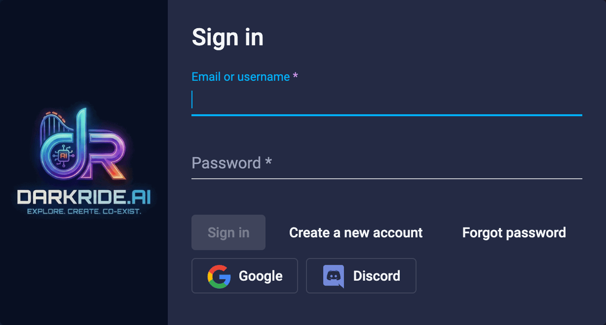
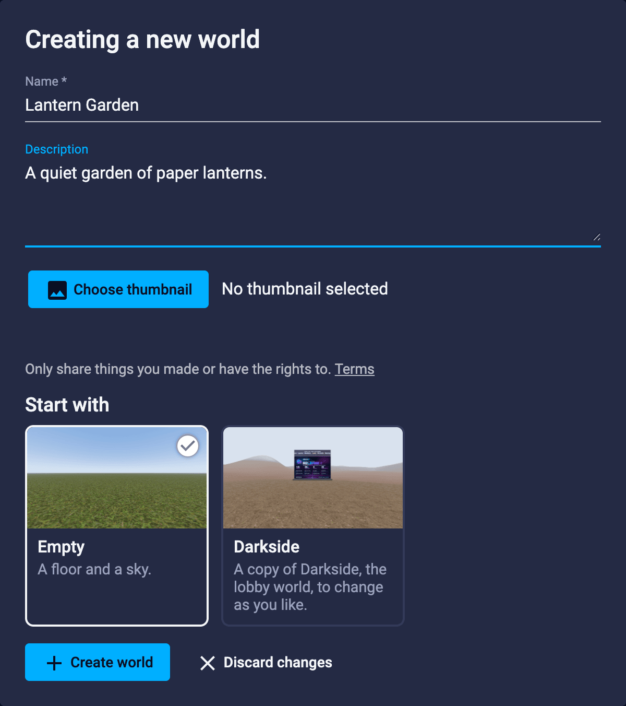
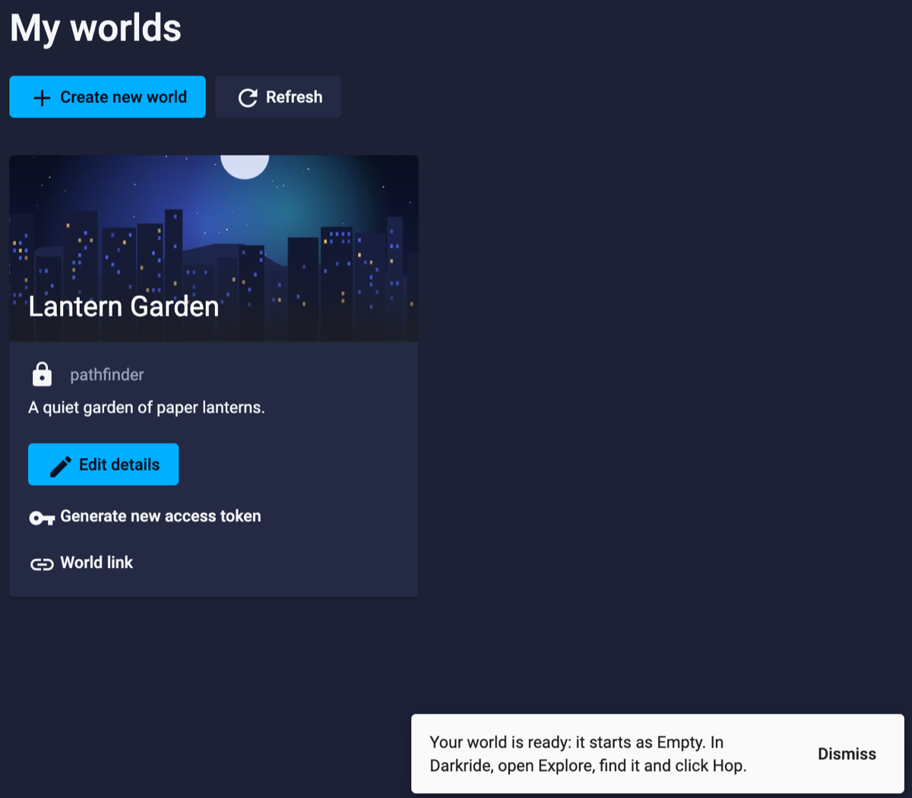
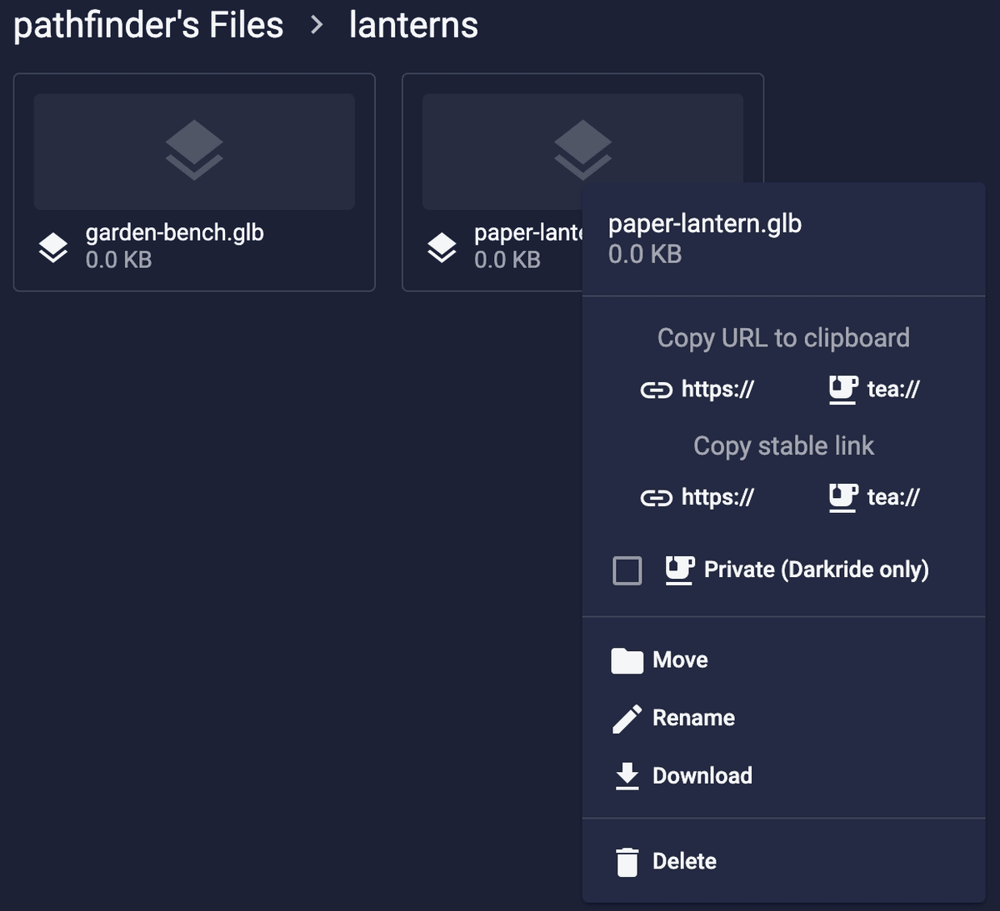
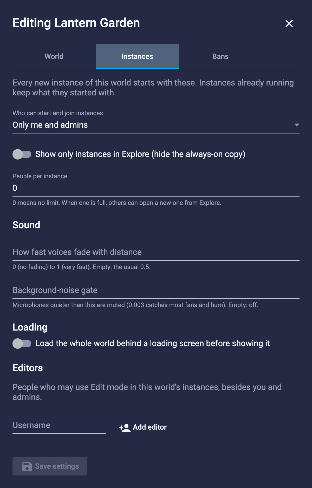

# Put up a world

Your world lives on darkride.ai, and Darkride's servers run it. When someone wants to visit, a copy of it starts on
one of our servers (an **instance**), and it closes again when everyone has left. Your world stays saved between
visits, as numbered **versions**.

There's nothing to install and nothing to keep running. When no server is free, a fresh one starts by itself first;
that takes a minute or two. You don't set any of it up.

## What you need

- The Darkride app, from [darkride.ai](https://darkride.ai).
- A Darkride account with a **confirmed email address**. Signing up with Google or Discord confirms it for you.
- An account at least **a day old** to open your world. (Anyone can join a world that's already open.)

## 1. Make your world

1. On [darkride.ai](https://darkride.ai), sign in, open the **Apps** menu and choose **My Worlds**.
2. Click **Create new world**.
3. Give it a **Name** (4 to 64 characters), and a **Description** and a picture if you like.
4. Under **Start with**, choose how it begins:
   - **Empty**: a floor and a sky.
   - **Darkside**: a copy of Darkside, the lobby world, to change as you like.
5. Click **Create world**.

The website says your world is ready. It starts as version 1, and at first only you can come in
([section 6](#_6-choose-who-can-come-in) changes that).

## 2. Go in

1. In Darkride, open **Explore**. Your world is in the **Popular** tab, or search for its name. Click **Hop**.
2. Darkride takes you to an instance of your world: one where people already are, or an empty one, or a new one.
   A new one can take a minute or two when a fresh server has to start first; the loading screen waits for it.

<!-- PICTURE explore-hop.png: Explore with the world's card and its Hop button -->

## 3. Build and save

While you're in your world, the top of **Explore** has a section, **You're in** *your world*, with its controls.

1. Turn on **Edit mode**. Without it, you visit your own world like anyone else and can't change it.
2. Build with **Build Mode** as usual.
3. Click **Save the World** (it's there while Edit mode is on). Darkride says "Saved as version *N*, *M* entities."
   Your world's objects and the files kept in it are saved together, and every new instance starts from your latest
   version.

<!-- PICTURE instance-bar.png: the "You're in" section with Edit mode on, Save the World, Copy Link and Close This Instance… -->
<!-- PICTURE saved.png: "Saved as version N, M entities." just after Save the World -->

### Build mode keys

| Key | What it does |
| --- | --- |
| **Q** | View: look around without changing anything |
| **W** | Move |
| **E** | Rotate |
| **R** | Scale |
| **T** | Terrain |
| **F** | Frame the selection: the view turns and zooms to it |
| **Shift+F** | Go to the selection |
| **Shift+Cmd+F** (Shift+Ctrl+F on Windows) | Bring the selection to you |
| **[** and **]** | Shrink and grow the terrain brush |

The toolbar's buttons show the same keys when you point at them.

### The Entities list's icons

Each row in the **Entities** list has an eye, an arrow and a padlock, and curly braces `{ }` where there are scripts.
Point at one to see what it does.

| Icon | What it does | For |
| --- | --- | --- |
| Eye | Hides it while you build | Only you |
| Arrow | Your clicks in the 3D view can't select it while you build (the list still can) | Only you |
| Padlock | Locks it: no one can move, change or delete it | Everyone |
| Braces `{ }` | Turns its scripts off: they stop running (a door stops opening) and stay attached, until you turn them on again | Everyone |

Click an icon to change the row and everything under it. **Alt-click** (Option-click on a Mac) changes that row
alone. Locking takes the world's **Lock / Unlock** right, which its owner can give; without it, the padlock is dimmed.

Come back, change things and save as often as you like.

- **An instance keeps the version it started with.** One that was already open when you saved shows as "An older
  version" in Explore, and it can't be edited: start a new one (**More ⌄** > **New instance**) to build on your
  latest version.
- **Your world is edited in one instance at a time.** If someone is already changing it in another instance,
  Darkride tells you who. In the same instance, you and your Editors can build together.
- **Others can build with you.** On darkride.ai, open **My Worlds**, click your world's **Edit details**, go to
  **Instances**, and add their usernames under **Editors** (up to 50). Editors can always come in, but for now
  Explore shows them your world only if it's open to **Everyone signed in** (or to **My friends** and they're your
  friends). Send them your instance's link ([section 7](#_7-invite-your-friends)).
- **What runs on Darkride's servers:**
  - Scripts that run in each visitor's app work as usual. A world's scripts load only from web addresses (http or
    https), the world's own files (`atp:`) or Darkride's file hosting (`tea:`), or are written into the object itself.
  - Vehicles work: their physics server joins your world by itself.
  - Scripts that run on the server, and agents (bots running beside the world), don't run on Darkride's servers yet.
  - **Edit** > **Asset Browser** (files kept in the world itself) works only in a world that already has such files,
    like one started from Darkside. For a world started from Empty, use **My Files** (section 4).

## 4. Add your own models, pictures and sounds

Everything in your world needs to be online. The easy place for it is **My Files** on darkride.ai:

1. Open **My Files** (in the Apps menu), click **Upload**, and choose your files or drag them into the upload box.
   Each file can be up to **50 MB**, and you have **1 GB** in all.
2. Right-click a file and, under **Copy stable link**, click **https://**. That link keeps working even if you move
   or rename the file.
3. In Darkride's Build Mode, paste the link where the model, picture or sound goes.

<!-- PICTURE files-copy-link.png: a NEW picture after metaverse's #15 deploy (Copy stable link > https://, no tea://
buttons, "Private" with its lock and line); the old one showed tea:// and "Private (Darkride only)". Put back as:
 -->

To keep a file off the web, tick **Private** in the same menu. A private file has no web link. People signed in to
Darkride see it where you use it (your avatar, your worlds); it can't be opened in a web browser.

- Put a private file in a world with the link from **Copy stable link** > **https://** (step 2). Its older `tea://`
  address, or its link under **Copy URL to clipboard**, loads it only for you. (Avatars in the **avatars** folder at
  the top of My Files still load by that address for anyone signed in, until Darkride 1.1.3.)
- Anyone who can see a private file can also load the private files in its folder and the folders inside it, so keep
  each private model and its textures in a folder of their own.
- Visitors need Darkride 1.1 or newer to see private files.

## 5. Bring in a world from High Fidelity

If you built a world in High Fidelity (or another app built on it), you can bring its entities in.

1. Find your old world's **entities file**: `models.json.gz` from your old server's content backup or its
   `entities` folder. Unzip it, so you have `models.json` to check in the next step.
2. **Check its links.** Open `models.json` in a text editor and look at the addresses of models, pictures, sounds
   and scripts:
   - Links to websites that are still up keep working.
   - Links starting `atp:` were files on your old server, and links to High Fidelity's own servers are gone. Upload
     those files to **My Files** (section 4), copy each one's stable link, and swap it in with your editor's
     find-and-replace. Save the file.
   - Scripts follow the rule in section 3: a script on your own computer or home network won't load. Scripts that
     ran on the old server won't run yet.
3. Go into your world and turn on **Edit mode** (section 3).
4. Import the file: **Build** menu, **Import Entities…**, and choose `models.json`. (A `.json.gz` file works too.)

   Everything in the file lands where your cursor points (or in front of you), in the same places relative to each
   other. A world over 10 km across keeps its own coordinates. Move it where you want it with Build Mode.
5. Click **Save the World**.

<!-- PICTURE import-entities.png: the Build menu with Import Entities… -->

Started from Empty? The floor and the sky are entities too: delete them if your old world brings its own.

## 6. Choose who can come in

On darkride.ai, open **My Worlds**, click your world's **Edit details**, and go to **Instances**. Under **Who can
start and join instances**, choose:

| Choice | Who can come in |
| --- | --- |
| **Nobody (off)** | Nobody can open a new instance. Instances already open keep running, for you, your Editors and admins. |
| **Everyone signed in** | Everyone signed in. Your world is listed in Explore for all. |
| **My friends** | You, your Darkride friends, your Editors, and admins. |
| **Only me and admins** | You, your Editors, and Darkride's admins. A new world starts with this. |

Then click **Save settings**. Who can come in, your Editors and your bans change at once, in instances already open
too. People signed out of Darkride never get in.

To choose which kind of instance to open, find your world in Explore and click **More ⌄** on its card (in the
Tiles or List view, click the world first). Under **New instance**, click:

- **Public**: listed in Explore for everyone who can come into your world.
- **Friends**: listed for the friends of whoever opened it.
- **Private**: not listed in Explore; anyone with its link who may come into the world can join.

A link never lets anyone in whom your world's setting keeps out.

<!-- PICTURE hop-kinds.png: the card with More ⌄ open: New instance, Public / Friends / Private -->

## 7. Invite your friends

- Your friends sign in to Darkride, open **Explore**, and **Hop** into your world (if it lets them in).
- When you're in a Public or Friends instance, your friends can **Join** you from their **People** panel.
- Or send them your instance's link: click **Copy Link** in the **You're in** section. They paste it into Explore's
  search box and press Return. The link works while that instance is open.

## 8. Look after your world

In **Edit details**:

- **Instances** also has **People per instance** (up to 200; 0 means no limit), how voices fade with distance, a
  background-noise gate, and **Loading**: whether visitors see a loading screen until the world is ready, rather
  than watching it appear. These apply to instances opened after you save. When an instance is full, nobody more
  can join it, and **Hop** may still pick it (a [known issue](/known-issues)): open another with **More ⌄** >
  **New instance**.
- **Bans**: enter a username, for how many days (leave it empty for "until I lift it"), and a note only you and the
  admins see, then click **Ban**. A ban works at once, in every instance of your world. **Lift** undoes it.

## When instances close

- An instance closes by itself **10 minutes** after the last person leaves (**30 minutes** while Edit mode is on),
  or 10 minutes after it opens if nobody comes.
- To close one straight away, click **Close This Instance…** in the **You're in** section, then **Close It for
  Everyone**. You see it if you opened the instance or own the world.
- Each of our servers runs for up to **12 hours**. In its last hour, Edit mode is refused, and changes you haven't
  saved are lost when it closes. **Save often.**
- Closing never loses your saves.

## Limits

These are today's settings and may change.

| | |
| --- | --- |
| Instances open at once | one per person (join it, or wait until it closes) |
| Instances opened | six an hour |
| People in one instance | what you set, up to 200 |
| Worlds | 100 per account |
| My Files | 50 MB a file, 1 GB in all |

## If something goes wrong

| Darkride says | What to do |
| --- | --- |
| "Verify your email address to start instances of worlds." or "Sign in again, then try once more." | Your email address may not be confirmed yet. Sign in on darkride.ai: it offers to send you an email with a button that confirms your address. Then sign in again in Darkride and try once more. |
| "New accounts can join instances but not start them for their first day." | Wait until your account is a day old. |
| "You already have an instance open." | Join the one you have, or close it (**You're in** section, **Close This Instance…**). |
| "You've started a lot of instances this hour." | Wait a little, then try again. |
| "Couldn't start a server right now. Try again in a minute." | Our servers are busy. Try again in a few minutes. |
| "Nobody can open this world right now." | The world's owner has set it to **Nobody (off)**. |
| "This instance runs version *N*; the world is now at version *M*. Start a new instance to edit it." | The world was saved since this instance opened. **More ⌄** > **New instance**, then edit there. |
| "*Name* is changing this world in another instance." | Someone else is editing it. Join their instance, or wait until they're done. |
| "This instance's server is about to be retired. Start a new instance to edit." | Save if you can, then open a new instance. |
| "You're banned from this world" | The world's owner has banned you. |
| "Storage is full" (My Files) | Delete files you don't need. |

Stuck? Ask on [Darkride's Discord](https://darkride.ai/discord).
